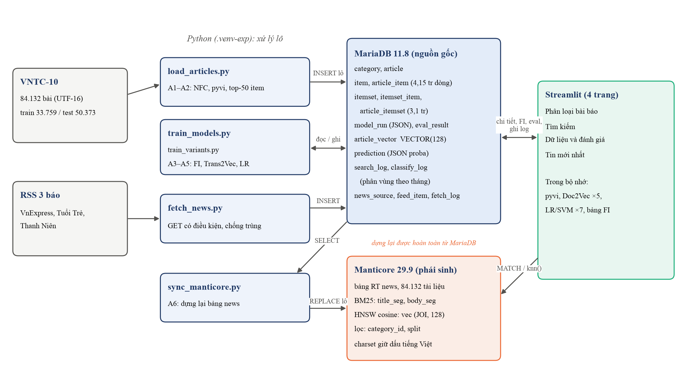
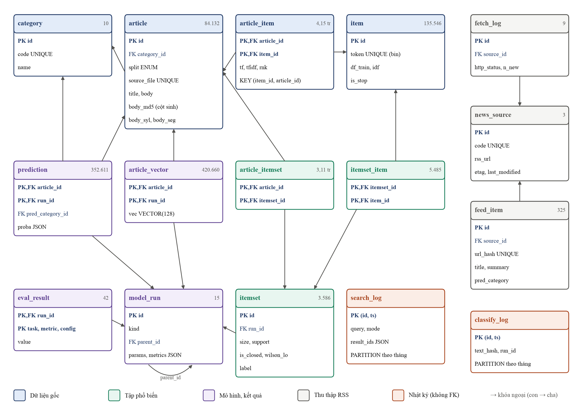
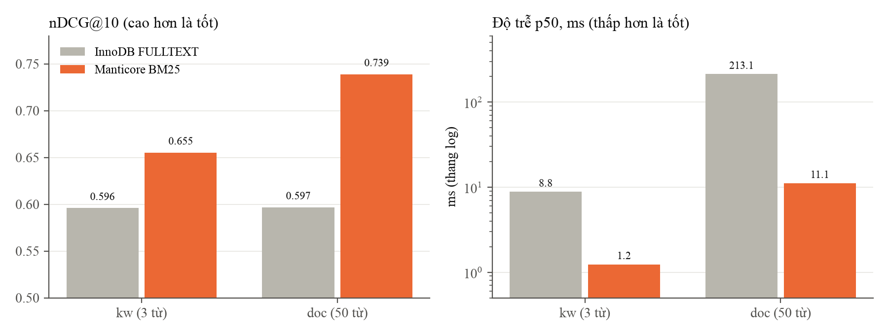
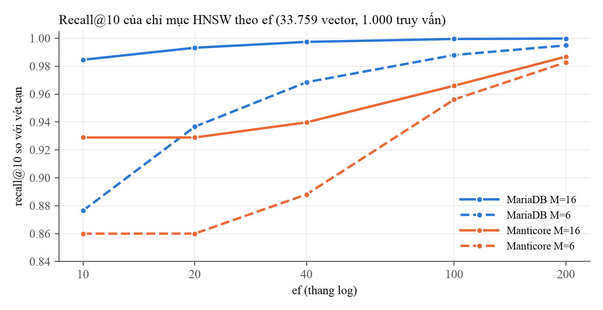
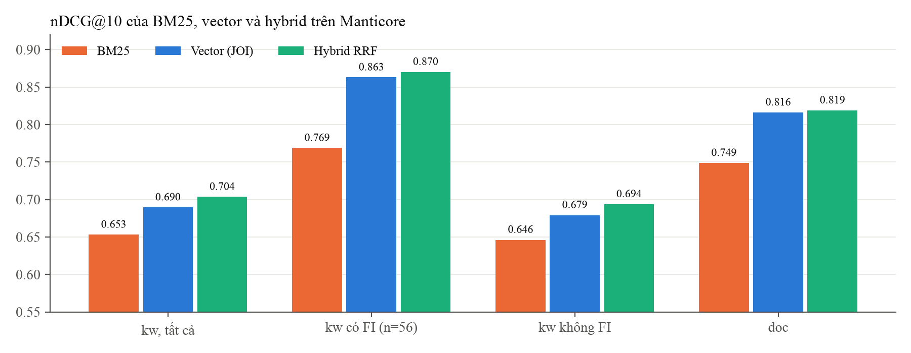
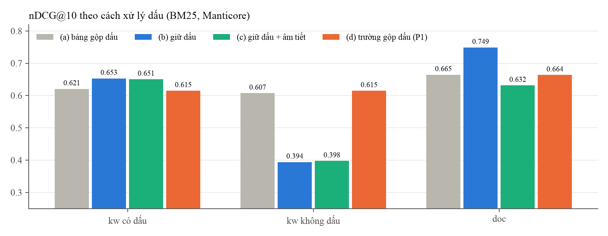
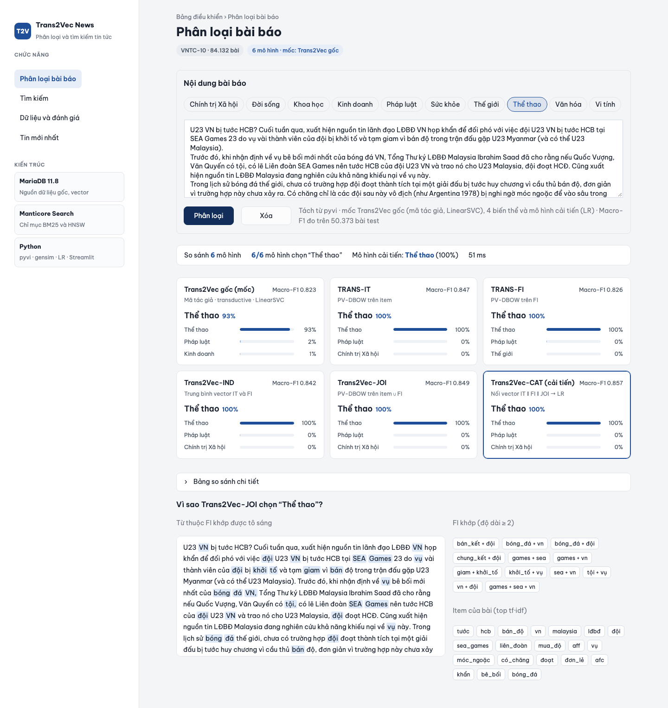
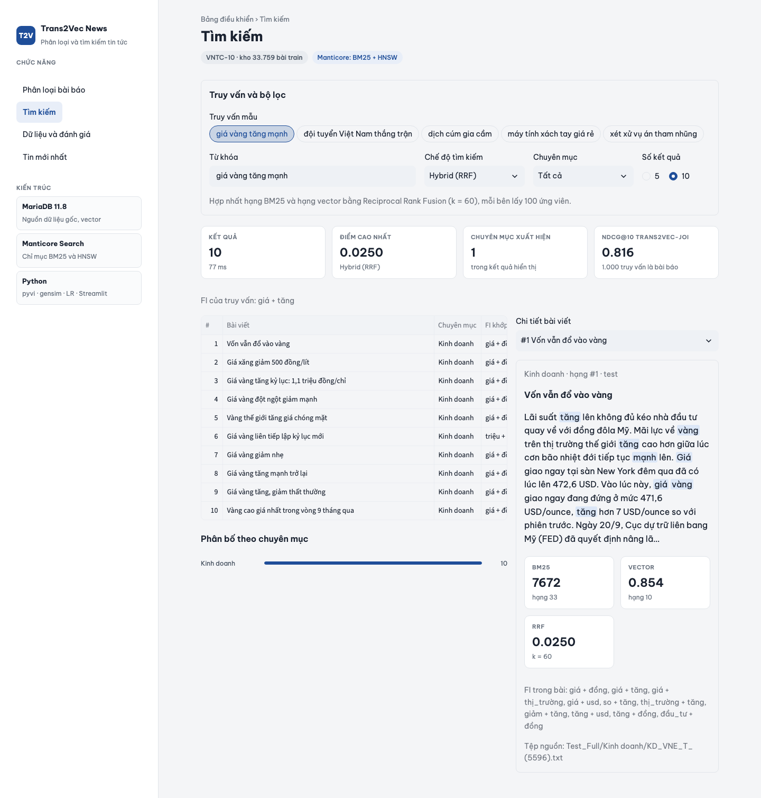

# Thiết kế và đánh giá hệ thống lưu trữ, tìm kiếm cho phân loại và tìm kiếm tin tức tiếng Việt trên MariaDB và Manticore Search

*Báo cáo môn Hệ cơ sở dữ liệu nâng cao, Chương trình Sau đại học, Trường Đại học Công nghệ TP.HCM (HUTECH)*

---

## Tóm tắt

Báo cáo trình bày phần cơ sở dữ liệu của một hệ thống phân loại chuyên mục và tìm kiếm tin tức tiếng Việt dùng biểu diễn Trans2Vec. Hệ thống tách hai vai trò. MariaDB 11.8 là nguồn dữ liệu gốc, lưu 84.132 bài báo của bộ VNTC-10, 4,15 triệu dòng transaction, các tập phổ biến, lịch sử huấn luyện mô hình, vector, dự đoán, kết quả đánh giá, nhật ký truy vấn và tin thu thập từ RSS. Manticore Search 29.9 là chỉ mục tìm kiếm phái sinh, dựng lại được hoàn toàn từ MariaDB, phục vụ BM25, tìm vector HNSW và hybrid. Lược đồ 16 bảng dùng collation tiếng Việt giữ dấu, mô hình hóa transaction và tập phổ biến dạng quan hệ nhiều–nhiều, lưu nguồn gốc của từng mô hình trong bảng `model_run` với siêu tham số dạng JSON, dùng kiểu `VECTOR(128)`, cột sinh để phát hiện bài trùng và phân vùng theo tháng cho bảng nhật ký.

Bốn thực nghiệm dùng chung giao thức 1.000 truy vấn trên kho 33.759 bài. Với tìm kiếm toàn văn, Manticore hơn InnoDB FULLTEXT cả về chất lượng (nDCG@10 cao hơn 0,06–0,14) lẫn tốc độ (nhanh hơn 7–19 lần). Với tìm kiếm vector, ở cùng tham số, chỉ mục MHNSW của MariaDB cho recall@10 cao hơn HNSW của Manticore (0,997 so với 0,940 ở M = 16, ef = 40), và độ trễ của cả hai dưới 1 ms. Hybrid RRF cho top-10 tốt nhất, lợi rõ nhất ở truy vấn ngắn, nhưng MAP@100 thấp hơn khi chỉ dùng vector. Giữ dấu tốt hơn gộp dấu với truy vấn có dấu, nhưng gần như hỏng với truy vấn không dấu; một trường gộp dấu đặt trong cùng bảng khắc phục được điều này (nDCG@10 0,394 lên 0,615).

Báo cáo cũng ghi lại các bài học thực tế: điều kiện để MariaDB dùng được chỉ mục vector; một phép JOIN trên biểu thức `MD5(body)` chạy hơn 5 phút, xuống còn 0,64 giây khi có cột sinh có chỉ mục; xung đột giữa khóa ngoại và phân vùng trong InnoDB; và cách nạp lô chạy tiếp được sau lỗi.

**Từ khóa:** MariaDB; Manticore Search; tìm kiếm toàn văn; BM25; tìm kiếm vector; HNSW; hybrid search; RRF; tiếng Việt; Trans2Vec.

---

## Mục lục

1. Giới thiệu
2. Kiến trúc hệ thống
3. Thiết kế cơ sở dữ liệu
4. Chỉ mục và tối ưu truy vấn
5. Nạp dữ liệu và giao dịch
6. Manticore Search: chỉ mục tìm kiếm phái sinh
7. Thực nghiệm
8. Ứng dụng
9. Thảo luận và hạn chế
10. Kết luận

Tài liệu tham khảo

## 1. Giới thiệu

### 1.1 Bối cảnh

Báo cáo này đi cùng bài khảo sát môn Tri thức dữ liệu về biểu diễn Trans2Vec cho tin tức tiếng Việt [1]. Trans2Vec coi mỗi bài báo là một *transaction* (tập các từ đặc trưng), khai phá các *tập phổ biến* (frequent itemsets, FI), rồi học vector cho bài bằng mô hình Paragraph Vector [2, 3].

Thực nghiệm của bài khảo sát chạy trên tệp và bộ nhớ của Python. Cách làm đó đủ cho nghiên cứu nhưng chưa phải một hệ thống dùng được: không có chỗ lưu và so sánh các lần huấn luyện, không tìm kiếm trực tuyến được, không ghi lại truy vấn, và không nhận được tin mới.

Phần CSDL của đề tài trả lời câu hỏi: **lưu trữ và truy vấn dữ liệu của một hệ thống phân loại và tìm kiếm tin tức tiếng Việt thế nào cho đúng và đủ nhanh**. Hệ thống phải xử lý cùng lúc dữ liệu quan hệ có ràng buộc toàn vẹn, dữ liệu bán cấu trúc (siêu tham số, phân phối xác suất), vector dày 128 chiều, và văn bản cần tìm kiếm toàn văn bằng một ngôn ngữ có dấu thanh và từ ghép nhiều âm tiết.

### 1.2 Mục tiêu và phạm vi

1. Thiết kế lược đồ quan hệ cho toàn bộ vòng đời dữ liệu, từ văn bản gốc tới nhật ký, kèm lý do của từng lựa chọn.
2. Chọn và cấu hình chỉ mục (B+tree, toàn văn, vector, phân vùng), kiểm chứng bằng `EXPLAIN` và số đo.
3. Kết hợp MariaDB với engine tìm kiếm chuyên dụng Manticore Search, và chỉ rõ hệ nào giữ dữ liệu gốc.
4. Đo đạc để trả lời bốn câu hỏi:
   - nên dùng InnoDB FULLTEXT hay Manticore để tìm kiếm toàn văn;
   - nên dùng chỉ mục vector của MariaDB hay của Manticore;
   - hybrid có hơn từng thành phần không;
   - nên giữ hay gộp dấu khi đánh chỉ mục.
5. Xây ứng dụng minh họa chạy trên dữ liệu thật.

Các mô hình học máy và cách đánh giá chúng thuộc phạm vi bài khảo sát; báo cáo này chỉ dùng lại kết quả khi cần. Mọi số liệu đo trên một máy macOS. MariaDB và Manticore chạy trong Docker (VM 7,6 GB RAM); client là Python 3.11. Báo cáo không xét replication, phân tán và phân quyền nhiều người dùng.

Mã nguồn nằm trong `src/system/`: lược đồ ở `db/`, nạp dữ liệu và huấn luyện ở `pipeline/`, ứng dụng ở `app/`, thực nghiệm ở `bench/`.

## 2. Kiến trúc hệ thống

### 2.1 Phân vai: nguồn gốc và phái sinh

Hệ thống có ba thành phần (Hình 2.1). Nguyên tắc xuyên suốt: **mọi dữ liệu trong Manticore đều dựng lại được từ MariaDB**, nên Manticore có thể bị xóa và nạp lại bất kỳ lúc nào. Đây là mô hình "hệ thống ghi nhận và dữ liệu phái sinh" [4]: hệ ghi nhận giữ phiên bản đúng duy nhất, còn hệ phái sinh là bản sao đã biến đổi, tối ưu cho một kiểu truy vấn.

**Bảng 2.1.** Phân vai giữa các thành phần

| Thành phần | Vai trò | Lý do chọn |
|---|---|---|
| MariaDB 11.8.9 | Nguồn dữ liệu gốc: bài báo, transaction, FI, mô hình, vector, dự đoán, đánh giá, nhật ký, tin RSS | ACID, khóa ngoại, CTE và window function, JSON; có kiểu `VECTOR` và chỉ mục vector [5] |
| Manticore Search 29.9.0 | Chỉ mục tìm kiếm: toàn văn BM25, vector HNSW, lọc thuộc tính | Engine chuyên dụng; dùng giao thức MySQL nên Python dùng chung một driver cho cả hai hệ [6] |
| Python 3.11 | Tách từ (pyvi [7]), khai phá FI, Doc2Vec (gensim [8]), bộ phân loại, ứng dụng Streamlit | Mô hình nằm ở tầng ứng dụng; CSDL chỉ lưu dữ liệu, vector và kết quả |

Không dùng một hệ duy nhất vì InnoDB FULLTEXT kém Manticore rõ rệt với tiếng Việt (Chương 7). Ngược lại, Manticore không có khóa ngoại, không có giao dịch nhiều câu lệnh đầy đủ và không có truy vấn phân tích phong phú, nên không giữ được vai trò nguồn gốc.



### 2.2 Luồng xử lý lô và luồng trực tuyến

**Bảng 2.2.** Các bước xử lý lô (đánh số như trong mã nguồn)

| Bước | Công việc | Script | Bảng ghi |
|---|---|---|---|
| A1 | Đọc VNTC (UTF-16), chuẩn hóa NFC, tách tiêu đề và thân bài | `load_articles.py` | `category`, `article` |
| A2 | Tách từ pyvi, xây từ vựng trên train, chọn top-50 item theo tf·idf | `load_articles.py` | `item`, `article_item` |
| A3 | Đọc transaction **từ MariaDB**, khai phá FI trên train (δ = 0,535%) | `train_models.py` | `model_run`, `itemset`, `itemset_item`, `article_itemset` |
| A4 | Huấn luyện Doc2Vec cho từng biến thể, suy luận vector | `train_models.py`, `train_variants.py` | `model_run`, `article_vector` |
| A5 | Huấn luyện bộ phân loại, dự đoán tập test, đánh giá | như trên | `prediction`, `eval_result` |
| A6 | Dựng lại bảng Manticore từ MariaDB | `sync_manticore.py` | Manticore `news` |

Bước A3 đọc dữ liệu từ CSDL chứ không từ tệp trung gian. Nhờ vậy mọi mô hình truy ngược được về đúng các dòng `article_item` đã dùng. Các bước A3–A5 tái hiện kết quả của bài khảo sát với sai lệch Macro-F1 không quá 0,004. Phần sai lệch này đến từ việc gensim huấn luyện đa luồng nên không tất định.

Tin RSS của VnExpress, Tuổi Trẻ và Thanh Niên do `fetch_news.py` thu thập. Tin được ghi vào các bảng riêng, **không trộn** vào `article`, để dữ liệu ngoài không làm bẩn tập train và test.

**Luồng trực tuyến:**
- **Phân loại:** tách từ, chọn top-50 item, khớp FI (bảng FI nạp sẵn trong bộ nhớ), suy luận vector, chạy 6 bộ phân loại, ghi `classify_log`.
- **Tìm kiếm:**
  1. Manticore chạy `MATCH()` (BM25) và `knn()`, mỗi nhánh lấy 100 ứng viên; lọc chuyên mục được đẩy xuống Manticore.
  2. Ứng dụng gộp hai danh sách bằng RRF.
  3. Khử trùng theo `body_md5` của MariaDB.
  4. Lấy chi tiết bài và FI từ MariaDB, rồi ghi `search_log`.

### 2.3 Triển khai

Hai dịch vụ chạy bằng Docker Compose với phiên bản ghim cố định, và chỉ mở cổng trên 127.0.0.1. Các tham số đáng chú ý của MariaDB:
- `innodb-buffer-pool-size=1G`: đủ để phần nóng của `article_item` nằm trong bộ nhớ.
- `mhnsw-max-cache-size=512M`: bộ đệm cho đồ thị HNSW.
- `innodb-ft-min-token-size=1` và `innodb-ft-enable-stopword=0`: tiếng Việt có nhiều âm tiết 1–2 ký tự, và danh sách stopword mặc định là tiếng Anh.
- `max-allowed-packet=256M`: câu `INSERT` theo lô chứa toàn văn bài báo.

Toàn bộ dữ liệu, gồm cả các bảng phụ cho thực nghiệm, chiếm khoảng 2,4 GB trong MariaDB và khoảng 1 GB trong Manticore.

## 3. Thiết kế cơ sở dữ liệu

### 3.1 Tổng quan lược đồ

Lược đồ gồm 16 bảng và 5 view, chia thành năm nhóm (Hình 3.1, Bảng 3.1). DDL đầy đủ nằm ở `src/system/db/schema.sql`, `views.sql` và `feed.sql`.



**Bảng 3.1.** Các bảng lớn và khối lượng dữ liệu (21/10/2026)

| Bảng | Số dòng | Dữ liệu + chỉ mục |
|---|---|---|
| `article` | 84.132 | 1.413 + 14 MB |
| `article_item` (transaction) | 4.146.151 | 215 + 87 MB |
| `article_itemset` | 3.114.776 | 90 + 77 MB |
| `article_vector` | 420.660 (5 lần chạy × 84.132) | 341 + 6 MB |
| `prediction` | 352.611 (7 bộ phân loại × 50.373) | 72 + 12 MB |
| `item` | 135.546 | 7 + 4 MB |

Các bảng còn lại đều nhỏ:
- `itemset`: 3.586 dòng; `itemset_item`: 5.485 dòng.
- `model_run`: 15 dòng; `eval_result`: 42 dòng.
- Ba bảng RSS và hai bảng nhật ký.

### 3.2 Collation tiếng Việt

Collation mặc định của server, `utf8mb4_uca1400_ai_ci`, **không phân biệt dấu**. Trên bản cài thật, `'bàn' = 'bán'` trả về 1, và FULLTEXT tìm "bàn" khớp cả "bán" lẫn "bạn". Với tiếng Việt, dấu thanh phân biệt nghĩa, nên đây là lỗi chứ không phải tiện ích. Lược đồ dùng hai collation:
- **Cột văn bản:** `utf8mb4_uca1400_vietnamese_as_ci`. Collation này giữ dấu, không phân biệt hoa thường, và sắp xếp đúng bảng chữ cái tiếng Việt.
- **`item.token`, `itemset.label`:** `utf8mb4_bin`, so khớp tuyệt đối như từ vựng của gensim. Nhờ vậy hai token khác nhau trong mô hình không thể trùng nhau trong CSDL.

Collation của **kết nối** cũng phải đặt giống như vậy (`src/system/config.py`). Hằng chuỗi trong câu SQL được so theo collation của kết nối, nên nếu để mặc định thì `WHERE token = 'bàn'` vẫn gộp dấu.

### 3.3 Transaction và tập phổ biến: quan hệ nhiều–nhiều

Dữ liệu cho khai phá FI thường là tệp "mỗi dòng một transaction". Trong CSDL, lưu như vậy là một cột chứa danh sách, vi phạm dạng chuẩn 1. Lược đồ tách thành các bảng:
- **`item`:** từ vựng. `idf` để `NULL` cho từ dừng và từ quá hiếm; các từ này không vào transaction nhưng vẫn được lưu để giải thích.
- **`article_item(article_id, item_id, tf, tfidf, rnk)`:** **bảng transaction**, mỗi dòng là một cặp (bài, từ). Cột `rnk` lưu thứ hạng trong top-50, nên dựng được transaction với k nhỏ hơn bằng `WHERE rnk <= k` mà không phải tính lại.
- **`itemset`:** mỗi FI một dòng, gắn với lần khai phá đã sinh ra nó (`run_id`). Bảng có `UNIQUE(run_id, label)` và cột `wilson_lo` (cận dưới khoảng tin cậy Wilson của support).
- **`itemset_item`:** các phần tử của FI.
- **`article_itemset`:** FI nào khớp bài nào, dùng để giải thích kết quả, ví dụ "bài này chứa {bóng, đội}".

Thiết kế này cho phép dùng SQL để kiểm chứng thuật toán. Một truy vấn tìm FI có tập cha trực tiếp cùng support trả về **rỗng**, tức mọi FI đều đóng. Kết quả này khớp với kiểm tra bằng Python và dẫn tới một đính chính cho bài khảo sát: ở cấu hình này, bước lọc FI đóng không có tác dụng.

### 3.4 Lịch sử mô hình: `model_run`

Mỗi lần khai phá FI, huấn luyện embedding hay huấn luyện bộ phân loại tạo một dòng `model_run`:
- `kind` là loại lần chạy: `fim`, `trans-it`, `trans2vec-joi`, `lr`, `svm`…
- `parent_id` là khóa ngoại tự tham chiếu. Ví dụ: bộ phân loại có cha là lần chạy embedding, embedding có cha là lần khai phá FI.
- `params` và `metrics` có kiểu `JSON` kèm `CHECK (JSON_VALID(...))`. Mỗi loại mô hình có bộ siêu tham số khác nhau; nếu tách thành cột thì sẽ có hàng chục cột phần lớn là `NULL`.
- Các giá trị **cần truy vấn thường xuyên** nằm ở bảng riêng `eval_result(run_id, task, metric, config, value)`. Ứng dụng chỉ việc `SELECT … WHERE metric = 'macro_f1'` mà không phải phân tích JSON.

Hiện có 15 lần chạy:
- id 1: khai phá FI.
- Mỗi biểu diễn một cặp (embedding, bộ phân loại): TRANS-IT 2/3, JOI 4/5, TF-IDF 6/7, mã gốc 8/9, TRANS-FI 10/12, IND 11/13, CAT 15/16.
- Id 14 bị trống do một lần chạy lỗi đã rollback (Mục 5.2).

Câu hỏi "Macro-F1 0,857 đến từ mô hình nào, dùng FI nào, siêu tham số gì?" được trả lời bằng một truy vấn đệ quy trên `parent_id`.

### 3.5 Vector, dự đoán và cột sinh

**`article_vector(article_id, run_id, vec VECTOR(128))`** lưu vector đã chuẩn hóa L2. Khóa chính hai cột cho phép nhiều lần chạy cùng tồn tại. Vì vậy bảng **không** có chỉ mục vector; Mục 4.3 giải thích lý do.

**`prediction`** có hai phần:
- Nhãn dự đoán là cột riêng, có khóa ngoại tới `category` và chỉ mục `(run_id, pred_category_id)`, phục vụ ma trận nhầm lẫn.
- Phân phối xác suất (`proba`) để dạng JSON vì chỉ dùng để hiển thị.

**Cột sinh `body_md5`.** VNTC có bài trùng y hệt nội dung: 3.415 nhóm, tức 4.984 bản thừa. 3.056 bài test (6,1%) có bản sao trong train, và 380 nhóm mang nhãn khác nhau. Để khử trùng, lược đồ thêm cột:

```sql
body_md5 BINARY(16) AS (UNHEX(MD5(body))) STORED,  KEY ix_body_md5 (body_md5)
```

Cột khai báo `STORED` chứ không `VIRTUAL`: hash của văn bản dài được tính một lần khi ghi, và cột đánh chỉ mục được. Kiểu `BINARY(16)` chỉ tốn một nửa chỗ so với chuỗi hex. Lệnh `ALTER TABLE` mất 18 giây. Tác dụng của cột này nằm ở Mục 4.4.

### 3.6 Phân vùng bảng nhật ký, và vì sao không phân vùng `article_item`

Thiết kế ban đầu định phân vùng `article_item` theo `split`. Ý định này va vào một giới hạn của InnoDB: **bảng phân vùng không được có khóa ngoại, và cũng không được là đích của khóa ngoại** [9]. Nhóm giữ khóa ngoại, vì ba lý do:
- Hai khóa ngoại bảo đảm transaction chỉ chứa bài và từ có thật.
- `split` không nằm trong `article_item`, nên muốn phân vùng theo cột này phải phi chuẩn hóa.
- Truy vấn trên `article_item` luôn đi theo khóa chính. Phân vùng không giúp loại bỏ phân vùng nào, mà còn bắt mỗi lần tra phải mở nhiều cây B+.

Phân vùng được dùng ở hai bảng **nhật ký** `search_log` và `classify_log`. Hai bảng này chỉ ghi thêm, thường được truy vấn theo khoảng thời gian, và cần xóa dữ liệu cũ theo lô. Thiết lập phân vùng:
- `RANGE COLUMNS(ts)` theo tháng, thêm phân vùng `pmax`.
- Không có khóa ngoại.
- Khóa chính (`id`, `ts`), vì khóa chính phải chứa cột phân vùng.

Xóa một tháng nhật ký là `DROP PARTITION`, tức thao tác trên siêu dữ liệu, không phải `DELETE` từng dòng.

### 3.7 Bảng RSS và view phân tích

Phần RSS gồm ba bảng:
- **`news_source`:** giữ `etag` và `last_modified` để gửi yêu cầu HTTP có điều kiện.
- **`feed_item`:** chống trùng bằng `url_hash BINARY(20)` (SHA-1 của URL) có ràng buộc `UNIQUE`, ghi bằng `INSERT IGNORE`. Khóa 20 byte gọn hơn `UNIQUE` trên `url VARCHAR(512)` và không vướng giới hạn độ dài khóa chỉ mục.
- **`fetch_log`:** ghi mã HTTP, số tin mới, độ trễ và lỗi của mỗi lần lấy.

Bốn view thể hiện truy vấn phân tích của SQL hiện đại:
- **`v_corpus_stats`:** thống kê corpus.
- **`v_category_top_item`, `v_category_fi`:** top từ hoặc FI của mỗi chuyên mục, dùng `ROW_NUMBER() OVER (PARTITION BY c.id ORDER BY COUNT(*) DESC)` trên kết quả `GROUP BY`. Ví dụ: Thể thao có {bóng, đội} ở 1.393 bài.
- **`v_confusion`:** ma trận nhầm lẫn của một lần chạy bất kỳ.

## 4. Chỉ mục và tối ưu truy vấn

Mọi kế hoạch thực thi trong chương lấy từ `EXPLAIN` trên CSDL thật (MariaDB 11.8.9). Thời gian đo bằng `SHOW PROFILES`.

### 4.1 Khóa chính cụm và thứ tự cột trong `article_item`

Trong InnoDB, khóa chính là **chỉ mục cụm**: các dòng được lưu theo thứ tự khóa chính trong lá cây B+, và mỗi chỉ mục phụ chứa sẵn các cột khóa chính. Vì vậy thứ tự cột trong khóa của `article_item` quyết định truy vấn nào nhanh:

| Khóa | Truy vấn được phục vụ | Cách đọc |
|---|---|---|
| `PRIMARY KEY (article_id, item_id)` | Lấy transaction của một bài | Khoảng 50 dòng liền nhau trên một trang lá |
| `KEY ix_item_article (item_id, article_id)` | Bài nào chứa từ *t*; đếm support; khớp FI | Chỉ mục phụ có đủ hai cột nên là **chỉ mục phủ**, không phải quay về bảng |

Nếu chỉ có một chỉ mục, một trong hai hướng truy vấn sẽ phải quét toàn bộ 4,15 triệu dòng. Cái giá của chỉ mục thứ hai là 87 MB, khoảng 40% dung lượng dữ liệu của bảng. Ví dụ, đếm support của mọi từ trên tập train (bước đầu của khai phá FI bằng SQL):

```sql
EXPLAIN SELECT ai.item_id, COUNT(*) FROM article a
JOIN article_item ai ON ai.article_id = a.id
WHERE a.split = 'train' GROUP BY ai.item_id;
```

| table | type | key | ref | rows | Extra |
|---|---|---|---|---|---|
| a | ref | ix_split_cat | const | 44.251 | Using where; Using index; Using temporary; Using filesort |
| ai | ref | PRIMARY | a.id | 49 | |

Bộ tối ưu làm hai bước:
1. Lấy id các bài train qua `ix_split_cat`. Id là khóa chính nên có sẵn trong chỉ mục phụ, vì vậy kế hoạch ghi "Using index".
2. Với mỗi bài, tra khoảng 49 dòng `article_item` qua khóa chính cụm.

Truy vấn chạy 2,4 giây trên 1,66 triệu dòng transaction train. Con số 44.251 chỉ là ước lượng (số thật là 33.759), vì InnoDB ước lượng bằng cách lấy mẫu trang.

### 4.2 Chỉ mục toàn văn InnoDB

`ALTER TABLE article ADD FULLTEXT (body_seg)` mất 28,2 giây và tạo chỉ mục 135 MB. Để dùng được với tiếng Việt phải làm ba việc:
- hạ độ dài token tối thiểu xuống 1;
- tắt stopword tiếng Anh;
- đặt collation giữ dấu, vì chỉ mục toàn văn so token theo collation của cột.

Ký tự `_` của pyvi ("giá_vàng") được InnoDB coi là một phần của từ, nên từ ghép được giữ nguyên. Tuy vậy, InnoDB xếp hạng bằng một biến thể tf·idf riêng, không chuẩn hóa độ dài như BM25 và không chỉnh được tham số. Chương 7 cho thấy đây là nguyên nhân chính khiến InnoDB kém Manticore.

### 4.3 Chỉ mục vector MariaDB và điều kiện để được dùng

MariaDB cài đặt chỉ mục vector theo thuật toán HNSW [10], gọi là MHNSW [5]. Bảng thử nghiệm của E-DB2:

```sql
CREATE TABLE vec_m16 (id INT UNSIGNED PRIMARY KEY, v VECTOR(128) NOT NULL,
                      VECTOR INDEX (v) M=16 DISTANCE=cosine) ENGINE=InnoDB;
```

Chỉ mục chỉ được dùng khi truy vấn có **đúng** dạng `ORDER BY VEC_DISTANCE_<hàm>(cột, hằng) LIMIT k`, và hàm trùng với `DISTANCE` lúc tạo chỉ mục:

| Truy vấn | type | key | rows | Extra |
|---|---|---|---|---|
| `ORDER BY VEC_DISTANCE_COSINE(v, @q) LIMIT 10` | index | v | 10 | |
| `ORDER BY VEC_DISTANCE_EUCLIDEAN(v, @q) LIMIT 10` | ALL | — | 32.589 | Using filesort |
| `ORDER BY VEC_DISTANCE_COSINE(v, @q)` (không `LIMIT`) | ALL | — | 32.589 | Using filesort |

Hai trường hợp sau rơi về quét toàn bảng. Kết quả vẫn đúng nên không có lỗi nào báo ra. Lý do: HNSW chỉ trả lời "k láng giềng gần nhất theo một hàm khoảng cách cố định"; muốn có toàn bộ thứ tự thì vẫn phải tính hết.

Bảng `article_vector` không có chỉ mục vector vì ba ràng buộc:
- Mỗi bảng chỉ có một chỉ mục vector.
- Chỉ mục không kết hợp được với điều kiện lọc. Với `WHERE run_id = 4 … LIMIT 10`, HNSW lấy 10 láng giềng của mọi lần chạy rồi mới lọc, nên có thể còn ít hơn 10 kết quả.
- `article_vector` chứa vector của 5 lần chạy.

Cách xử lý: E-DB2 chép vector của một lần chạy sang bảng riêng, còn hệ thống giao tìm kiếm vector cho Manticore. Manticore có lọc thuộc tính, và ứng dụng xin gấp 4 lần số ứng viên khi có bộ lọc.

### 4.4 Bài học: JOIN trên biểu thức

Câu hỏi "bao nhiêu bài test có bản sao trong train" lần đầu được viết như sau:

```sql
SELECT COUNT(DISTINCT a.id) FROM article a JOIN article b ON MD5(a.body) = MD5(b.body)
WHERE a.split = 'test' AND b.split = 'train';
```

Truy vấn chạy **hơn 5 phút** và phải dừng tay. Điều kiện nối là biểu thức trên cột nên không chỉ mục nào dùng được. Bộ tối ưu rơi về nested loop, về nguyên tắc phải tính MD5 cho 50.373 × 33.759 cặp văn bản. Lần thứ hai, hash được tính trước vào một bảng tạm có chỉ mục, và truy vấn chạy 2,4 giây. Cuối cùng, cột sinh `body_md5` (Mục 3.5) đưa lời giải vào lược đồ:

| table | type | key | ref | rows | Extra |
|---|---|---|---|---|---|
| a | ref | ix_split_cat | const | 44.251 | Using index condition; Using where |
| b | ref | ix_body_md5 | a.body_md5 | 1 | Using where |

Mỗi bài test giờ chỉ cần một lần tra B+tree trên khóa 16 byte. Truy vấn trả 3.056 bài sau **0,64 giây**, nhanh hơn ít nhất 470 lần. Bài học: **không đặt hàm lên cột trong điều kiện nối hay điều kiện lọc**. Nếu cần lọc theo biểu thức thì hiện thực hóa nó thành cột sinh có chỉ mục.

### 4.5 Loại bỏ phân vùng và thời gian của view

Với bảng nhật ký phân vùng theo tháng, điều kiện trên `ts` cho phép bộ tối ưu chỉ mở phân vùng liên quan:

```sql
EXPLAIN PARTITIONS SELECT COUNT(*), AVG(latency_ms) FROM search_log
WHERE ts >= '2026-11-01' AND ts < '2026-12-01';     -- partitions: p2026_11
```

Thời gian của các view:

| View | Khối lượng xử lý | Thời gian |
|---|---|---|
| `v_confusion` | 50.373 dòng `prediction` | 0,04 s |
| `v_category_fi` | 3,11 triệu dòng `article_itemset` | 0,66 s |
| `v_category_top_item` | 4,15 triệu dòng `article_item` | 3,8 s |

`v_category_top_item` chậm nhất vì phải gom nhóm toàn bộ transaction train rồi xếp hạng trong từng chuyên mục. Ứng dụng không gọi view này; trang thống kê dùng `v_category_fi` và lưu kết quả trong bộ nhớ đệm 1 giờ. Nếu cần dùng view này trực tuyến thì nên hiện thực hóa thành bảng, cập nhật sau mỗi lần nạp.

## 5. Nạp dữ liệu và giao dịch

### 5.1 Nạp lô dữ liệu gốc và kết quả huấn luyện

**Nạp bài báo.** `load_articles.py` nạp 84.132 bài theo lô 1.000 bài. Mỗi lô là **một giao dịch** gồm hai lệnh `executemany`: một cho `article`, một cho khoảng 49.000 dòng `article_item`. Kích thước lô là một đánh đổi:
- Lô quá nhỏ: mỗi `COMMIT` buộc ghi redo log xuống đĩa.
- Lô quá lớn: giữ nhiều undo log, và một lỗi giữa chừng làm mất nhiều việc.

Toàn bộ dữ liệu nạp xong trong **99 giây**. Ba biện pháp bảo đảm đúng đắn:
- Script từ chối chạy nếu `article` đã có dữ liệu, để tránh nạp hai lần.
- Transaction tự tính được so khớp với thư viện thực nghiệm bằng `assert` trên 500 bài đầu.
- Sau khi nạp, script chạy `ANALYZE TABLE` để bộ tối ưu có thống kê mới.

**Ghi kết quả huấn luyện.** Mỗi bộ phân loại được ghi theo trình tự:
1. `INSERT model_run`.
2. Huấn luyện.
3. `INSERT eval_result`.
4. `INSERT prediction` 50.373 dòng theo lô 20.000.
5. `UPDATE model_run SET metrics`.

Các bước 3, 4, 5 commit riêng. Mô hình (khoảng 130 MB) lưu thành tệp ngoài CSDL, đặt tên theo id lần chạy; đường dẫn ghi trong `params`. Mô hình chỉ được đọc trọn khi ứng dụng khởi động, nên lưu tệp hợp lý hơn lưu BLOB.

Cách chia giao dịch này **chưa nguyên tử ở mức lần chạy**. Nếu tiến trình chết giữa bước 3 và 4, CSDL sẽ có lần chạy có đánh giá nhưng thiếu dự đoán. Có hai cách sửa:
- gói cả 5 bước trong một giao dịch;
- thêm cột `status ENUM('running','done','failed')` và chỉ đọc lần chạy `done`.

Cách thứ hai hợp hơn khi huấn luyện lâu, vì không giữ giao dịch mở nhiều phút.

### 5.2 Lỗi và chạy tiếp: trường hợp lần chạy 14

Khi thêm mô hình Trans2Vec-CAT, lần chạy đầu bị lỗi theo trình tự sau:
1. Script tạo `model_run` id 14, rồi ghi vector CAT vào `article_vector`.
2. Vector CAT có 384 chiều nên MariaDB từ chối, báo lỗi 1292: cột là `VECTOR(128)`.
3. Ngoại lệ làm script dừng. Giao dịch đang mở bị **rollback**: dòng `model_run` 14 và phần vector đã chèn đều biến mất.

Có hai quan sát:
1. **Kiểu `VECTOR(n)` là một ràng buộc thật.** Dữ liệu sai chiều bị chặn ngay ở CSDL, không lọt vào làm hỏng các phép tính khoảng cách về sau.
2. **`AUTO_INCREMENT` không bị rollback**, nên lần chạy kế tiếp nhận id 15. Đây là hành vi có chủ đích: bộ đếm tự tăng không bị khóa tới cuối giao dịch, để các giao dịch song song không phải chờ nhau. Khóa tự tăng chỉ bảo đảm duy nhất, không bảo đảm liên tục.

Sau sự cố, `train_variants.py` được sửa để **chạy tiếp được**. Mỗi bước kiểm tra trong `model_run` xem lần chạy loại đó đã có chưa; nếu có thì nạp lại mô hình đã lưu thay vì huấn luyện lại. Đây là idempotency ở mức ứng dụng, dựa trên chính dữ liệu trong CSDL.

### 5.3 Thu thập RSS: một báo, một giao dịch

`fetch_news.py` xử lý mỗi báo trong **một giao dịch riêng**:
1. Gửi yêu cầu HTTP có điều kiện (`If-None-Match`, `If-Modified-Since`).
2. `INSERT IGNORE` từng tin. Số dòng ảnh hưởng cho biết tin nào thật sự mới.
3. Cập nhật `etag` của nguồn.
4. Ghi `fetch_log`.
5. `COMMIT`.

Nếu một báo lỗi, giao dịch của báo đó rollback rồi ghi một dòng `fetch_log` báo lỗi; các báo khác không bị ảnh hưởng. ETag phải được cập nhật **cùng giao dịch** với tin đã lưu. Nếu tách riêng, có thể ETag mới được lưu còn tin thì không, và lần sau máy chủ trả 304 khiến tin bị mất vĩnh viễn. Lần chạy đầu thu được 49, 50 và 60 tin từ ba báo (116–338 ms). Chạy lại ngay chỉ có 1 tin mới thật, không trùng.

### 5.4 Ghi trực tuyến và mức cô lập

Kết nối chính của ứng dụng đặt `autocommit=True`. Mỗi lệnh ghi nhật ký có hiệu lực ngay và độc lập với các thao tác khác. Nút "Lấy tin ngay" dùng kết nối riêng, vì cần giao dịch tường minh như Mục 5.3.

`autocommit` còn quan trọng vì một lý do ít được để ý:
- Mức cô lập mặc định của InnoDB là `REPEATABLE READ`: mọi `SELECT` trong một giao dịch đọc cùng một ảnh chụp, tạo ở lần đọc đầu tiên.
- Ứng dụng web giữ kết nối suốt vòng đời tiến trình. Nếu không autocommit, giao dịch đầu tiên không bao giờ kết thúc, và ứng dụng sẽ **không bao giờ thấy** tin RSS hay kết quả huấn luyện mới.
- Với autocommit, mỗi `SELECT` là một giao dịch riêng nên luôn đọc dữ liệu đã commit mới nhất.

Streamlit chạy mỗi phiên trong một luồng, còn kết nối `pymysql` không an toàn khi dùng từ nhiều luồng. Vì vậy các truy vấn đi qua một `threading.Lock` chung. Khi có nhiều người dùng, nên thay bằng connection pool.

## 6. Manticore Search: chỉ mục tìm kiếm phái sinh

### 6.1 Bảng real-time `news`

Manticore có bảng *plain* (dựng một lần từ nguồn) và bảng *real-time* (RT, ghi được bằng `INSERT`/`REPLACE`). Hệ thống dùng bảng RT (`src/system/db/manticore.sql`):

```sql
CREATE TABLE news (
  title       text,                -- lưu + đánh chỉ mục, để HIGHLIGHT()
  title_seg   text indexed,        -- tiêu đề đã tách từ
  body_seg    text indexed,        -- toàn văn đã tách từ (giá_vàng là một token)
  body_syl    text indexed,        -- toàn văn theo âm tiết (cấu hình c của E-DB5)
  category_id uint,
  split       string attribute,
  vec         float_vector knn_type='hnsw' knn_dims='128'
              hnsw_similarity='COSINE' hnsw_m='16' hnsw_ef_construction='200'
) charset_table='…' min_word_len='1';
```

Ba lựa chọn thiết kế:
- **`text indexed`** chỉ đánh chỉ mục, không lưu nội dung. Toàn văn đã có ở MariaDB, nên ứng dụng lấy id từ Manticore rồi tra chi tiết từ MariaDB. Mỗi hệ làm đúng việc của nó.
- **Thuộc tính `category_id`, `split`** dùng để lọc ngay trong engine, cùng lúc với xếp hạng.
- **Cột vector** chứa vector Trans2Vec-JOI, biến thể cho nDCG@10 tìm kiếm cao nhất (0,816).

Kiểm tra trên bản 29.9 phát hiện vài chỗ cú pháp khác tài liệu cũ:
- `stored_fields` không dùng được trong `CREATE TABLE` của bảng RT.
- ef viết dạng `knn(vec, k, (…), {ef=200})`.
- Trong `knn(vec, k, …)`, `k` **không giới hạn số dòng trả về**, nên mọi truy vấn phải kèm `LIMIT k`.

### 6.2 Tách từ và bộ ký tự tiếng Việt

Manticore không có bộ tách từ cho tiếng Việt. Vì vậy hệ thống **đánh chỉ mục văn bản đã tách bằng pyvi**, dùng cùng bộ tách với mô hình, và tách truy vấn theo đúng cách đó.

Bộ ký tự mặc định `non_cjk` có hai vấn đề:
- **Gộp dấu:** "bàn", "bán", "bản", "ban" thành một token.
- **Coi `_` là dấu tách:** "giá_vàng" thành "gia" và "vang".

Hệ thống dùng một `charset_table` tự định nghĩa [11]:
- giữ nguyên các chữ có dấu (Latin-1, Latin Extended-A, khối U+1EA0–U+1EF9), chỉ hạ chữ hoa về chữ thường;
- giữ `_` là ký tự của từ;
- kèm `min_word_len='1'`.

Hệ quả là truy vấn "vàng" **không** khớp bài chỉ chứa "giá_vàng". Trường `body_syl` được thêm để thử khắc phục, nhưng không có lợi (Mục 7.5). Ngoài ra, bảng có thêm hai trường `title_fold` và `body_fold` chứa văn bản đã gộp dấu ở Python, dành cho truy vấn gõ không dấu.

### 6.3 Ba chế độ truy vấn

**BM25.** Ranker mặc định của Manticore (`proximity_bm25`) không chuẩn hóa độ dài như BM25 chuẩn [12], nên hệ thống chỉ định tường minh:

```sql
SELECT id, WEIGHT() FROM news
WHERE MATCH('@(title_seg,body_seg) (giá_vàng | tăng | mạnh)') AND split = 'train' LIMIT 100
OPTION ranker=expr('10000*bm25a(1.2,0.75)'), idf='plain,tfidf_unnormalized', max_matches=1000;
```

Truy vấn dài (dán cả bài) được rút còn top-50 item theo tf·idf. Nếu để nguyên, số term OR quá lớn và truy vấn chậm.

**Vector.** Ứng dụng suy luận vector truy vấn bằng Doc2Vec (3–5 ms), rồi chạy `SELECT id, knn_dist() FROM news WHERE knn(vec, 400, (…), {ef=400}) AND category_id = 8 LIMIT 100`. Khi có bộ lọc, ứng dụng xin gấp 4 lần số ứng viên để bù phần bị lọc. MariaDB không làm được điều này (Mục 4.3).

**Hybrid.** Hai danh sách top-100 được gộp bằng Reciprocal Rank Fusion [13]: điểm(d) = Σ 1/(k + hạng(d)), với k = 60. RRF chỉ dùng thứ hạng, nên không phải chuẩn hóa điểm BM25 (hàng nghìn) với cosine (0–1). Sau đó ứng dụng **khử trùng** bằng `body_md5` lấy từ MariaDB (Mục 3.5). Nếu không khử trùng, top-10 có thể chứa hai, ba bản giống hệt nhau.

### 6.4 Đồng bộ từ MariaDB

`sync_manticore.py` dựng lại bảng theo bốn bước:
1. `DROP` rồi `CREATE TABLE` từ tệp DDL.
2. Đọc `article ⋈ article_vector` bằng con trỏ, 500 dòng mỗi lần.
3. `REPLACE INTO news … VALUES (…), (…)` theo lô.
4. `FLUSH RAMCHUNK`.

Bước 2–3 xử lý 84.132 tài liệu trong **99 giây**, gồm cả tách từ tiêu đề bằng pyvi và gộp dấu. Bảng chiếm khoảng 533 MB. Cuối script, số tài liệu ở Manticore được so với MariaDB; nếu lệch, script thoát với mã lỗi, nên đồng bộ không thể lặng lẽ thành công một nửa. Dùng `REPLACE` thay `INSERT` giúp chạy lại an toàn. Cùng script, với `--table news_fold --charset non_cjk`, dựng bảng gộp dấu cho E-DB5.

Đây là cách **dựng lại toàn bộ**: đơn giản và luôn nhất quán sau khi chạy xong, nhưng không phản ánh ngay các thay đổi lẻ. Mục 9.2 thảo luận phương án tăng dần.

## 7. Thực nghiệm

### 7.1 Giao thức chung

Các thực nghiệm dùng cùng giao thức với phần tìm kiếm của bài khảo sát, để hai phần so sánh được với nhau:
- **Kho:** 33.759 bài train.
- **Truy vấn:** 1.000 bài test, mỗi chuyên mục 100 bài (seed 0), ở hai dạng:
  - **doc:** 50 item có tf·idf cao nhất của bài, mô phỏng "tìm bài tương tự";
  - **kw:** 3 item cao nhất, mô phỏng truy vấn từ khóa ngắn.
- **Độ liên quan:** bài cùng chuyên mục với truy vấn. Đây là proxy (xem Mục 9.1).
- **Độ đo:**
  - chất lượng: P@10, MAP@100, nDCG@10; với chỉ mục vector thêm recall@10 so với tìm vét cạn;
  - hiệu năng: độ trễ p50/p95 đo từ client Python trên cùng máy, QPS khi chạy 4 luồng, thời gian dựng và dung lượng chỉ mục.

E-DB3 (khai phá FI bằng SQL) và E-DB6 (ghi kép có lỗi) đã bỏ khỏi phạm vi khi chốt kế hoạch. Mã nguồn ở `src/system/bench/`, số liệu gốc ở `src/system/bench/results/`.

### 7.2 E-DB1: InnoDB FULLTEXT so với Manticore BM25

**Thiết lập:** cùng cột `body_seg`. InnoDB dùng `NATURAL LANGUAGE MODE`, đã chỉnh như Mục 4.2. Manticore dùng BM25 với k1 = 1,2 và b = 0,75.

**Bảng 7.1.** Kết quả E-DB1

| Engine | Truy vấn | P@10 | MAP@100 | nDCG@10 | p50 (ms) | p95 (ms) | QPS (4 luồng) |
|---|---|---|---|---|---|---|---|
| InnoDB | kw | 0,595 | 0,401 | 0,596 | 8,8 | 44,9 | 240 |
| Manticore | kw | 0,643 | 0,419 | **0,655** | **1,2** | 2,7 | **2.498** |
| InnoDB | doc | 0,600 | 0,436 | 0,597 | 213,1 | 355,8 | 14 |
| Manticore | doc | 0,733 | 0,550 | **0,739** | **11,1** | 17,7 | **244** |

{width=85%}

**Nhận xét:**
- **Manticore tốt hơn cả về chất lượng lẫn tốc độ.** nDCG@10 cao hơn 0,06 (kw) và 0,14 (doc); độ trễ thấp hơn 7–19 lần. Chi phí dựng chỉ mục của hai bên gần nhau: InnoDB 28,2 s, 135 MB; Manticore 22,2 s, 113 MB.
- **Khoảng cách chất lượng lớn nhất ở truy vấn dài.** BM25 chuẩn hóa độ dài văn bản (b) và bão hòa tần suất từ (k1). InnoDB không làm hai việc này, nên bài dài chứa nhiều từ phổ biến dễ được xếp cao.
- **Với truy vấn dài, InnoDB chỉ đạt 14 QPS**, không dùng được cho tính năng "bài tương tự". Tìm kiếm xếp hạng nên giao cho engine chuyên dụng.

### 7.3 E-DB2: Chỉ mục vector MariaDB MHNSW so với Manticore HNSW

**Thiết lập:**
- 33.759 vector Trans2Vec-JOI 128 chiều, khoảng cách cosine.
- M ∈ {6, 16}, ef ∈ {10, 20, 40, 100, 200}.
- Chân lý: top-10 vét cạn bằng numpy (nDCG@10 = 0,8158; 1,9 ms mỗi truy vấn khi tính theo lô).

**Bảng 7.2.** Recall@10 và độ trễ p50 (M = 16)

| ef | MariaDB | Manticore |
|---|---|---|
| 10 | 0,985 · 0,53 ms | 0,929 · 0,85 ms |
| 40 | **0,997 · 0,46 ms** | 0,940 · 0,59 ms |
| 200 | 1,000 · 0,74 ms | 0,987 · 0,61 ms |

{width=75%}

**Nhận xét:**
- **Ở cùng M và ef, MariaDB cho recall cao hơn rõ rệt.** Manticore cần ef = 200 mới đạt 0,987. Ở Manticore, ef = 10 và ef = 20 cho kết quả trùng nhau hoàn toàn; có thể engine áp một ngưỡng ef tối thiểu, nhưng tài liệu chưa xác nhận điều này.
- **Chi phí dựng:** MariaDB 1,7 s (M = 6) và 7,1 s (M = 16), dung lượng 52–58 MB gồm cả dữ liệu. Manticore 7,1–8,4 s, 38–41 MB.
- **Độ trễ của cả hai đều dưới 1 ms**, nhỏ hơn nhiều thời gian suy luận vector truy vấn (3–5 ms). Nút cổ chai nằm ở mô hình chứ không ở chỉ mục. Ở quy mô này, quét toàn bảng trong MariaDB cũng chỉ mất 7 ms.
- **nDCG@10 của mọi cấu hình nằm trong khoảng 0,811–0,818**, vì proxy "cùng chuyên mục" ít nhạy với việc lấy nhầm vài láng giềng. Khi so sánh chỉ mục ANN, độ đo đúng là recall so với vét cạn.

**Lựa chọn cho hệ thống: Manticore**, dù recall thấp hơn. Lý do là BM25 và vector nằm cùng một bảng, có lọc thuộc tính, và lấy top-k trong một truy vấn. Cấu hình đang dùng (M = 16, ef = 400) đạt recall ≥ 0,99. Nếu cần tìm kiếm thuần SQL, MariaDB với M = 16, ef = 40 là lựa chọn rất tốt.

### 7.4 E-DB4: Hybrid BM25 + vector

**Thiết lập:** bảng `news` của Manticore. RRF dùng k = 60, mỗi nguồn đóng góp d = 100 ứng viên. Số liệu đo sau khi thêm trường gộp dấu (Mục 7.5); so với lần đo trước đó, nDCG@10 lệch không quá 0,005.

**Bảng 7.3.** Kết quả E-DB4. Độ trễ của vector gồm cả thời gian suy luận.

| Truy vấn | Phương pháp | P@10 | MAP@100 | nDCG@10 | p50 (ms) |
|---|---|---|---|---|---|
| kw | BM25 | 0,640 | 0,423 | 0,653 | 1,8 |
| kw | Vector (JOI) | 0,688 | **0,596** | 0,690 | 5,2 |
| kw | **Hybrid RRF** | **0,698** | 0,525 | **0,704** | 6,9 |
| doc | BM25 | 0,744 | 0,558 | 0,749 | 10,0 |
| doc | Vector (JOI) | 0,809 | **0,682** | 0,816 | 8,4 |
| doc | **Hybrid RRF** | **0,812** | 0,639 | **0,819** | 18,4 |

{width=85%}

**Nhận xét:**
- **Hybrid cho P@10 và nDCG@10 cao nhất.** Lợi ích rõ ở truy vấn ngắn: +0,014 so với vector và +0,051 so với BM25. Với truy vấn dài, hybrid gần như ngang vector (+0,003).
- **MAP@100 của hybrid thấp hơn vector** (0,525 so với 0,596 với kw), vì BM25 kéo bài sai chuyên mục vào phần đuôi. Hybrid hợp cho trang top-10; nếu cần thu hồi sâu thì vector tốt hơn.
- **Độ nhạy theo tham số:** d = 20 kém d = 100 (kw 0,687 so với 0,704); k = 60 và k = 200 gần như ngang nhau.
- **Truy vấn kw có chứa FI (56/1.000) dễ hơn hẳn**, và ở nhóm này vector hơn BM25 khoảng 0,09. Kết quả khớp lập luận của bài khảo sát, nhưng n nhỏ nên mới chỉ là gợi ý.
- **Độ trễ của hybrid gần bằng tổng hai nhánh.** Khi lọc theo chuyên mục, gồm cả tách từ, p50 là 1,1 ms với BM25, 3,3 ms với vector và 7,8 ms với hybrid. Có thể giảm độ trễ bằng cách chạy song song hai nhánh.

### 7.5 E-DB5: Giữ dấu hay gộp dấu

**Thiết lập:** bốn cấu hình BM25, thêm một bộ truy vấn kw đã bỏ dấu để mô phỏng người dùng gõ không dấu.
- (a) bảng riêng `news_fold` dùng `non_cjk`: gộp dấu, `_` là dấu tách.
- (b) bảng `news`: giữ dấu và giữ từ ghép.
- (c) như (b), khớp thêm âm tiết trên `body_syl`.
- (d) trường `title_fold`, `body_fold` trong chính bảng `news`. Văn bản được gộp dấu ở Python (bỏ dấu, đ→d) trước khi đánh chỉ mục, vì `charset_table` áp cho cả bảng.

Cấu hình (d) được thêm sau lần đo đầu, theo kết quả của chính thực nghiệm này.

**Bảng 7.4.** Kết quả E-DB5 (nDCG@10, p50 tính bằng ms)

| Cấu hình | kw có dấu | kw không dấu | Truy vấn rỗng (kw không dấu) | doc | p50 doc |
|---|---|---|---|---|---|
| (a) bảng gộp dấu | 0,621 | 0,607 | 0% | 0,665 | 45,2 |
| **(b) giữ dấu** | **0,653** | 0,394 | **9%** | **0,749** | **11,0** |
| (c) giữ dấu + âm tiết | 0,651 | 0,398 | 0% | 0,632 | 71,3 |
| (d) trường gộp dấu | 0,615 | **0,615** | 0% | 0,664 | 36,4 |

{width=85%}

**Nhận xét:**
- **Gộp dấu gây nhập nhằng nghiêm trọng.** "bàn", "bán", "bản", "ban" khi giữ dấu khớp lần lượt 3.520, 4.183, 1.946 và 3.687 bài. Với `non_cjk`, cả bốn thành một token khớp 21.316 bài (63% kho). Riêng "bạn" vẫn tách riêng: `non_cjk` không gộp "ạ", tức việc gộp dấu của cấu hình mặc định không đều.
- **Với truy vấn có dấu, giữ dấu tốt hơn và nhanh hơn.** So với (a), kw tăng 0,032 và doc tăng 0,084, doc nhanh hơn 4 lần. Khớp thêm âm tiết (c) không có lợi, và với truy vấn dài còn chậm gấp 6 lần.
- **Với truy vấn không dấu, bảng giữ dấu gần như hỏng:** nDCG 0,39, 9% truy vấn rỗng. Trường gộp dấu (d) đạt 0,615, nhỉnh hơn bảng riêng (a). Dung lượng chỉ tăng 143 MB (bảng `news` từ 390 lên 533 MB), thay vì thêm một bảng 391 MB.
- **Hệ thống chọn nhánh tự động:** truy vấn có ít nhất một chữ có dấu đi (b); truy vấn không có dấu nào đi (d). Đo đầu-cuối với 1.000 truy vấn gõ tự do không dấu (không biết từ ghép), nDCG@10 tăng từ 0,399 lên 0,534. Ở chế độ hybrid, vector suy luận từ chữ không dấu kéo kết quả xuống 0,473, nên hybrid bỏ nhánh vector khi truy vấn không dấu.
- **Tác dụng phụ:** sau khi thêm hai trường, điểm của (b) và (c) cũng đổi nhẹ. Với truy vấn có dấu, mức lệch không quá 0,003; với (b) trên truy vấn không dấu, nDCG tăng từ 0,362 lên 0,394. Giả thuyết là Manticore tính idf của một từ trên toàn bảng, không theo trường, nên token không dấu trong `body_fold` làm đổi trọng số ở các trường khác. Giả thuyết này chưa được kiểm chứng riêng. Muốn tách hẳn thống kê thì phải dùng bảng riêng như (a), với cái giá gần gấp ba dung lượng tăng thêm.

## 8. Ứng dụng

Ứng dụng viết bằng Streamlit (`src/system/app/`), gồm bốn trang theo bản phác đã duyệt. Khi khởi động, ứng dụng nạp vào bộ nhớ 5 mô hình Doc2Vec, 7 bộ phân loại, bảng FI và từ điển idf (khoảng 2 giây). Mọi dữ liệu còn lại được đọc từ hai CSDL theo từng yêu cầu.

**Phân loại bài báo** (Hình 8.1). Ứng dụng so sánh sáu mô hình:
- mốc Trans2Vec gốc, chạy đúng mã của tác giả;
- bốn biến thể TRANS-IT, TRANS-FI, Trans2Vec-IND, Trans2Vec-JOI;
- mô hình cải tiến Trans2Vec-CAT, nối vector ba biến thể rồi đưa vào hồi quy logistic.

Danh sách mô hình và Macro-F1 không viết cứng trong mã. Ứng dụng đọc từ `model_run` và `eval_result`, lấy lần chạy mới nhất của mỗi loại. Vì vậy sau khi huấn luyện lại, mô hình mới tự hiện ra mà không phải sửa code. Trên 50.373 bài test, Macro-F1 lần lượt là:

| Mô hình | Macro-F1 |
|---|---|
| Mốc gốc | 0,823 |
| TRANS-IT | 0,847 |
| TRANS-FI | 0,826 |
| IND | 0,842 |
| JOI | 0,849 |
| CAT | **0,857** |

Phân loại một bài với cả sáu mô hình mất trung bình khoảng 10 ms. `classify_log` chỉ lưu hash SHA-256 của văn bản đầu vào, không lưu văn bản.

{width=62%}

**Tìm kiếm** (Hình 8.2):
- Người dùng chọn chế độ (BM25, vector, hybrid), lọc chuyên mục và số kết quả.
- Bảng kết quả hiện hạng của mỗi bài theo BM25 và theo vector, nên thấy được RRF gộp hai nguồn thế nào.
- Khung chi tiết lấy từ MariaDB phần đầu bài, các FI của bài (qua `article_itemset`) và tệp nguồn.

{width=62%}

**Dữ liệu và đánh giá:** trang hoàn toàn dựa trên SQL:
- kết quả từ `eval_result`;
- ma trận nhầm lẫn từ `v_confusion` (chọn được mô hình);
- `v_corpus_stats`, `v_category_fi`;
- thống kê nhật ký.

Kết quả được giữ trong bộ nhớ đệm 1 giờ.

**Tin mới nhất:**
- Trang hiển thị trạng thái ba nguồn RSS (từ `fetch_log`) và tin từ `v_latest_news`.
- Nút "Lấy tin ngay" gọi quy trình ở Mục 5.3, tối đa một lần mỗi 5 phút.
- Người dùng phân loại được từng tin hoặc cả loạt tin bằng mô hình CAT. Kết quả ghi vào `feed_item.pred_category`.
- RSS chỉ có tiêu đề và mô tả ngắn, nên phân phối dữ liệu khác bài VNTC. Cần lưu ý điều này khi đọc kết quả.

**Kiểm thử:**
- `streamlit.testing.v1.AppTest` đi qua cả bốn trang (phân loại, các chế độ tìm kiếm có lọc, ma trận nhầm lẫn, phân loại tin RSS), không có lỗi.
- Giao diện được chụp màn hình bằng Chrome headless để kiểm tra hiển thị.
- Dòng nhật ký do kiểm thử sinh ra đã được xóa, để số liệu nhật ký chỉ phản ánh lượt dùng thật.

## 9. Thảo luận và hạn chế

### 9.1 Proxy độ liên quan

Chương 7 coi một bài là "liên quan" nếu cùng chuyên mục với truy vấn. Proxy này cho phép đánh giá tự động, nhưng có ba hệ quả:
- **Đánh giá sai truy vấn ngắn.** Với "giá vàng tăng", mọi bài Kinh doanh đều tính là đúng, kể cả bài không nói gì về vàng. Ngược lại, một bài Thế giới về giá vàng quốc tế lại bị tính là sai.
- **Kém nhạy với chỉ mục ANN.** Recall đổi từ 0,86 đến 1,0 mà nDCG chỉ dao động 0,007 (E-DB2).
- **Ưu ái biểu diễn theo chủ đề.** Vector Trans2Vec gom bài theo chủ đề nên hưởng lợi hơn BM25. Một phần khoảng cách ở E-DB4 có thể đến từ proxy.

Cần một tập truy vấn có nhãn liên quan do người gán, dù chỉ khoảng 50 truy vấn. Báo cáo chưa làm được việc này.

### 9.2 Nhất quán giữa hai hệ

Hiện Manticore được **dựng lại toàn bộ** sau mỗi lần nạp hoặc huấn luyện. Sau khoảng 100 giây, Manticore phản ánh chính xác MariaDB, và bước kiểm tra số lượng bảo đảm không thiếu tài liệu. Kho VNTC là tĩnh nên cách này đủ dùng.

Khi dữ liệu thay đổi liên tục, ví dụ đưa tin RSS vào kho tìm kiếm, cần đồng bộ tăng dần. Cách "ghi kép" (ứng dụng ghi MariaDB rồi ghi Manticore) có lỗ hổng kinh điển [4]: tiến trình chết giữa hai lần ghi làm hai hệ lệch nhau mà không ai biết, và hai luồng ghi song song có thể đến hai hệ theo thứ tự khác nhau.

Phương án phù hợp là **mẫu outbox**:
1. Trong **cùng giao dịch** ghi `feed_item`, ứng dụng (hoặc một trigger) ghi thêm một dòng vào bảng `sync_outbox(id, entity, entity_id, op)`.
2. Một tiến trình nền đọc outbox theo thứ tự `id`, áp lên Manticore bằng `REPLACE` hoặc `DELETE` (đều idempotent), rồi đánh dấu đã xử lý. Cột `feed_item.indexed_at` đã có sẵn cho việc này.
3. Nếu tiến trình nền chết, nó chỉ việc đọc tiếp từ dòng chưa xử lý; áp lại một thay đổi hai lần không gây sai.

Kết quả là **nhất quán cuối cùng**: Manticore có thể chậm vài giây nhưng không mất thay đổi nào. Phương án mạnh hơn là đọc binlog của MariaDB (change data capture). Cách đó không cần sửa ứng dụng nhưng thêm một thành phần phải vận hành.

### 9.3 Những gì chưa làm và các giới hạn khác

| Hạng mục | Hướng làm |
|---|---|
| E-DB3: khai phá FI trong DBMS | Đếm support bằng self-join trên `article_item` theo hướng SETM [14] hoặc các phương án tích hợp của Sarawagi và cộng sự [15]; so với Python |
| E-DB6: ghi kép có lỗi | Kiểm chứng mẫu outbox ở Mục 9.2 |
| Nguyên tử ở mức lần chạy | Cột `status` cho `model_run` (Mục 5.1) |

**Các giới hạn khác:**
- **Môi trường và quy mô:** một máy, Docker trên macOS, 84 nghìn tài liệu nằm gọn trong bộ nhớ. Các so sánh tương đối vẫn có giá trị vì cùng điều kiện, nhưng kết luận "quét toàn bảng cũng đủ nhanh" không còn đúng khi kho lên hàng triệu bài.
- **Bài trùng của VNTC:** ảnh hưởng tới Macro-F1 không đáng kể (JOI 0,8498 so với 0,8488 khi bỏ các bài trùng), nhưng kết quả tìm kiếm bắt buộc phải khử trùng khi hiển thị.
- **Bảo mật:** mật khẩu chỉ dành cho máy cá nhân, cổng chỉ mở trên 127.0.0.1, và ứng dụng dùng một tài khoản có quyền ghi mọi bảng. Khi triển khai thật, nên tách tài khoản chỉ đọc cho trang tra cứu và tài khoản chỉ được `INSERT` vào bảng nhật ký.

## 10. Kết luận

Báo cáo đã trình bày phần cơ sở dữ liệu của một hệ thống phân loại và tìm kiếm tin tức tiếng Việt, từ thiết kế lược đồ tới vận hành thực tế trên 84.132 bài báo.

**Về thiết kế:**
- Hệ thống tách rõ hai vai: MariaDB giữ dữ liệu gốc có ràng buộc toàn vẹn, Manticore là chỉ mục tìm kiếm dựng lại được bất kỳ lúc nào.
- Lược đồ 16 bảng mô hình hóa đủ vòng đời dữ liệu học máy:
  - transaction và tập phổ biến dạng quan hệ nhiều–nhiều;
  - lịch sử lần chạy có quan hệ cha–con và siêu tham số dạng JSON;
  - vector với kiểu `VECTOR(128)` có kiểm tra số chiều;
  - dự đoán kèm phân phối xác suất;
  - nhật ký phân vùng theo tháng.
- Các quyết định quan trọng đều xuất phát từ kiểm tra trên bản cài thật, không từ giả định:
  - chọn collation giữ dấu sau khi thấy `'bàn' = 'bán'` dưới collation mặc định;
  - bỏ phân vùng `article_item` vì xung đột với khóa ngoại;
  - không đặt chỉ mục vector lên bảng nhiều lần chạy vì chỉ mục không lọc được;
  - thêm cột sinh `body_md5` sau khi một phép JOIN trên biểu thức chạy hơn 5 phút.

**Về thực nghiệm**, bốn kết luận chính:
1. Với tìm kiếm toàn văn tiếng Việt, engine chuyên dụng vượt chỉ mục toàn văn của InnoDB cả về chất lượng lẫn tốc độ.
2. Chỉ mục vector của MariaDB 11.8 cạnh tranh tốt, thậm chí cho recall cao hơn Manticore ở cùng tham số. Ở quy mô này, thời gian suy luận của mô hình mới là nút cổ chai, không phải chỉ mục.
3. Hybrid RRF cho top-10 tốt nhất, nhất là với truy vấn ngắn, nhưng đánh đổi chất lượng ở phần đuôi danh sách.
4. Giữ dấu là cấu hình đúng cho tiếng Việt có dấu. Với người dùng gõ không dấu, hệ thống tự chuyển sang trường gộp dấu, nâng nDCG@10 từ 0,394 lên 0,615.

**Hướng tiếp theo:**
- Đồng bộ tăng dần bằng mẫu outbox để đưa tin RSS vào kho tìm kiếm.
- Bổ sung tập truy vấn có nhãn liên quan do người gán.
- Hoàn thành thực nghiệm khai phá tập phổ biến ngay trong DBMS (E-DB3), để trả lời câu hỏi bao giờ nên đưa thuật toán khai phá dữ liệu vào trong hệ quản trị.

## Tài liệu tham khảo

[1] Nhóm thực hiện, "Biểu diễn văn bản dựa trên mẫu phổ biến cho hệ thống tìm kiếm và phân loại chuyên mục tin tức tiếng Việt: Khảo sát và đề xuất hướng tiếp cận Trans2Vec," bài khảo sát môn Tri thức dữ liệu, Trường Đại học Công nghệ TP.HCM (HUTECH), 2026.

[2] D. Nguyen, T. D. Nguyen, W. Luo, and S. Venkatesh, "Trans2Vec: Learning transaction embedding via items and frequent itemsets," in *Advances in Knowledge Discovery and Data Mining (PAKDD 2018)*, LNAI vol. 10939, Springer, 2018, pp. 361–372, doi: 10.1007/978-3-319-93040-4_29.

[3] Q. Le and T. Mikolov, "Distributed representations of sentences and documents," in *Proc. 31st Int. Conf. Machine Learning (ICML)*, 2014, pp. 1188–1196.

[4] M. Kleppmann, *Designing Data-Intensive Applications: The Big Ideas Behind Reliable, Scalable, and Maintainable Systems*. Sebastopol, CA, USA: O'Reilly Media, 2017.

[5] MariaDB Foundation, "Vectors," *MariaDB Server Documentation*. [Online]. Available: https://mariadb.com/docs/server/reference/sql-structure/vectors (truy cập 21/10/2026).

[6] Manticore Software, "KNN vector search," *Manticore Search Manual*. [Online]. Available: https://manual.manticoresearch.com/Searching/KNN (truy cập 21/10/2026).

[7] V.-T. Tran, "Pyvi: Python Vietnamese core NLP toolkit," 2017. [Online]. Available: https://github.com/trungtv/pyvi (truy cập 21/10/2026).

[8] R. Řehůřek and P. Sojka, "Software framework for topic modelling with large corpora," in *Proc. LREC 2010 Workshop on New Challenges for NLP Frameworks*, Valletta, Malta, 2010, pp. 45–50.

[9] MariaDB Foundation, "Partitioning overview," *MariaDB Server Documentation*. [Online]. Available: https://mariadb.com/docs/server/server-usage/partitioning-tables/partitioning-overview (truy cập 21/10/2026).

[10] Y. A. Malkov and D. A. Yashunin, "Efficient and robust approximate nearest neighbor search using hierarchical navigable small world graphs," *IEEE Trans. Pattern Anal. Mach. Intell.*, vol. 42, no. 4, pp. 824–836, 2020, doi: 10.1109/TPAMI.2018.2889473.

[11] Manticore Software, "Low-level tokenization," *Manticore Search Manual*. [Online]. Available: https://manual.manticoresearch.com/Creating_a_table/NLP_and_tokenization/Low-level_tokenization (truy cập 21/10/2026).

[12] S. Robertson and H. Zaragoza, "The probabilistic relevance framework: BM25 and beyond," *Foundations and Trends in Information Retrieval*, vol. 3, no. 4, pp. 333–389, 2009, doi: 10.1561/1500000019.

[13] G. V. Cormack, C. L. A. Clarke, and S. Büttcher, "Reciprocal rank fusion outperforms Condorcet and individual rank learning methods," in *Proc. 32nd Int. ACM SIGIR Conf. Research and Development in Information Retrieval*, 2009, pp. 758–759, doi: 10.1145/1571941.1572114.

[14] M. Houtsma and A. Swami, "Set-oriented mining for association rules in relational databases," in *Proc. 11th Int. Conf. Data Engineering (ICDE)*, 1995, pp. 25–33, doi: 10.1109/ICDE.1995.380413.

[15] S. Sarawagi, S. Thomas, and R. Agrawal, "Integrating association rule mining with relational database systems: Alternatives and implications," *ACM SIGMOD Record*, vol. 27, no. 2, pp. 343–354, 1998, doi: 10.1145/276305.276335.
