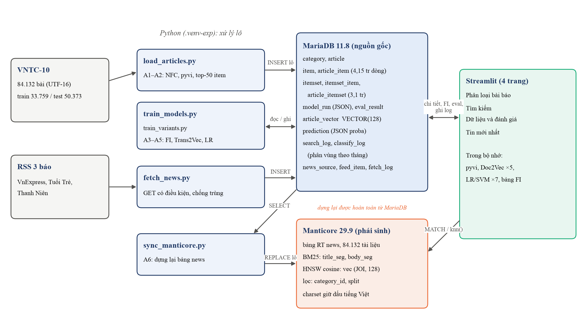
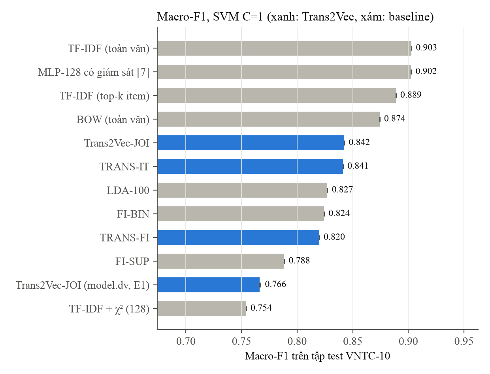

# Biểu diễn văn bản dựa trên mẫu phổ biến cho hệ thống tìm kiếm và phân loại chuyên mục tin tức tiếng Việt: Khảo sát và đề xuất hướng tiếp cận Trans2Vec

*Bài khảo sát — Môn Tri thức dữ liệu, Chương trình Sau đại học, Trường Đại học Công nghệ TP.HCM (HUTECH)*

---

## Tóm tắt

Phân loại chuyên mục tin tức tiếng Việt đã được nghiên cứu gần hai thập kỷ, với các cách biểu diễn văn bản đi từ túi từ (bag-of-words) và n-gram âm tiết, qua chọn đặc trưng thống kê và trích từ khóa, tới embedding học bằng mạng nơ-ron và mô hình ngôn ngữ tiền huấn luyện như PhoBERT. Song song với dòng nghiên cứu đó, cộng đồng khai phá dữ liệu đã phát triển hướng *học biểu diễn dựa trên mẫu phổ biến*. Đại diện tiêu biểu là Trans2Vec: phương pháp kết hợp tập phổ biến (frequent itemsets) với mô hình Paragraph Vector để học vector cho dữ liệu dạng tập hợp mà không cần nhãn.

Bài khảo sát này tổ chức tài liệu theo **đường ống của một hệ thống tìm kiếm và phân loại tin tức**: tiền xử lý tiếng Việt, biến văn bản thành transaction, khai phá tập phổ biến, học embedding, phân loại, tìm kiếm, và giao thức đánh giá. Bài hệ thống hóa 19 công trình chính và 27 tài liệu bổ sung theo một khung phân loại bảy nhánh biểu diễn. Bài trả lời sáu câu hỏi nghiên cứu, chỉ ra mười mâu thuẫn trong tài liệu, và đánh giá phản biện Trans2Vec qua tám hạn chế khi áp dụng cho tin tức tiếng Việt. Kết quả khảo sát cho thấy bốn điểm. (i) Độ khó của corpus và giao thức đánh giá chi phối kết quả nhiều hơn thuật toán: trên cùng VNTC, cùng TF-IDF với bộ phân loại tuyến tính, các công trình báo accuracy từ 92,5% đến 96,21%. (ii) Vai trò của tiền xử lý tiếng Việt giảm dần qua các thế hệ biểu diễn nhưng trở lại thành yếu tố cốt lõi với biểu diễn dựa trên mẫu. (iii) Hai bài tổng quan lớn về phân loại văn bản không có nhánh nào cho biểu diễn dựa trên mẫu phổ biến, và hướng này chưa từng được áp dụng cho văn bản tiếng Việt, cho văn bản dài như tin tức, hay cho tìm kiếm. (iv) Tài liệu chứa tám mối đe dọa đến tính hợp lệ của kết quả. Đề tài đo được mức ảnh hưởng của sáu mối.

Từ đó, bài đề xuất và hiện thực một hệ thống dùng chung biểu diễn Trans2Vec cho phân loại chuyên mục và tìm kiếm, trên MariaDB và Manticore Search, kèm giao thức đánh giá chuẩn hóa. Thực nghiệm trên toàn bộ VNTC-10 (33.759 bài huấn luyện, 50.373 bài kiểm tra) cho thấy: Trans2Vec chưa vượt TF-IDF ở phân loại (Macro-F1 0,857 với mô hình cải tiến, so với 0,907), và tập phổ biến chỉ đóng góp −0,3 đến +0,9 điểm. Lọc tập phổ biến đóng không có tác dụng, vì gần như mọi tập phổ biến trên tin tức đã đóng. Chọn tập phổ biến ổn định cũng không tốt hơn chọn ngẫu nhiên cùng số lượng. Ngược lại, ở tìm kiếm, Trans2Vec là biểu diễn không giám sát tốt nhất: nDCG@10 đạt 0,816, so với 0,749 của BM25, và 0,819 khi kết hợp hai cách. Trans2Vec còn cho phần giải thích chuyên mục dễ đọc, với chi phí một đến hai phút trên CPU. Thực nghiệm cũng phát hiện một cái bẫy đánh giá: vector huấn luyện và vector kiểm tra không được sinh cùng quy trình có thể làm sai lệch kết quả tới 8 điểm và tạo ra những cải thiện giả.

**Từ khóa:** phân loại văn bản tiếng Việt; tin tức; tập phổ biến; Trans2Vec; Paragraph Vector; học biểu diễn; tìm kiếm kết hợp; khai phá tri thức.

---

## Mục lục

1. Giới thiệu
2. Đặc thù xử lý văn bản tiếng Việt
3. Kiến thức nền tảng
4. Tiến hóa của biểu diễn văn bản cho phân loại tiếng Việt
5. Trans2Vec và mô thức biểu diễn dựa trên mẫu phổ biến
6. Bộ phân loại và đánh đổi hiệu năng – chi phí
7. Dữ liệu và giao thức đánh giá
8. So sánh tổng hợp và thảo luận
9. Đề xuất hệ thống tìm kiếm và phân loại chuyên mục dựa trên Trans2Vec
10. Kết luận và hướng phát triển

Phụ lục A: Bảng tóm tắt công trình · Phụ lục B: Thuật ngữ Việt – Anh · Tài liệu tham khảo

## 1. Giới thiệu

### 1.1 Bối cảnh

Báo điện tử là một trong những nguồn văn bản tiếng Việt lớn và tăng nhanh nhất. Mỗi ngày, hàng chục trang tin như VnExpress, Tuổi Trẻ, Thanh Niên, Dân trí xuất bản hàng nghìn bài, và mỗi bài được biên tập viên xếp vào một chuyên mục: Thời sự, Kinh doanh, Thể thao, Sức khỏe, v.v. Hai nhu cầu xử lý cơ bản nảy sinh từ khối dữ liệu này:
- **Phân loại chuyên mục tự động:** gán chuyên mục cho bài mới, cho bài từ nguồn chưa được phân loại, hoặc thống nhất hệ thống chuyên mục khác nhau giữa các trang.
- **Tìm kiếm:** truy xuất những bài *liên quan về nội dung* tới một truy vấn hay một bài đang đọc, vượt ra ngoài việc khớp từ khóa chính xác.

Về hình thức, phân loại văn bản là bài toán học một ánh xạ từ tập tài liệu vào tập chuyên mục định trước [1, 2]. Chất lượng của mọi bộ phân loại, cũng như mọi hệ thống tìm kiếm dựa trên độ tương đồng, phụ thuộc trước hết vào **cách biểu diễn văn bản thành vector**. Với tiếng Việt, câu hỏi biểu diễn càng khó hơn: ranh giới từ không trùng với khoảng trắng, và phần lớn từ có nghĩa được ghép từ hai âm tiết trở lên [3, 4].

### 1.2 Động lực: điểm giao giữa khai phá mẫu và học biểu diễn

Nghiên cứu phân loại văn bản tiếng Việt đã trải qua ba thế hệ biểu diễn:
1. **Biểu diễn thưa và chọn đặc trưng:** túi từ và TF-IDF [2], n-gram âm tiết, các tiêu chí chọn đặc trưng như Information Gain, χ² hay OCFS [3, 4], và các phương pháp trích từ khóa [5, 6].
2. **Biểu diễn dày học từ dữ liệu:** mạng nơ-ron trích đặc trưng [7, 8] và embedding tĩnh Word2Vec, GloVe, Doc2Vec [9].
3. **Mô hình ngôn ngữ tiền huấn luyện:** họ BERT, đặc biệt PhoBERT [10, 11, 12, 13].

Ở một nhánh khác, cộng đồng khai phá dữ liệu (KDD) từ lâu đã biểu diễn dữ liệu dạng tập hợp bằng **tập phổ biến** (frequent itemsets): những tổ hợp phần tử cùng xuất hiện với tần suất vượt một ngưỡng [14, 15]. Tập phổ biến đã được dùng cho phân cụm và phân loại văn bản [16, 17, 18], kể cả văn bản tiếng Việt [19]. Tuy nhiên, cách dùng này gặp hai trở ngại cố hữu: số chiều rất lớn và vector rất thưa.

Năm 2018, Nguyen và cộng sự đề xuất **Trans2Vec** [20]: coi mỗi tập phổ biến như một "từ" và học vector cho mỗi transaction bằng mô hình Paragraph Vector [21]. Kết quả là một biểu diễn **dày, ít chiều, không cần nhãn**, nhưng vẫn mang tri thức đồng xuất hiện bậc cao của tập phổ biến. Áp vào văn bản, mỗi bài báo là một transaction và mỗi từ là một item. Khi đó tập phổ biến chính là các cụm từ hay đi cùng nhau, chẳng hạn {chứng_khoán, cổ_phiếu, sàn} cho chuyên mục Kinh doanh. Với tiếng Việt, có thêm một điểm đáng chú ý: nếu item là âm tiết, các tập phổ biến hai phần tử có khả năng tự "khôi phục" từ ghép, ví dụ {chứng, khoán}. Nhờ vậy hệ thống phần nào bớt phụ thuộc vào bộ tách từ.

Dù vậy, cho tới nay chưa có công trình nào đưa hướng tiếp cận này vào văn bản tiếng Việt, và cũng chưa có công trình nào dùng nó cho bài toán tìm kiếm. Hai bài tổng quan lớn gần đây về phân loại văn bản [22, 23] phủ từ phương pháp truyền thống tới mạng đồ thị và mô hình tiền huấn luyện, nhưng không có nhánh nào cho biểu diễn dựa trên mẫu phổ biến. Bài khảo sát này nhằm lấp khoảng trống đó.

Để bài khảo sát phục vụ trực tiếp việc xây hệ thống, các chương được tổ chức theo **đường ống xử lý** của một hệ thống tìm kiếm và phân loại tin tức (Hình 1.1). Mỗi bước ứng với một câu hỏi thiết kế, và mỗi tài liệu được đặt vào bước mà nó đóng góp.

```
Tin tức thô → (1) Tiền xử lý tiếng Việt → (2) Văn bản → transaction → (3) Khai phá FI → (4) Học embedding
                                                                                            │
                                     ┌──────────────────────────────────────────────────────┤
                                     ▼                                                      ▼
                         (5a) Phân loại chuyên mục                          (5b) Tìm kiếm (truy vấn → top-k)
                                     └───────────► (6) Dữ liệu và giao thức đánh giá ◄──────┘
```
*Hình 1.1. Đường ống hệ thống và các bước được khảo sát.*

### 1.3 Câu hỏi nghiên cứu

Bài khảo sát được tổ chức quanh sáu câu hỏi nghiên cứu (RQ). Mỗi câu gắn với một bước của Hình 1.1:

| RQ | Câu hỏi | Bước | Chương |
|---|---|---|---|
| **RQ1** | Tiếng Việt đặt ra những thách thức tiền xử lý nào (tách từ, dấu thanh, bảng mã, từ dừng), và tầm quan trọng của chúng thay đổi thế nào theo từng họ biểu diễn? | (1) | 2 |
| **RQ2** | Các họ biểu diễn văn bản (thưa, chọn đặc trưng, dày có giám sát, embedding, mẫu phổ biến, mô hình tiền huấn luyện, đồ thị) so sánh với nhau ra sao trên tiếng Việt? | (4) | 4, 8 |
| **RQ3** | Tri thức đồng xuất hiện dưới dạng tập phổ biến có làm giàu được embedding tài liệu không, nên khai phá loại FI nào, và Trans2Vec cần điều chỉnh gì để áp dụng cho tin tức tiếng Việt? | (2)–(4) | 3, 5, 9 |
| **RQ4** | Bộ phân loại nào phù hợp với từng loại biểu diễn, và chi phí tính toán đổi lại được gì? | (5a) | 6 |
| **RQ5** | Các tập dữ liệu và giao thức đánh giá hiện có có đủ chuẩn để so sánh công bằng giữa các nghiên cứu không? | (6) | 7, 8 |
| **RQ6** | Biểu diễn nào phục vụ được *đồng thời* phân loại và tìm kiếm, và nên đánh giá phần tìm kiếm thế nào cho đúng? | (5b) | 3, 9 |

### 1.4 Phương pháp khảo sát

Tài liệu được thu thập theo hai vòng:
- **Vòng 1:** 11 công trình nòng cốt do người thực hiện tuyển chọn. Gồm 10 nghiên cứu phân loại văn bản tiếng Việt giai đoạn 2007–2025 và bài gốc Trans2Vec. Mỗi công trình được đọc toàn văn và lập phiếu đọc theo mẫu thống nhất: bài toán, phương pháp, dữ liệu, kết quả, hạn chế, liên hệ với Trans2Vec.
- **Vòng 2:** 27 tài liệu bổ sung, tìm theo bốn hướng:
  - các công trình cùng mô thức với Trans2Vec;
  - nền tảng khai phá tập phổ biến;
  - tập phổ biến cho văn bản;
  - tài nguyên và benchmark tiếng Việt.

  Mọi tài liệu bổ sung đều được xác minh thông tin thư mục qua nguồn chính thức (ACL Anthology, DBLP, kho của nhà xuất bản hoặc của trường).
- **Vòng 3:** 8 công trình (2013–2025) chọn để lấp những bước còn mỏng của đường ống:
  - hai bài về khai phá tập phổ biến, cho bước (3) [24, 25];
  - hai bài về văn bản tiếng Việt, cho bước (1) và (5a) [8, 26];
  - hai hướng hiện đại cạnh tranh với Trans2Vec: embedding từ mô hình ngôn ngữ lớn đóng băng [27] và mạng đồ thị [28];
  - hai bài tổng quan lớn về phân loại văn bản [22, 23].

  Thông tin thư mục của cả 8 bài được xác minh qua Crossref. Hai bài tổng quan chỉ dùng làm **khung tham chiếu** (khung phân loại, danh mục dataset, độ đo, danh sách thách thức). Chúng không được dùng làm bằng chứng kết quả, vì số liệu trong đó được chép từ các bài gốc với giao thức khác nhau.

Ba tài liệu kỹ thuật về tìm kiếm (BM25, chỉ mục HNSW, Reciprocal Rank Fusion) [29, 30, 31] được dùng thêm cho phần hệ thống; chúng không tính vào các vòng trên.

Song song với khảo sát, đề tài hiện thực hệ thống trên MariaDB và Manticore Search và chạy thực nghiệm có kiểm soát trên VNTC-10. Các phép đo này được dùng làm bằng chứng bổ sung, chủ yếu cho bước (5b) và (6), nơi tài liệu sơ cấp còn ít nhất.

Kết quả được tổng hợp vào các ma trận đối chiếu (đường ống × tài liệu, khung phân loại × tài liệu, dataset, kết quả theo nhóm so sánh được, tiền xử lý × biểu diễn). Các ma trận này là xương sống của các Chương 4–8. Ba công trình về phát hiện ngôn từ thù ghét và phân tích cảm xúc [9, 11, 12] nằm ngoài miền tin tức. Chúng được giữ lại vì chứa bằng chứng về biểu diễn và tiền xử lý tiếng Việt có thể chuyển giao, nhưng không đưa vào so sánh trực tiếp với kết quả trên tin tức.

### 1.5 Đóng góp

Bài khảo sát có ba đóng góp:
1. **Hệ thống hóa theo đường ống** các thành phần của một hệ thống tìm kiếm và phân loại tin tức tiếng Việt. Khung phân loại bảy nhánh đặt **mô thức biểu diễn dựa trên mẫu phổ biến** (pattern-based embedding) cạnh các nhánh mà hai bài tổng quan lớn [22, 23] đã phủ, và cho thấy nhánh này vắng mặt trong cả hai.
2. **Phân tích phản biện có kiểm chứng.** Trans2Vec được phân tích qua tám hạn chế khi áp dụng cho tin tức tiếng Việt. Các hạn chế được kiểm chứng bằng thực nghiệm có kiểm soát giao thức: chạy trên VNTC-10, tái hiện trên chính dữ liệu của bài gốc, và đo sáu mối đe dọa đến tính hợp lệ của đánh giá. Kết quả cho thấy đóng góp của tập phổ biến bị thổi phồng khi giao thức không nhất quán.
3. **Đề xuất và hiện thực** một kiến trúc dùng chung biểu diễn cho phân loại và tìm kiếm, với ba chế độ tìm kiếm (từ khóa, vector, kết hợp) và cách xử lý dấu thanh tiếng Việt, cùng một **giao thức đánh giá chuẩn hóa** khắc phục các vấn đề về tính so sánh được, rò rỉ dữ liệu và khả năng tái lập.

### 1.6 Cấu trúc bài

Các chương đi theo đường ống ở Hình 1.1:
- Chương 2: bước (1), đặc thù tiếng Việt.
- Chương 3: nền tảng cho bước (2)–(4) và (5b): khai phá tập phổ biến, học biểu diễn phân tán, tìm kiếm từ khóa và tìm kiếm vector.
- Chương 4: bước (4), tiến hóa của biểu diễn văn bản.
- Chương 5: bước (2)–(4), phân tích sâu Trans2Vec và họ phương pháp của nó.
- Chương 6: bước (5a), bộ phân loại và chi phí.
- Chương 7: bước (6), dữ liệu và giao thức đánh giá.
- Chương 8: so sánh tổng hợp, các mâu thuẫn và các mối đe dọa đến tính hợp lệ.
- Chương 9: hệ thống đề xuất, phần hiện thực và kết quả thực nghiệm, gồm bước (5b).
- Chương 10: kết luận.

## 2. Đặc thù xử lý văn bản tiếng Việt

### 2.1 Âm tiết, từ và bài toán tách từ

Tiếng Việt là ngôn ngữ đơn lập. Đơn vị viết cách nhau bằng khoảng trắng là **âm tiết** (Hoang và cộng sự gọi là *morpho-syllable* [3]), chứ không phải từ. Một âm tiết có thể là một từ, một hình vị, hoặc không mang nghĩa độc lập. Nguyen và cộng sự ghi nhận **hơn 80% từ tiếng Việt có hai âm tiết** [4]. Vì vậy việc xác định ranh giới từ, tức **tách từ** (word segmentation), là bước tiền xử lý đặc thù, và cách tách khác nhau có thể dẫn tới nghĩa khác nhau. Ba ví dụ kinh điển trong các công trình được khảo sát:

| Câu | Cách tách 1 | Cách tách 2 | Hệ quả với phân loại | Nguồn |
|---|---|---|---|---|
| "Một luật gia cầm cự với tình hình hiện nay" | luật_gia / cầm_cự → *Chính trị – Xã hội* | gia_cầm → *Sức khỏe (cúm gia cầm)* | Đổi chuyên mục | [3] |
| "học sinh ra từ hành" | học / sinh_ra / từ / hành | học_sinh / ra / từ / hành | Cả hai cách đều gồm các từ có thật | [4] |
| "Bảo lãnh bằng chứng khoán" | bảo_lãnh / bằng / chứng_khoán → *Tài chính* | bảo_lãnh / bằng_chứng / khoán → lệch nghĩa, nghiêng về *Pháp luật* | Từ khóa sai, phân loại sai | [5, 8] |

Các công trình xử lý vấn đề này theo hai hướng:
- **Dùng bộ tách từ:** MaxEnt [3], vnTokenizer [5, 8, 26], pyvi [9, 12], VnCoreNLP/RDRSegmenter [11, 32]. Rủi ro là lỗi tách từ lan truyền sang các bước sau. Pham Van và Ta Minh xếp sự phụ thuộc vào thư viện tách từ vào danh sách hạn chế chính [5].
- **Tránh tách từ:** làm việc trực tiếp với âm tiết, qua bag-of-syllables [4], mô hình ngôn ngữ n-gram âm tiết [3], hoặc tổ hợp unigram + bigram [7]. Hoang và cộng sự cho thấy mô hình n-gram âm tiết đạt độ chính xác ngang SVM trên túi từ (95,58% so với 96,21%) mà không cần tách từ hay chọn đặc trưng [3].

Bài toán ranh giới từ không riêng tiếng Việt. Sogou News, một benchmark tin tức tiếng Trung, cũng là văn bản không có ranh giới từ tường minh [23]. Tiếng Việt khác ở chỗ khoảng trắng vẫn tách *âm tiết*, nên luôn có một mức biểu diễn dùng được mà không cần bộ tách từ.

**Chi phí và độ tin cậy của công cụ.** Tách từ không phải nút thắt về tốc độ: bộ công cụ VNLP tách 2 triệu âm tiết trong 6 giây sau khi tối ưu, so với 234 giây của bản vnTokenizer gốc [26]. Các công cụ sâu hơn thì còn yếu. Trong cùng bộ công cụ, nhận diện thực thể theo luật chỉ đạt F1 0,58, và phân tích phụ thuộc đạt khoảng 70% [26]. Vì vậy, phương pháp nào cần nhiều tầng phân tích ngôn ngữ (từ loại, phụ thuộc, thực thể) sẽ chịu lan truyền lỗi lớn khi chuyển sang tiếng Việt (Mục 4.7).

**Bằng chứng từ thực nghiệm của đề tài.** Trên VNTC-10, bỏ tách từ làm mọi biểu diễn mất 1–3 điểm Macro-F1 (thực nghiệm A1, Mục 9.5). Nói cách khác, với tin tức tiếng Việt, tách từ vẫn có ích, dù không bắt buộc.

### 2.2 Bảng mã, dấu thanh và biến thể chính tả

Văn bản tiếng Việt điện tử từng tồn tại ở nhiều bảng mã (TELEX, VNI, TCVN3, VIQR, Unicode). Vị trí dấu thanh cũng không thống nhất (ví dụ "hoà" và "hòa"), và có biến thể chính tả như "thời kỳ" và "thời kì". Nếu không chuẩn hóa, cùng một từ sẽ thành nhiều đặc trưng khác nhau. Các công trình sớm đều xây bước chuẩn hóa riêng [3, 4]. Ngày nay chuẩn hóa Unicode vẫn được dùng như bước đầu tiên, kể cả trong các hệ thống dựa trên Transformer [11].

**Dấu thanh trong tìm kiếm.** Các công trình khảo sát chỉ bàn dấu thanh ở góc độ phân loại. Với tìm kiếm, vấn đề khác hẳn, vì người dùng có thể gõ không dấu. Thực nghiệm của đề tài trên chỉ mục BM25 (Mục 9.5) cho thấy hai mặt của cùng một lựa chọn:
- **Giữ dấu** tốt hơn khi truy vấn có dấu: nDCG@10 0,653 so với 0,621 khi gộp dấu. Lý do là gộp dấu dồn "bàn", "bán", "bản", "ban" thành một token; token đó khớp khoảng 63% số bài của kho.
- **Gộp dấu** là bắt buộc khi truy vấn không dấu. Trên chỉ mục giữ dấu, truy vấn không dấu chỉ còn nDCG@10 0,394, và 9% truy vấn không có kết quả nào.

Hệ thống vì vậy giữ cả hai dạng và chọn theo truy vấn. Chi tiết ở Mục 9.2.

### 2.3 Từ dừng và từ vựng

Danh sách từ dừng tiếng Việt thường được **xây thủ công** và thiếu chuẩn chung: khoảng 900 từ trong [3], khoảng 2.000 từ trong [5, 8]. Tính chủ quan của danh sách được chính các tác giả nêu là một nguồn sai số [5]. Một hướng khác là lọc từ vựng bằng từ điển, chỉ giữ các gram ứng với từ có thật. Cách này giảm từ vựng bigram từ 300.000 xuống 30.000 và đặc biệt có lợi cho kNN, vốn nhạy với đặc trưng nhiễu [4].

### 2.4 Tầm quan trọng của tiền xử lý thay đổi theo họ biểu diễn

Một quan sát xuyên suốt của khảo sát này: tiền xử lý **không có vai trò cố định**, mà phụ thuộc vào cách biểu diễn được dùng (Bảng 2.1).
- **Với mô hình Transformer:** Luu và cộng sự cho thấy các bước tiền xử lý truyền thống (bỏ từ dừng, chuyển chữ thường, bỏ emoji, hashtag, URL) **không cải thiện, thậm chí làm giảm** hiệu năng [12]. Ngoại lệ duy nhất là tách từ bằng VnCoreNLP cho PhoBERT, giúp tăng khoảng 2 điểm Macro-F1, vì PhoBERT được tiền huấn luyện trên văn bản đã tách từ theo cách này [10, 12].
- **Với biểu diễn dựa trên tập hợp và mẫu** (từ khóa, Trans2Vec): tiền xử lý quyết định *những item nào tồn tại*, và do đó những tập phổ biến nào được khai phá. Vai trò của nó vì vậy là cốt lõi.

**Bảng 2.1.** Vai trò của tiền xử lý theo họ biểu diễn (tổng hợp từ các công trình khảo sát)

| Bước | Âm tiết / n-gram | TF-IDF + chọn đặc trưng | Từ khóa | Embedding tĩnh | **Trans2Vec** | PhoBERT / BERT |
|---|---|---|---|---|---|---|
| Chuẩn hóa mã, dấu | Cần | Cần | Cần | Cần | **Cần** | Cần |
| Tách từ | Không cần [3, 4] | Cần | Cần; lỗi lan truyền [5] | Cần [9] | **Tùy chọn, cần thực nghiệm** | Cần cho PhoBERT [12] |
| Bỏ từ dừng | Có ích | Có ích | Rất quan trọng | Có ích | **Rất quan trọng** | Vô ích hoặc có hại [12] |
| Lọc từ vựng / top-k | — | Giúp kNN [4] | Bản chất phương pháp | — | **Bắt buộc** (Mục 5.6) | — |

Bảng 2.1 cho thấy một **đường cong chữ U**. Vai trò của tri thức ngôn ngữ tiếng Việt giảm dần từ biểu diễn thưa đến Transformer, rồi tăng trở lại với biểu diễn dựa trên mẫu. Đây là luận điểm đầu tiên trả lời RQ1. Nó cũng là lý do Chương 9 đặt tiền xử lý thành một mô-đun có thể cấu hình, kèm thực nghiệm loại trừ (ablation).

## 3. Kiến thức nền tảng

### 3.1 Bài toán phân loại và tìm kiếm văn bản

Cho tập tài liệu $D=\{d_1,\dots,d_N\}$ và tập chuyên mục $C=\{c_1,\dots,c_k\}$. **Phân loại văn bản** là học hàm $F: D\times C\to\{\text{đúng},\text{sai}\}$, với $F(d_i,c_j)=\text{đúng}$ nếu $d_i$ thuộc $c_j$ [1, 2]. Có ba trường hợp:
- **nhị phân:** $k=2$;
- **đa lớp:** $k>2$, mỗi tài liệu thuộc đúng một lớp. Đây là trường hợp phân loại chuyên mục tin tức;
- **đa nhãn:** một tài liệu có thể thuộc nhiều lớp [13].

Quy trình chuẩn gồm năm bước: tiền xử lý, biểu diễn, giảm chiều, huấn luyện bộ phân loại, đánh giá [2, 5].

**Tìm kiếm ngữ nghĩa** được hiểu ở đây là một bài toán xếp hạng. Cho một truy vấn $q$, là một chuỗi từ khóa hoặc một tài liệu, ta xếp hạng các tài liệu trong $D$ theo độ tương đồng $\text{sim}(\phi(q),\phi(d))$, với $\phi$ là hàm biểu diễn. Khi $\phi$ cho ra vector dày, $\text{sim}$ thường là cosine và bài toán trở thành tìm láng giềng gần nhất. Đây là nguyên lý của dense retrieval [33, 34]. Điểm then chốt cho đề tài: **nếu cùng một $\phi$ dùng được cho cả phân loại và tìm kiếm, hệ thống chỉ cần học và lưu một biểu diễn duy nhất.**

Ba thành phần kỹ thuật của tìm kiếm được dùng trong hệ thống ở Chương 9:
- **BM25** [29] là hàm xếp hạng từ khóa chuẩn. Điểm của tài liệu $d$ với truy vấn $q$ cộng dồn trọng số IDF của từng từ trong $q$, nhân với một hàm bão hòa của tần suất từ trong $d$, có chuẩn hóa theo độ dài tài liệu (tham số $k_1$ và $b$).
- **Chỉ mục vector xấp xỉ HNSW** [30] tổ chức các vector thành đồ thị nhiều tầng để tìm láng giềng gần nhất mà không phải so với toàn bộ kho. Đổi lại, kết quả có thể thiếu một vài láng giềng thật. Mức này đo bằng *recall* so với tìm vét cạn.
- **Reciprocal Rank Fusion (RRF)** [31] gộp nhiều danh sách xếp hạng chỉ dựa trên thứ hạng: $\text{RRF}(d)=\sum_i 1/(k+\text{rank}_i(d))$, thường với $k=60$. Cách này không cần đưa điểm BM25 và điểm cosine về cùng thang, nên hợp để kết hợp tìm kiếm từ khóa với tìm kiếm vector (*tìm kiếm kết hợp*, hybrid search).

### 3.2 Khai phá tập phổ biến

Cho tập item $I=\{i_1,\dots,i_M\}$ và cơ sở dữ liệu transaction $D=\{T_1,\dots,T_N\}$ với $T_i\subseteq I$. **Độ hỗ trợ** (support) của itemset $X\subseteq I$ là

$$\text{sup}(X)=\frac{|\{T_i\in D : X\subseteq T_i\}|}{|D|}.$$

$X$ là **tập phổ biến** (frequent itemset, FI) nếu $\text{sup}(X)\ge\delta$, với $\delta\in[0,1]$ là ngưỡng hỗ trợ tối thiểu [14, 35]. Tính chất **đóng xuống** (anti-monotone) là nền tảng của mọi thuật toán khai phá: mọi tập con của một tập phổ biến cũng phổ biến.

Ba thuật toán chính liên quan tới đề tài:
- **Apriori** [14]: sinh ứng viên theo từng mức độ dài và tỉa nhờ tính đóng xuống. Đơn giản nhưng phải quét dữ liệu nhiều lần.
- **FP-Growth** [15]: nén cơ sở dữ liệu vào cấu trúc cây FP-tree và khai phá đệ quy, **không sinh ứng viên**. Thường nhanh hơn Apriori nhiều bậc trên dữ liệu dày.
- **Tập phổ biến đóng** (closed itemsets), ví dụ thuật toán CHARM [36]: chỉ giữ các FI không có tập cha nào cùng độ hỗ trợ. Đây là biểu diễn nén *không mất thông tin* của toàn bộ tập FI.

**Ví dụ.** Với δ = 0,6 trên năm transaction {a,b,c}, {b,c,d}, {a,d}, {b,c,d,e}, {a,c,d}, ta thu được sáu FI: {a}, {b}, {c}, {d}, {b,c}, {c,d}. Mỗi transaction có thể được viết lại thành tập các FI mà nó chứa [20].

**Tập phổ biến đóng, lớp tương đương và độ ổn định.** Zhang và cộng sự hệ thống hóa lý thuyết của tập phổ biến đóng (CFI) [24]. Gọi $t(X)$ là tập transaction chứa $X$, và $i(Y)$ là tập item chung của các transaction trong $Y$. Toán tử bao đóng $c=i\circ t$ có tính mở rộng, đơn điệu và lũy đẳng; $X$ là tập đóng khi $c(X)=X$. Các itemset có cùng $t(X)$ lập thành một **lớp tương đương**: chúng có cùng độ hỗ trợ, và mỗi lớp có đúng một phần tử lớn nhất, chính là CFI của lớp. Vì vậy toàn bộ FI được phân hoạch thành các lớp, mỗi lớp đại diện bởi một CFI. Bài còn đề xuất **CICFI**: chỉ giữ CFI có *cận dưới khoảng tin cậy* của độ hỗ trợ (Wald, Wilson hoặc Clopper–Pearson) không nhỏ hơn ngưỡng. Ý tưởng là phân biệt mẫu "phổ biến và ổn định" với mẫu chỉ phổ biến do dao động lấy mẫu. Cần đọc bài này thận trọng: phần tính chất của CFI là kết quả kinh điển, thực nghiệm chỉ minh họa trên hai dataset với mẫu 40–60 transaction, và không có tác vụ hạ nguồn nào.

**Thuật toán và hồ sơ dữ liệu.** Trasierras và cộng sự so sánh chín thuật toán khai phá FI trên 14 dataset [25]. Các thuật toán chia theo cách duyệt dữ liệu: theo chiều ngang (Apriori), theo chiều dọc (Eclat, dEclat), lai (FP-Growth, Relim), cùng SaM và họ LCM. Bài đề xuất **tám độ đo hồ sơ dữ liệu** để mô tả một cơ sở dữ liệu transaction: độ dày (density, độ dài transaction trung bình chia cho số item), độ giống nhau giữa các transaction (similarity), phân bố đồng xuất hiện của item, độ dài transaction, kích thước itemset kỳ vọng, số transaction, số item và tổng số phần tử. Bốn kết luận liên quan tới đề tài:
1. **Ngưỡng δ làm thay đổi chính hồ sơ dữ liệu.** Bỏ item không phổ biến có thể biến một dataset thưa thành dày, nên so sánh thuật toán ở một δ duy nhất dễ thiên lệch.
2. Không thuật toán nào thắng mọi nơi; **LCM và FP-Growth** thường tốt nhất. Ở ngưỡng thấp, chênh lệch giữa các thuật toán lên tới 4–6 bậc độ lớn. Ví dụ, Eclat mất khoảng 140 giờ trên một dataset nhưng chỉ 4 giây trên dataset khác.
3. Các kỹ thuật mở rộng (cắt tỉa phần mở rộng hoàn hảo, k-items machine) quan trọng hơn bản thân thuật toán.
4. **Bùng nổ tổ hợp vẫn chưa giải được.** Ứng dụng thực tế phải hậu xử lý: tóm tắt mẫu, nén mẫu, hoặc giữ top-k.

Bài chỉ đo tốc độ, không đánh giá chất lượng mẫu cho tác vụ hạ nguồn, và không có dataset văn bản. Mục 9.5 vì vậy tự tính tám độ đo này cho văn bản (thực nghiệm E8).

**Biểu diễn bằng FI và vấn đề của nó.** Cách cổ điển là biểu diễn mỗi transaction bằng vector nhị phân $f(T)=[x_1,\dots,x_F]$, với $x_i=1$ nếu $X_i\subseteq T$. Cách này gặp hai vấn đề [20]:
1. **Số chiều rất lớn:** số FI có thể vượt $10^5$ khi δ < 5%.
2. **Rất thưa.**

Các giải pháp đi trước chọn **FI phân biệt** theo information gain hoặc độ chênh support giữa các lớp [18], hoặc xây **bộ phân lớp dựa trên luật kết hợp** [37]. Cả hai đều cần nhãn. Hệ quả là biểu diễn gắn với một tác vụ duy nhất và không chuyển sang phân cụm hay tìm kiếm được.

### 3.3 Học biểu diễn phân tán

**Word2Vec** [38] học vector cho từ bằng cách dự đoán từ ngữ cảnh. Mô hình Skip-gram dự đoán các từ xung quanh từ trung tâm; mô hình CBOW làm ngược lại. Hàm softmax trên toàn bộ từ vựng quá tốn kém, nên được xấp xỉ bằng **negative sampling**. Với cặp (đơn vị mục tiêu $u$, ngữ cảnh $c$) và $K$ mẫu âm $u_n$ rút từ phân phối nhiễu $P$, hàm mục tiêu là:

$$\mathcal{L}=-\log\sigma\big(\mathbf{v}_u\cdot\mathbf{h}_c\big)-\sum_{n=1}^{K}\mathbb{E}_{u_n\sim P}\log\sigma\big(-\mathbf{v}_{u_n}\cdot\mathbf{h}_c\big),$$

với $\sigma$ là hàm sigmoid.

**Paragraph Vector** (Doc2Vec) [21] mở rộng ý tưởng cho tài liệu: mỗi tài liệu có thêm một vector riêng $\mathbf{f}(d)$. Mô hình có hai biến thể:
- **PV-DM** (Distributed Memory): ghép vector tài liệu với vector các từ ngữ cảnh để dự đoán từ tiếp theo.
- **PV-DBOW** (Distributed Bag-of-Words): chỉ dùng $\mathbf{f}(d)$ để dự đoán các từ *có trong* tài liệu, bỏ qua thứ tự. Đây chính là công thức trên với $\mathbf{h}_c=\mathbf{f}(d)$ và $u$ là một từ thuộc $d$.

**PV-DBOW là lõi của Trans2Vec**, nên ba tính chất của nó cần được ghi nhận:
1. **Mô hình coi tài liệu như một *tập* đơn vị.** Vì vậy nó áp dụng được nguyên dạng cho dữ liệu transaction, và các đơn vị không nhất thiết phải là từ.
2. **Vector của tài liệu mới phải được *suy luận*** bằng cách giữ cố định vector đơn vị và tối ưu riêng $\mathbf{f}(d_{\text{mới}})$ vài vòng gradient. Nói cách khác, không có công thức dạng đóng (closed-form) để tính vector cho tài liệu mới.
3. **Hiệu năng nhạy với cấu hình** (số chiều, số epoch, kích thước cửa sổ, tần suất tối thiểu) và với lượng dữ liệu. Lau và Baldwin cho thấy Doc2Vec, và đặc biệt PV-DBOW, cho kết quả vững khi được cấu hình đúng và huấn luyện trên đủ dữ liệu. Họ cũng đưa ra bộ siêu tham số khuyến nghị [39]. Tính chất này giúp giải thích một mâu thuẫn quan trọng trong tài liệu tiếng Việt (Mục 8.3).

**Embedding ngữ cảnh.** BERT [40] và các biến thể như PhoBERT [10] tạo vector *phụ thuộc ngữ cảnh* bằng kiến trúc Transformer tiền huấn luyện trên corpus lớn. Để tìm kiếm, vector câu hoặc tài liệu thường được lấy bằng Sentence-BERT [34] hoặc bằng cách gộp đầu ra của các tầng cuối [11].

### 3.4 Độ đo đánh giá

- **Phân loại:** Accuracy; Precision, Recall, F1 theo trung bình macro hoặc micro. Với dữ liệu mất cân bằng, **Macro-F1** được khuyến nghị vì nó coi các lớp ngang nhau, trong khi accuracy thiên về lớp đa số [12]. Với bài toán đa nhãn có thêm Hamming loss [13].
- **Tìm kiếm:** Precision@k, Mean Average Precision (MAP), nDCG@k [41], và MRR khi mỗi truy vấn chỉ có một kết quả đúng [22]. Khi so sánh các **chỉ mục vector xấp xỉ**, độ đo phù hợp là recall@k so với tìm vét cạn, vì nó đo đúng phần sai lệch do chỉ mục gây ra (Mục 9.5).
- **Chủ đề / phân cụm:** độ gắn kết chủ đề $C_v$ và độ đa dạng chủ đề [13]; NMI và ARI khi so cụm với nhãn.

## 4. Tiến hóa của biểu diễn văn bản cho phân loại tiếng Việt

### 4.1 Khung phân loại

Các phương pháp được khảo sát được tổ chức thành bảy nhánh (Hình 4.1):

```
Biểu diễn văn bản tiếng Việt cho phân loại / tìm kiếm
├── A. Biểu diễn thưa
│   ├── A1. Theo âm tiết: bag-of-syllables, n-gram LM
│   └── A2. Theo từ: BoW, TF-IDF
├── B. Giảm chiều / chọn đặc trưng
│   ├── B1. Thống kê: IG, χ², MI, OR, GSS, OCFS; SVD
│   ├── B2. Lọc bằng từ điển
│   └── B3. Trích từ khóa: KeywordScore, TextRank
├── C. Biểu diễn dày học có giám sát: MLP trích đặc trưng; LSTM, CNN trên túi từ
├── D. Embedding không giám sát
│   ├── D1. Mức từ: Word2Vec, GloVe
│   ├── D2. Mức tài liệu: Doc2Vec (PV-DM / PV-DBOW)
│   └── D3. Mô hình chủ đề: LDA, Top2Vec, BERTopic
├── E. Biểu diễn dựa trên mẫu phổ biến                 ← trọng tâm (Chương 5)
│   ├── E1. FI làm đặc trưng / cụm / luật
│   ├── E2. FI làm đơn vị học embedding (Trans2Vec và họ phương pháp)
│   └── E3. Chọn loại mẫu: FI đóng, FI ổn định, theo hồ sơ dữ liệu
├── F. Mô hình ngôn ngữ tiền huấn luyện
│   ├── F1. Tinh chỉnh (fine-tune): PhoBERT, XLM-R, …
│   └── F2. Embedding đóng băng + bộ phân loại nhẹ
└── G. Mạng đồ thị: TextGCN và các biến thể; đồ thị phân cấp + BERT
```
*Hình 4.1. Khung phân loại bảy nhánh.*

**Đối chiếu với hai bài tổng quan lớn.** Nhánh A–D, F1 và G đều có tương ứng trong khung phân loại của Li và cộng sự (mô hình truyền thống, MLP, RNN, CNN, mô hình tiền huấn luyện, mạng đồ thị) [22] và của Minaee và cộng sự [23]. **Nhánh E không có tương ứng nào.** Hai bài tổng quan này cũng không có mục nào về luật kết hợp hay mẫu phổ biến cho phân loại văn bản, dù đây là hướng kinh điển của khai phá dữ liệu [18, 37]. Nhánh F2 chưa xuất hiện vì cả hai bài dừng ở năm 2021–2022.

**Bảng 4.1.** Ma trận nhánh × công trình (● trọng tâm, ○ dùng làm baseline hoặc đề cập)

| Nhánh | [3] | [4] | [5] | [2] | [6] | [7] | [9] | [13] | [11, 12] | [20] |
|---|---|---|---|---|---|---|---|---|---|---|
| A1 | ● | ● | | | | ○ | | | | |
| A2 | ● | | ● | ● | | ● | ● | ● | | ○ |
| B1 | ● | ● | | | | ○ | | | | |
| B2 | | ● | | | | | | | | |
| B3 | | | ● | | ● | | | | | |
| C | | | ○ | | | ● | | | | |
| D1–D2 | | | | | | | ● | ● | | ○ |
| D3 | | | | | | | | ● | | |
| E1 | | | | | | | | | | ○ |
| E2 | | | | | | | | | | **●** |
| F | | | | | | | | ● | ● | |

*Các cột theo thứ tự: Hoang 2007, Nguyen 2009, Pham Van 2017, Duong 2019, Huynh 2020, Vinh 2021, Huong 2022, Nguyen 2025, Pham 2020 / Luu 2024, Trans2Vec 2018.*

Ô **E2 × tiếng Việt** trống hoàn toàn. Nhánh E1 có đúng một tiền lệ tiếng Việt: Đỗ Phúc dùng tập phổ biến và luật kết hợp để phân loại tóm tắt bài báo khoa học CNTT [19], không có thành phần embedding.

**Bảng 4.2.** Các nhánh được bổ sung từ vòng tài liệu thứ ba

| Nhánh | Công trình | Nội dung | Có trên tiếng Việt? |
|---|---|---|---|
| A2, B1, C | [8] | BoW, TF-IDF (+SVD) → LR, cây quyết định, SVM, LSTM, CNN trên VNTC | Có |
| E3 | [24, 25] | FI đóng và FI ổn định; chọn thuật toán theo hồ sơ dữ liệu | Không |
| F2 | [27] | Embedding đóng băng của mô hình ngôn ngữ lớn + bộ phân loại nhẹ | Không |
| G | [28] | Đồ thị phân cấp có tri thức miền + hợp nhất với BERT | Không |

Ba ô E3, F2, G đều trống ở tiếng Việt. Trong ba ô này, chỉ E3 thuộc phạm vi đề tài. F2 là đối chứng tự nhiên của Trans2Vec (Mục 4.6). G ít phù hợp với tiếng Việt vì phụ thuộc vào công cụ ngôn ngữ sâu (Mục 4.7).

### 4.2 Nhánh A – Biểu diễn thưa

**A1 – Theo âm tiết.** Nguyen, Gao và Andreae biểu diễn văn bản ở mức hình thái: túi unigram âm tiết hoặc túi bigram âm tiết [4]. Trên tập 4 chủ đề, bigram vượt unigram với mọi thuật toán (98,1–98,6% so với 97,5–98,1%). Bigram còn có lợi rõ hơn trên tác vụ khó, tức phân loại theo thể loại *Tư liệu* hay *Phân tích*: kNN tăng từ 65,5 lên 73,2 điểm. Đổi lại, bigram chậm hơn 4,5–9,6 lần. Hoang và cộng sự xây **mô hình ngôn ngữ n-gram âm tiết** cho từng lớp và phân loại theo $c^*=\arg\max_c P(c)\prod_i P_c(w_i\mid w_{i-n+1}^{i-1})$, với làm trơn Good-Turing cho kết quả tốt nhất [3]. Ưu điểm then chốt của nhánh A1 là **không cần tách từ**.

**A2 – Theo từ.** Túi từ có trọng số TF-IDF, kết hợp SVM, là baseline mạnh và bền nhất trong toàn bộ tài liệu khảo sát [2, 3, 9]. Kết quả này nhất quán với các nghiên cứu kinh điển trên tiếng Anh [42]. Điểm yếu cố hữu của nó là số chiều lớn (hàng chục đến hàng trăm nghìn) và không nắm được quan hệ ngữ nghĩa giữa các từ.

### 4.3 Nhánh B – Giảm chiều và chọn đặc trưng

**B1 – Chọn đặc trưng thống kê.** Hoang và cộng sự so sánh sáu tiêu chí MI, IG, χ², GSS, OR và OCFS (Optimal Orthogonal Centroid Feature Selection) trên 2.500 term. OCFS cho kết quả tốt nhất [3]. Nguyen và cộng sự cho thấy chỉ dùng **Information Gain** đã giảm từ vựng từ 300.000 xuống khoảng 1.000 term mà độ chính xác của NB và kNN *tăng* [4]. Kết quả này phù hợp với nghiên cứu kinh điển của Yang và Pedersen [43].

**B2 – Lọc bằng từ điển.** Chỉ giữ gram ứng với từ có thật trong một từ điển khoảng 30.000 từ. Cách này giảm từ vựng 6–10 lần (unigram: 30.000 → 5.000; bigram: 300.000 → 30.000), cải thiện kNN rõ rệt và chỉ làm giảm nhẹ hiệu năng của SVM [4].

**B3 – Trích từ khóa.** Pham Van và Ta Minh chọn 10 từ khóa mỗi bài theo một điểm tần suất chuẩn hóa (KeywordScore), dựng từ điển từ khóa và biểu diễn túi từ trên đó (KEBoW). Kết hợp với mạng nơ-ron sáu lớp, họ báo cáo 99,75% [5]. Mục 8.2 sẽ thảo luận độ tin cậy của con số này. Huynh và cộng sự đi xa hơn: biểu diễn mỗi văn bản *chỉ* bằng **tập từ khóa** trích bởi TextRank [44], rồi phân loại bằng độ tương đồng **Jaccard** có trọng số với tập từ khóa đại diện của từng chủ đề [6]. Độ chính xác tăng từ 75,27% với 10 từ khóa lên khoảng 90% với 50 từ khóa, sau đó bão hòa. Dùng toàn bộ từ khóa thì đạt 95,40%. Đáng chú ý, cách nhìn "**văn bản là một tập từ khóa, đo tương đồng bằng phép toán tập hợp**" chính là góc nhìn transaction mà Trans2Vec khai thác (Chương 5).

### 4.4 Nhánh C – Biểu diễn dày học có giám sát

Vinh và Kha thay bước *chọn* đặc trưng bằng bước *học* đặc trưng [7]:
- Vector TF-IDF 10.000 chiều (unigram + bigram) đi qua một mạng hai lớp ẩn, huấn luyện với nhãn của 30 chuyên mục.
- Sau khi huấn luyện, lớp đầu ra bị bỏ đi và đầu ra **128 chiều** của lớp ẩn cuối trở thành đặc trưng cho SVM.
- Ở cùng 128 chiều, đặc trưng học được vượt χ² và OCFS.

Công trình này là mắt xích chuyển tiếp từ biểu diễn thưa sang biểu diễn dày trong tài liệu tiếng Việt. Nó cũng là **đối chứng trực tiếp nhất với Trans2Vec**: cùng 128 chiều, cùng SVM, cùng miền tin tức nhiều chuyên mục. Khác biệt căn bản nằm ở chỗ đặc trưng của Vinh và Kha **gắn với nhãn**, nên không dùng được cho tài liệu chưa gán nhãn, cho phân cụm hay cho tìm kiếm.

Hien và cộng sự là công trình mới nhất trên VNTC trong tài liệu khảo sát [8]. Họ tách từ bằng vnTokenizer, bỏ khoảng 2.000 từ dừng, biểu diễn bằng BoW hoặc TF-IDF (có giảm chiều bằng SVD), rồi so năm bộ phân loại. Trên VNTC 10 chuyên mục, LSTM trên BoW đạt accuracy cao nhất, 94,52%, còn SVM trên TF-IDF đạt 93,60%. Tác giả kết luận học sâu tốt hơn học máy truyền thống. Kết luận này cần đọc thận trọng vì ba lý do:
1. **Đầu vào của LSTM và CNN là một vector túi từ** sau khi chọn hoặc giảm chiều, không phải chuỗi từ. Mô hình gọi là "LSTM" vì vậy không mô hình hóa thứ tự từ, mà chỉ là một bộ phân loại phi tuyến trên đặc trưng túi từ. Về bản chất, nó cùng nhánh C với [7].
2. **Mức chênh rất nhỏ:** với TF-IDF, LSTM chỉ hơn SVM 0,15 điểm (10 chuyên mục) và 0,08 điểm (27 chuyên mục), không có độ lệch chuẩn hay kiểm định.
3. **Chỉ báo accuracy** trên dữ liệu mất cân bằng, và không công bố siêu tham số của mạng.

### 4.5 Nhánh D – Embedding không giám sát

**D1–D2.** Huong và cộng sự so sánh TF-IDF, Word2Vec, GloVe và Doc2Vec trên hai tập bình luận cảm xúc. TF-IDF thắng tuyệt đối; Word2Vec và Doc2Vec chỉ đạt khoảng 50% [9]. Nguyen và cộng sự cũng ghi nhận Word2Vec kém túi từ một chút trên review Shopee (Macro-F1 tốt nhất 0,88 so với 0,91) [13]. Hai kết quả này mâu thuẫn với kết quả của PV-DBOW trên dữ liệu Snippets [20]. Mục 8.3 sẽ phân tích mâu thuẫn này.

**D3 – Mô hình chủ đề.** Các mô hình chủ đề dùng được cho cả gán nhãn chủ đề lẫn tìm kiếm:
- **LDA** [45]: mô hình xác suất.
- **Top2Vec** [46]: embedding chung cho tài liệu và từ, tự xác định số chủ đề, có sẵn chức năng tìm kiếm ngữ nghĩa.
- **BERTopic** [47]: embedding Transformer kết hợp c-TF-IDF.

Trên review Shopee tiếng Việt, LDA và BERTopic đạt độ gắn kết khoảng 0,48 và độ đa dạng trên 0,8, còn **Top2Vec kém hơn**. Không mô hình nào đủ tốt để dùng trực tiếp làm nhãn, nên các tác giả phải gán nhãn thủ công [13]. Trên dữ liệu tiếng Anh, Phan và cộng sự cho thấy chủ đề ẩn học từ một corpus ngoài lớn (Wikipedia) nâng độ chính xác phân loại văn bản ngắn từ 65,75% lên 82,18% [48]. Đây là bằng chứng rõ cho giá trị của **tri thức ngoài**.

### 4.6 Nhánh F – Mô hình ngôn ngữ tiền huấn luyện

PhoBERT là mô hình RoBERTa đơn ngữ tiếng Việt. Dữ liệu tiền huấn luyện khoảng 20 GB, trong đó khoảng 19 GB là **tin tức** [10]. Điều này khiến PhoBERT đặc biệt hợp với miền tin tức. Các công trình được khảo sát cho thấy:
- Fine-tune có chiến lược (huấn luyện thêm MLM trên dữ liệu miền, đóng băng rồi mở dần các tầng, learning rate theo khối, label smoothing) đạt Macro-F1 0,7221 trên VLSP 2019 HSD. Đặc trưng từ 4–6 khối cuối tốt nhất [11].
- Các phương pháp tăng cường dữ liệu và hàm mất mát cho dữ liệu mất cân bằng chỉ cải thiện 1–2 điểm [12].
- Trên review Shopee, PhoBERT kết hợp hồi quy logistic đạt Macro-F1 0,96, vượt mọi biểu diễn khác ít nhất 5 điểm. Đổi lại, nó cần GPU và khoảng 41 phút huấn luyện, so với khoảng 22 giây của TF-IDF trên CPU [13].

**F2 – Embedding đóng băng.** Liu và cộng sự dùng mô hình ngôn ngữ lớn theo một cách khác: không sinh văn bản, không tinh chỉnh, mà lấy biểu diễn ẩn làm đặc trưng [27]. Phương pháp LLMEmbed đóng băng LLaMA2-7B, lấy trung bình vector token ở năm tầng cuối, ghép với vector câu của BERT và RoBERTa, rồi đưa vào một bộ phân loại nhẹ. Họ còn dùng **gộp đồng xuất hiện** (co-occurrence pooling), tức tích ngoài của vector với chính nó, để nắm tương tác bậc hai giữa các chiều. Accuracy trung bình trên năm benchmark tiếng Anh đạt 0,962 (AG News 0,958), ngang cách dùng prompt CARP với GPT-3 (0,952). So với CARP, phương pháp chỉ tốn khoảng 1,5% thời gian và 1,8% điện năng. Ba điểm cần lưu ý:
- Đây là đối chứng có **cùng hình dạng đường ống** với Trans2Vec: embedding không học từ nhãn, rồi một bộ phân loại tuyến tính hoặc nhẹ. So sánh này công bằng về mô thức hơn so với PhoBERT tinh chỉnh.
- Baseline RoBERTa-large trên R52 chỉ đạt 0,422, đúng bằng tỉ lệ của lớp lớn nhất trong tập kiểm tra. Bộ phân loại của baseline nhiều khả năng không hội tụ, nên phần so sánh với mô hình tiền huấn luyện kém tin cậy.
- Phương pháp cần GPU, chỉ thử trên tiếng Anh, và tác giả tự nhận **yếu với văn bản dài**. Tin tức tiếng Việt dài hàng trăm từ, nên không thể giả định kết quả chuyển sang được.

### 4.7 Nhánh G – Mạng đồ thị

Mạng đồ thị cho văn bản, như TextGCN, dựng đồ thị từ – tài liệu với cạnh trọng số theo đồng xuất hiện, rồi học bằng mạng tích chập đồ thị [22, 23]. Onan đề xuất một khung bảy giai đoạn: trích đặc trưng ngôn ngữ (từ loại, phụ thuộc, thực thể, đồng tham chiếu), dựng đồ thị phân cấp có tri thức miền, học đồ thị nhiều mức, rồi hợp nhất với BERT [28]. Bài báo cáo accuracy 98,75% trên R8 và 93,71% trên 20 Newsgroups.

Nhánh G có hai điểm chung với Trans2Vec. Cả hai khai thác **đồng xuất hiện giữa các từ**: TextGCN qua cạnh trọng số PMI (bậc hai), Trans2Vec qua tập phổ biến (bậc cao, không cần các từ đứng liền nhau). Bản gốc của cả hai cũng học **transductive**, tức đưa tài liệu kiểm tra vào lúc học biểu diễn (Mục 9.5).

Kết quả của [28] cần đọc thận trọng. **Baseline lệch so với chính các bài tổng quan:** TextGCN được báo 79,52 trên 20 Newsgroups, trong khi [23] ghi 86,34; trên MR là 80,18 so với 76,74 [22]. Như vậy mức "vượt trội trên mọi dataset" có thể đến từ baseline yếu hoặc không nhất quán. Bài cũng không công bố mã nguồn và chi phí. Với tiếng Việt, khung này phụ thuộc vào đúng những công cụ còn yếu (thực thể F1 0,58, phân tích phụ thuộc khoảng 70% [26]), nên sẽ chịu lan truyền lỗi lớn. Đây là lý do hệ thống ở Chương 9 không chọn hướng đồ thị.

### 4.8 Nhận xét chung

Bốn xu hướng rút ra từ chương này:
1. **Từ chọn sang học:** đặc trưng ngày càng được *học* thay vì *chọn* (B → C → D → F).
2. **Từ thưa sang dày:** chiều biểu diễn giảm từ $10^4$–$10^5$ xuống $10^2$–$10^3$.
3. **Từ dữ liệu nội tại sang tri thức ngoài:** từ chỉ học trên corpus đích sang tận dụng corpus ngoài (LDA trên Wikipedia, tiền huấn luyện PhoBERT).
4. **Từ tinh chỉnh quay lại đóng băng:** F2 cho thấy một bộ mã hóa lớn đóng băng cộng bộ phân loại nhẹ có thể ngang cách dùng đắt hơn nhiều. Đây chính là hình dạng đường ống mà Trans2Vec đã dùng, chỉ khác nguồn của biểu diễn.

Nhánh E nằm ở một vị trí đặc biệt. Nó *học* biểu diễn dày như C, D, F, nhưng đơn vị học là **mẫu do khai phá dữ liệu phát hiện**, nên giữ được tính diễn giải của nhánh B. Đồng thời nó **không giám sát** như D, và chạy được trên CPU. Chương 5 phân tích nhánh này.

## 5. Trans2Vec và mô thức biểu diễn dựa trên mẫu phổ biến

### 5.1 Ý tưởng

Trans2Vec [20] giải bài toán nêu ở Mục 3.2. Đầu vào là dữ liệu transaction; mục tiêu là học hàm $f: D\to\mathbb{R}^d$ **không giám sát**, sao cho hai transaction giống nhau có vector gần nhau. Ý tưởng cốt lõi là **dùng FI như "từ" trong mô hình PV-DBOW**. FI mang thông tin đồng xuất hiện bậc cao mà item đơn lẻ không có. PV-DBOW nén thông tin đó vào một vector dày $d$ chiều, nhờ vậy loại bỏ cả vấn đề số chiều cao lẫn vấn đề vector thưa của biểu diễn FI nhị phân.

**Ánh xạ sang văn bản tin tức** (đề xuất của bài khảo sát):

| Khái niệm Trans2Vec | Văn bản tin tức tiếng Việt |
|---|---|
| Item $i$ | Từ (sau tách từ), hoặc âm tiết |
| Transaction $T$ | Tập các từ phân biệt của một bài báo |
| Frequent itemset $X$ | Cụm từ thường xuất hiện cùng nhau trong các bài, ví dụ {chứng_khoán, cổ_phiếu}, {đội_tuyển, HLV, vòng_loại} |
| Vector transaction $f(T)$ | Vector bài báo, dùng cho phân loại **và** tìm kiếm |

### 5.2 Bốn biến thể

**(1) TRANS-IT: học từ item.** Áp dụng PV-DBOW, coi item là từ. Hàm mục tiêu với negative sampling:

$$O_1=-\log\sigma\big(g(i_j)\cdot f(T_t)\big)-\sum_{n=1}^{K}\mathbb{E}_{i_n\sim P(i)}\log\sigma\big(-g(i_n)\cdot f(T_t)\big),$$

với $g(\cdot)$ là vector item, $f(T_t)$ là vector transaction, và $i_n$ là các item âm không thuộc $T_t$. Biến thể này về bản chất **chính là Doc2Vec PV-DBOW**.

**(2) TRANS-FI: học từ tập phổ biến.** Thay item bằng các FI chứa trong $T_t$, với vector $h(X_j)$. Hàm mục tiêu $O_2$ có cùng dạng. Biến thể này có một điểm yếu: transaction không chứa FI nào sẽ nhận vector 0.

**(3) Trans2Vec-IND (individual).** Học riêng $f_1(T)$ từ item và $f_2(T)$ từ FI, rồi lấy trung bình $f(T)=\tfrac{1}{2}(f_1(T)+f_2(T))$. Cách này đơn giản nhưng không mô hình hóa quan hệ giữa item và FI.

**(4) Trans2Vec-JOI (joint).** Gộp item và FI thành một tập **mẫu** (pattern) $p_j\in I(T_t)\cup F(T_t)$ và học một vector duy nhất:

$$O=-\sum_{p_j\in I(T_t)\cup F(T_t)}\log\Pr(p_j\mid T_t),$$

cũng được xấp xỉ bằng negative sampling. Sau khi huấn luyện, hai transaction có vector gần nhau khi chúng chia sẻ nhiều item **và** nhiều FI.

**Chọn tham số.** Số chiều $d=128$. Ngưỡng δ được chọn bằng **phương pháp elbow** trên đường cong "số FI theo δ" của tập huấn luyện, tức chọn điểm mà khi giảm δ thêm thì số FI bắt đầu tăng vọt. Cách chọn này không dùng nhãn [20, 49].

### 5.3 Kết quả gốc

Trans2Vec được đánh giá trên bốn tập dữ liệu:
- **Snippets:** đoạn trích kết quả tìm kiếm web, 8 lĩnh vực, 12.340 mẫu, tiếng Anh [48];
- **Cancer** (bệnh án), **Retail** (bán lẻ), **Food** (giỏ thực phẩm).

Vector được đưa vào SVM tuyến tính với C = 1 cố định, chạy lặp 10 lần trên cùng tập huấn luyện và tập kiểm tra (Bảng 5.1).

**Bảng 5.1.** Accuracy / Macro-F1 (%) của Trans2Vec và các baseline, trích từ [20]

| Phương pháp | Snippets | Cancer | Retail | Food |
|---|---|---|---|---|
| BOW | 66,32 / 65,83 | 48,57 / 48,57 | 77,33 / 77,31 | 63,12 / 63,12 |
| TF-IDF | 70,26 / 69,52 | 49,43 / 49,43 | 81,67 / 81,56 | 64,50 / 64,49 |
| FI-BIN | 64,52 / 63,96 | 48,52 / 48,44 | 77,67 / 77,62 | 61,75 / 61,74 |
| FI-SUP | 37,94 / 32,19 | 47,30 / 46,54 | 80,33 / 79,20 | 71,00 / 70,03 |
| TRANS-IT | 75,23 / 74,79 | 49,35 / 49,32 | 81,17 / 81,07 | 65,95 / 65,81 |
| TRANS-FI | 77,88 / 77,41 | 50,03 / 49,92 | 82,07 / 81,90 | 69,14 / 68,95 |
| Trans2Vec-IND | 78,80 / 77,92 | 50,10 / 50,02 | 82,23 / 82,12 | 69,22 / 69,12 |
| **Trans2Vec-JOI** | **79,05 / 78,31** | **50,34 / 50,28** | **83,43 / 83,36** | **72,51 / 72,47** |

*Ghi chú:* khi tái hiện bằng dữ liệu và mã nguồn chính thức, TRANS-IT khớp (75,29%) nhưng JOI chỉ đạt 75,99%; xem Mục 9.5.

Bốn quan sát quan trọng cho bài khảo sát:
- **(a) Embedding học từ item thắng TF-IDF:** +5,0 điểm trên Snippets, một tập *văn bản ngắn*.
- **(b) FI có đóng góp riêng:** TRANS-FI hơn TRANS-IT 2,7 điểm trên Snippets, và TRANS-FI luôn hơn TRANS-IT trên cả bốn tập. Đây là **bằng chứng định lượng duy nhất** trong tài liệu khảo sát cho RQ3.
- **(c) Học chung item và FI tốt hơn học riêng:** JOI > IND trên cả bốn tập.
- **(d) δ chọn bằng elbow luôn cho độ chính xác tốt nhất trong các giá trị thử.** Riêng số chiều $d$: độ chính xác tăng rồi giảm trên Snippets và Food, khác với xu hướng "càng nhiều chiều càng tốt" thường thấy ở embedding tài liệu.

### 5.4 Họ phương pháp "mẫu + embedding"

Trans2Vec không đứng riêng lẻ. Tác giả chính Dang Nguyen và các cộng sự (chủ yếu tại Đại học Deakin) đã áp dụng một **mô thức chung**, gồm khai phá mẫu phổ biến, coi mẫu như từ, rồi học embedding kiểu PV-DBOW, cho nhiều kiểu dữ liệu khác nhau (Bảng 5.2).

**Bảng 5.2.** Mô thức biểu diễn dựa trên mẫu phổ biến

| Phương pháp | Kiểu dữ liệu | Loại mẫu | Ý nghĩa với văn bản |
|---|---|---|---|
| Trans2Vec [20] | Tập hợp (transaction) | Frequent itemset | Bài báo = tập từ |
| Sqn2Vec [50] | Chuỗi | Mẫu tuần tự có ràng buộc khoảng cách (gap) | Bài báo = **chuỗi** từ, **giữ được thứ tự** |
| Graph embedding qua đồ thị con phổ biến [51] | Đồ thị | Đồ thị con phổ biến | Kết hợp được với graph-of-words [49] |
| Con2Vec [52] | Transaction có biến mục tiêu | Contrast set | Phiên bản có định hướng nhãn |

Cũng theo hướng dùng mẫu cho văn bản, Rousseau và cộng sự biểu diễn văn bản bằng đồ thị từ (graph-of-words) và khai phá **đồ thị con phổ biến** làm đặc trưng, tức "n-gram khoảng cách xa" [49]. Wang và cộng sự giới hạn việc khai phá trên **thực thể có tên** để xử lý văn bản dài nhiều nhiễu [53]. Các công trình sớm hơn dùng tập từ phổ biến để **phân cụm văn bản** [16] và xây **cây chủ đề phân cấp** có nhãn diễn giải được [17].

Như vậy, dùng tập phổ biến cho văn bản không phải ý tưởng mới. Điểm mới của nhánh E2 là **dùng mẫu làm đơn vị học embedding**. Nhờ đó biểu diễn vừa dày, vừa không giám sát, vừa chuyển giao được giữa các tác vụ phân loại, phân cụm và tìm kiếm.

**Tương tác ký hiệu và tương tác tiềm ẩn.** Cả ba hướng E, F2, G đều xuất phát từ cùng một quan sát: tương tác giữa các đơn vị bổ sung thông tin cho biểu diễn bậc một. Chúng khác nhau ở *nơi* tương tác được mô hình hóa (Bảng 5.3).

**Bảng 5.3.** Ba cách đưa đồng xuất hiện vào biểu diễn

| | Trans2Vec [20] | TextGCN và biến thể [28] | LLMEmbed [27] |
|---|---|---|---|
| Đơn vị tương tác | Tập từ cùng xuất hiện trong bài | Cặp từ, cặp từ – tài liệu | Cặp chiều của vector ẩn |
| Bậc | Cao (tới độ dài FI) | Hai | Hai |
| Cách có | Đếm tường minh, lọc theo δ | Trọng số cạnh (PMI) | Tích ngoài $\phi\phi^\top$ |
| Đọc được? | Có, FI là cụm từ | Một phần | Không |
| Cần gì | CPU, không nhãn | GPU, công cụ ngôn ngữ | GPU, mô hình 7 tỉ tham số |

Trans2Vec là cách duy nhất trong ba cách cho ra tương tác **đọc được** và chạy được trên CPU. Đổi lại, nó chỉ nhìn thấy tương tác ở mức ký hiệu, nên không nắm được từ đồng nghĩa hay các từ khác mặt chữ mà cùng nghĩa.

### 5.5 Vì sao phù hợp với tin tức tiếng Việt

1. **Cụm đồng xuất hiện mang tính chuyên mục.** Chuyên mục tin tức thường được nhận diện qua tổ hợp từ hơn là từ đơn lẻ. Ví dụ "lãi suất" xuất hiện ở cả Kinh doanh lẫn Bất động sản, nhưng {lãi_suất, căn_hộ, dự_án} thì chỉ thuộc Bất động sản. FI nắm được những tổ hợp này một cách tường minh. Snippets, tập mà Trans2Vec thắng rõ nhất, cũng là bài toán phân loại lĩnh vực của văn bản.
2. **Giảm phụ thuộc vào tách từ.** Hơn 80% từ tiếng Việt có hai âm tiết [4], nên nếu chọn item là âm tiết, FI hai phần tử có thể đóng vai từ ghép. Khác với n-gram [3], FI không đòi hỏi các phần tử đứng liền nhau. Đây là một **giả thuyết cần kiểm chứng**, chưa phải kết luận.
3. **Không giám sát.** Biểu diễn học được trên toàn bộ kho bài, kể cả bài chưa có chuyên mục, và dùng được ngay cho tìm kiếm cũng như phân cụm. Điều này khác với đặc trưng gắn nhãn của [7].
4. **Diễn giải được và chi phí thấp.** FI là các cụm từ đọc được, nên có thể dùng để giải thích vì sao một bài được xếp vào một chuyên mục. Về nguyên tắc, toàn bộ quy trình (FP-Growth và PV-DBOW) chạy được trên CPU, khác với yêu cầu GPU của PhoBERT [13]. Chi phí thực tế vẫn cần được đo (H7, Mục 5.6).

### 5.6 Phân tích phản biện: tám hạn chế khi áp dụng cho tin tức

**Bảng 5.4.** Hạn chế của Trans2Vec, hệ quả với tin tức tiếng Việt và hướng giải quyết có cơ sở tài liệu

| # | Hạn chế | Hệ quả với tin tức tiếng Việt | Hướng giải quyết |
|---|---|---|---|
| **H1** | Transaction là *tập*, nên mất tần suất và thứ tự từ | Tin tức dài; tần suất từ mang thông tin chuyên mục | Sqn2Vec [50]; nối thêm TF-IDF; khai phá FI trên cửa sổ câu |
| **H2** | Transaction trong thực nghiệm gốc rất ngắn (trung bình 6–27 item) | Bài báo có hàng trăm từ, nên số FI **bùng nổ tổ hợp** khi δ nhỏ | Giữ top-k từ mỗi bài theo TF-IDF hoặc TextRank (k ≈ 50 [6]); dùng tập phổ biến đóng [24, 36]; item là thực thể có tên [32, 53]; giới hạn độ dài itemset ≤ 3. Bùng nổ tổ hợp vẫn là bài toán mở của khai phá FI, nên hậu xử lý kiểu top-k là cần thiết [25] |
| **H3** | Baseline yếu: không có LDA, PV-DM hay BERT; SVM không tinh chỉnh; không báo độ lệch chuẩn | Không biết Trans2Vec đứng ở đâu so với các phương pháp hiện đại | So sánh thêm với [7], LDA [45], Top2Vec [46], PhoBERT [10] |
| **H4** | Hiệu quả phụ thuộc dữ liệu (Cancer: mọi phương pháp ≈ 50%) | Cần đánh giá trên cả corpus dễ và corpus khó | VNTC-10 và VNTC-27 / corpus ≥ 25 chuyên mục [2, 3]; mô tả corpus bằng hồ sơ dữ liệu giao dịch [25] |
| **H5** | Không mô tả cách suy luận vector cho transaction mới | Chức năng tìm kiếm cần vector cho **truy vấn**. Truy vấn ngắn có thể không chứa FI nào | Suy luận PV-DBOW [21, 39]; dự phòng chỉ dùng phần item; mở rộng truy vấn |
| **H6** | Chỉ đánh giá phân loại | Phần tìm kiếm và phân cụm chưa được kiểm chứng | Đo Precision@k, nDCG [41], NMI/ARI; dùng FI làm nhãn chủ đề diễn giải được [17] |
| **H7** | Không báo chi phí tính toán | Không đánh giá được tính khả thi khi triển khai | Đo thời gian khai phá FI theo δ và thời gian huấn luyện, theo mẫu của [2, 13] |
| **H8** | Các FI cùng lớp tương đương (cùng tập transaction) đều được đưa vào làm token riêng | Trong PV-DBOW, các token này có ngữ cảnh trùng hoàn toàn, làm tăng từ vựng mà không thêm tín hiệu | Chỉ giữ FI đóng, đại diện duy nhất của mỗi lớp [24] |

Hạn chế H8 do bài khảo sát nêu ra, dựa trên tính chất lớp tương đương của [24]. Thực nghiệm E8 (Mục 9.5) cho thấy H8 ít xảy ra với tin tức: sau khi lọc top-k, FI không đóng chỉ chiếm 0–0,17% trên VNTC và tối đa 3,4% trên Snippets.

Hạn chế H3 cần được nhấn mạnh. Trên **chính tập Snippets**, Phan và cộng sự đạt **82,18%** khi bổ sung chủ đề ẩn học từ Wikipedia [48], cao hơn mức 79,05% của Trans2Vec-JOI. Bài Trans2Vec không so sánh với kết quả này. Hai con số không cùng điều kiện, vì một bên dùng dữ liệu ngoài và bộ phân loại MaxEnt. Dù vậy, so sánh này cho thấy **tri thức ngoài vẫn vượt embedding chỉ học từ dữ liệu nội tại**. Đó là lý do Chương 9 đề xuất thử nghiệm khởi tạo Trans2Vec bằng vector từ tiền huấn luyện, theo khuyến nghị của [39].

### 5.7 Trả lời RQ3

Tài liệu hiện có cho phép trả lời RQ3 ở mức **thận trọng**:
- **FI có làm giàu embedding.** Trên Snippets, FI giúp tăng 2,7 điểm so với embedding chỉ từ item, và JOI tăng thêm 1,2 điểm [20].
- **Bằng chứng còn mỏng.** Nó đến từ *một* công trình, trên dữ liệu *tiếng Anh*, với transaction *ngắn*.
- **Về loại FI nên khai phá**, tài liệu khai phá dữ liệu gợi ý hai hướng: dùng FI đóng để bỏ phần dư thừa [24], và chọn δ cùng thuật toán theo hồ sơ dữ liệu [25]. Cả hai chưa từng được kiểm chứng trên một tác vụ hạ nguồn.
- **Muốn áp dụng cho tin tức tiếng Việt, cần ít nhất:**
  1. một chiến lược chặn bùng nổ FI (H2);
  2. một cơ chế suy luận vector cho truy vấn (H5);
  3. một giao thức đánh giá có đối chứng hiện đại (H3, H6).

Kiểm chứng các điều kiện này trên tiếng Việt chính là đóng góp mà đề tài hướng tới. Mục 9.5 trình bày kết quả thực nghiệm, và Mục 10.1 tổng hợp câu trả lời cuối cùng cho RQ3.

## 6. Bộ phân loại và đánh đổi hiệu năng – chi phí

### 6.1 Các bộ phân loại trong tài liệu

Duong và Hoang tổng quan lý thuyết các bộ phân loại thường dùng [2]:
- k láng giềng gần nhất (kNN);
- Naive Bayes, dạng Multinomial và Bernoulli, có làm trơn Laplace;
- hồi quy logistic (LR);
- cây quyết định ID3, C4.5, CART;
- rừng ngẫu nhiên (RF);
- SVM với lề cứng, lề mềm và hàm nhân;
- các chiến lược mở rộng bộ phân loại nhị phân thành đa lớp: một-đấu-một (OVO) và một-đấu-tất-cả (OVA).

Bảng 6.1 tổng hợp các tổ hợp bộ phân loại × biểu diễn đã được kiểm chứng trong tài liệu.

**Bảng 6.1.** Bộ phân loại × biểu diễn đã được kiểm chứng

| Bộ phân loại | Biểu diễn đã thử | Nhận xét tổng hợp |
|---|---|---|
| **SVM** | TF-IDF [2, 3, 9]; âm tiết [4]; MLP-128 [7]; Trans2Vec [20] | Gần như luôn tốt nhất hoặc nhì với biểu diễn thưa. Thường được dùng làm **bộ phân loại chuẩn để so biểu diễn**: [20] cố định C = 1 |
| **LR** | TF-IDF [2, 8, 9]; PhoBERT [13] | Gần bằng SVM (F1 0,734 so với 0,749 [2]; accuracy 92,77% so với 93,60% [8]) nhưng **suy luận nhanh hơn hàng nghìn lần**; tốt nhất khi dùng trên vector PhoBERT [13] |
| NB | TF-IDF [2]; n-gram [3]; âm tiết [4] | Rất nhanh; mạnh khi đã chọn đặc trưng tốt [4] |
| kNN | [2, 3, 4, 9] | Kém nhất (F1 0,500–0,626 [2]); **rất nhạy với đặc trưng nhiễu** [4] |
| RF / XGBoost | [2, 5, 9, 13] | Trung bình; RF huấn luyện chậm |
| MLP / fine-tune | [5, 7, 11, 12, 13] | Mạnh nhất khi có đủ nhãn; PhoBERT cần GPU |
| LSTM, CNN trên túi từ | [8] | Trên VNTC, LSTM hơn SVM 2,7–3,3 điểm accuracy với BoW, nhưng chỉ 0,08–0,15 điểm với TF-IDF (Mục 4.4) |
| Bộ phân loại nhẹ trên embedding đóng băng | [27] | Ngang cách dùng prompt CARP với GPT-3 về accuracy; thời gian chỉ khoảng 1,5% so với CARP |

Từ Bảng 6.1 có hai hệ quả cho hệ thống đề xuất:
1. **SVM tuyến tính** phù hợp làm bộ phân loại đánh giá, để so các biểu diễn một cách công bằng theo đúng thiết kế của [20]. **LR** phù hợp làm bộ phân loại triển khai. Thực nghiệm của đề tài còn cho thấy, trên vector Trans2Vec, LR hơn SVM 0,6–0,7 điểm Macro-F1 ở mọi biến thể (Mục 9.5).
2. **kNN kém và nhạy nhiễu.** Tìm kiếm top-k theo cosine thực chất là một bài toán láng giềng gần nhất, nên **chất lượng tìm kiếm phụ thuộc trực tiếp vào độ "sạch" của biểu diễn**. Đây là lập luận ủng hộ biểu diễn dày, đã lọc nhiễu, thay cho vector TF-IDF thưa.

### 6.2 Chi phí tính toán

**Bảng 6.2.** Chi phí được báo cáo trong tài liệu

| Công trình | Thiết lập | Số liệu |
|---|---|---|
| [2] | 37.500 bài, 25 chuyên mục, CPU Xeon 3,2 GHz | NB: 0,3 s huấn luyện; LR: 77 s; SVM-RBF: 839 s huấn luyện / 291 s kiểm tra; OVO: 4.785 s kiểm tra |
| [4] | Unigram so với bigram âm tiết | Bigram chậm hơn 4,5–9,6 lần |
| [6] | 4.500 bài | 2.155–9.279 s huấn luyện, tăng theo số từ khóa |
| [13] | 12.240 review | TF-IDF: 22 s trên CPU; PhoBERT: khoảng 4 phút mỗi epoch trên GPU T4 (khoảng 41 phút cho 10 epoch) |
| [26] | Tách từ 2 triệu âm tiết | 6 s sau khi tối ưu (bản gốc 234 s) |
| [25] | Khai phá FI, 14 dataset | Chênh 4–6 bậc độ lớn giữa các thuật toán ở ngưỡng thấp; có lần chạy mất khoảng 140 giờ hoặc hết bộ nhớ |
| [27] | 5 benchmark, GPU A100 | Trung bình 1 giờ 41 phút và 0,38 kWh, so với 115 giờ và 20,93 kWh của cách dùng prompt |
| [20] | — | **Không báo cáo** |

Thiếu số liệu chi phí cho Trans2Vec (H7) là một khoảng trống thực tế. Chi phí của Trans2Vec gồm hai phần:
- **Khai phá FI:** phụ thuộc mạnh vào δ và độ dài transaction (H2). Theo [25], chi phí này không phải hằng số mà là hàm của δ và hồ sơ dữ liệu.
- **Huấn luyện PV-DBOW:** tuyến tính theo tổng số mẫu.

Đề tài đã đo cả hai trên VNTC-10 (Mục 9.5). Với cấu hình chính, toàn bộ chạy trên CPU: khai phá FI 3 giây, huấn luyện 16 giây, suy luận vector cho 50.373 bài kiểm tra 42 giây. Nếu suy luận lại cả vector huấn luyện theo giao thức ở Mục 7.3, phần huấn luyện cộng suy luận mất khoảng 98 giây (Bảng 9.9). Hạ δ từ 0,535% xuống 0,2% làm số FI tăng 12 lần và thời gian huấn luyện cộng suy luận tăng gấp đôi. Trên trục chi phí, Trans2Vec nằm giữa TF-IDF và các mô hình cần GPU (PhoBERT tinh chỉnh, LLM đóng băng).

### 6.3 Trả lời RQ4

- SVM là chuẩn so sánh; LR là lựa chọn triển khai, và trên embedding còn tốt hơn SVM.
- Biểu diễn dày giúp các bộ phân loại đơn giản và nhanh (LR, tìm kiếm cosine) đạt hiệu năng cao. Biểu diễn thưa cần bộ phân loại mạnh hơn (SVM với hàm nhân) và đắt hơn.
- Nối nhiều embedding có lợi nhưng nhỏ: ghép thêm BERT, RoBERTa và gộp đồng xuất hiện vào LLaMA2 chỉ thêm khoảng 0,3 điểm [27]; nối ba vector Trans2Vec thêm 0,8 điểm Macro-F1 (Mục 9.5).
- Mức chi phí của PhoBERT và của LLM đóng băng chỉ hợp lý khi xử lý theo lô hoặc khi có GPU [13, 27]. Trans2Vec là lựa chọn khi cần chạy trên CPU và cần giải thích được.

## 7. Dữ liệu và giao thức đánh giá

### 7.1 Các tập dữ liệu

**Bảng 7.1.** Tập dữ liệu trong các công trình khảo sát

| Tập dữ liệu | Công trình | Miền / nguồn | #Tài liệu | #Lớp | Chia dữ liệu | Công khai |
|---|---|---|---|---|---|---|
| **VNTC Level 1** | [3, 5, 8] | Tin tức, 4 báo | 84.132 | 10 | 33.759 / 50.373 | ✅ |
| **VNTC Level 2** | [3, 5, 8] | Tin tức, chủ đề con | 26.451 | 27 | 14.375 / 12.076 | ✅ |
| VNNews-01 | [2] | Tin tức, >30 trang | 37.500 | 25 | 5-fold CV | Theo yêu cầu |
| Corpus của [7] | [7] | Tin tức, 5 trang | 68.363 | 30 | 48.363 / 10.000 / 10.000 | ❌ |
| D1 / D2 | [4] | Tin tức / thể loại | ~16.000 / 1.743 | 4 / 2 | 10% huấn luyện | ❌ |
| Corpus của [6] | [6] | Tin tức, 4 trang | 4.500 | 15 | 200 / 100 mỗi lớp | ❌ |
| Snippets | [20, 48] | Đoạn trích tìm kiếm web (tiếng Anh) | 12.340 | 8 | 10.060 / 2.280 | ✅ |
| Shopee reviews | [13] | Review thương mại điện tử, đa nhãn | 17.049 | 5 (+Khác) | 70 / 10 / 20 | ❌ |

Bốn nhận xét:
1. **Dữ liệu phân mảnh.** Có ít nhất sáu corpus tin tức tiếng Việt khác nhau, nhưng chỉ **VNTC** [3] vừa công khai vừa đã có kết quả công bố để đối chiếu. VNTC được xây từ VnExpress, Tuổi Trẻ, Thanh Niên và Người Lao Động, sau đó được năm học viên cao học ngành ngôn ngữ học hiệu chỉnh thủ công.
2. **Độ khó chênh lệch lớn.** Corpus 4 chuyên mục cho độ chính xác khoảng 98% với *mọi* thuật toán [4], nên không còn đủ sức phân biệt các phương pháp. Ngược lại, VNNews-01 với 25 chuyên mục chồng lấn chỉ cho F1 0,749 với bộ phân loại tốt nhất [2].
3. **Sai lệch nhỏ trong mô tả dữ liệu.** Một công trình ghi 17.002 review ở phần tóm tắt nhưng 17.049 ở phần dữ liệu [13]. Những chi tiết như vậy làm giảm khả năng tái lập.
4. **VNTC có bài trùng.** Khi đưa VNTC-10 vào cơ sở dữ liệu và đánh chỉ mục theo mã băm nội dung, đề tài phát hiện 3.415 nhóm bài trùng y hệt, gồm 8.399 bài, tức 4.984 bản thừa. Có 2.522 nhóm nằm ở cả tập huấn luyện lẫn tập kiểm tra, nghĩa là **3.056 bài kiểm tra (6,1%) có bản sao trong tập huấn luyện**. Ngoài ra, 380 nhóm mang nhãn chuyên mục khác nhau, tức là nhiễu nhãn. Ảnh hưởng tới phân loại không đáng kể: bỏ 3.056 bài này thì Macro-F1 gần như không đổi (Trans2Vec-JOI 0,8498 so với 0,8488; TF-IDF 0,9063 so với 0,9065). Dù vậy, đây là rò rỉ giữa tập huấn luyện và tập kiểm tra mà các công trình dùng VNTC chưa đề cập. Với tìm kiếm, hệ thống phải khử trùng khi hiển thị kết quả.

### 7.2 Vấn đề giao thức đánh giá

**Bảng 7.2.** Giao thức đánh giá không thống nhất

| Khía cạnh | Biến thể trong tài liệu |
|---|---|
| Chia dữ liệu | Chia cố định [3]; 10% huấn luyện, lặp 10 lần [4]; 5-fold [2]; 10-fold [11]; 70/30 [9]; không rõ [5] |
| Độ đo | Accuracy trung bình theo lớp [3, 5]; F-measure [2]; Macro-F1 [11, 12, 20]; Hamming loss [13] |
| Độ lệch chuẩn | Hầu như không báo; [20] nói "< 10⁻²" nhưng không đưa bảng |
| Mức fit tiền xử lý | Có trường hợp từ điển từ khóa được dựng trên toàn bộ corpus [5] |
| Mô tả siêu tham số | Thiếu với embedding [9] và với mạng nơ-ron [8] |
| Học transductive | Mã công bố của [20] học vector trên cả tập kiểm tra; TextGCN cũng đưa tài liệu kiểm tra vào đồ thị [28]. Bài báo không nêu điều này |
| Baseline chạy lại | Baseline lệch so với công bố gốc [28]; baseline không hội tụ [27] (Mục 8.4) |
| Bài trùng giữa các tập | 6,1% bài kiểm tra VNTC có bản sao trong tập huấn luyện (Mục 7.1) |

### 7.3 Đề xuất giao thức chuẩn

Để trả lời RQ5 theo hướng xây dựng, bài khảo sát đề xuất một giao thức tối thiểu cho các nghiên cứu phân loại và tìm kiếm tin tức tiếng Việt:
1. **Dữ liệu:** dùng VNTC (Level 1 và Level 2) với cách chia công bố, để đối chiếu được với [3]. Bổ sung một corpus khó (≥ 25 chuyên mục) để tránh hiệu ứng trần.
2. **Không rò rỉ:** từ vựng, danh sách từ khóa, tập phổ biến, embedding và mọi tham số tiền xử lý **chỉ được fit trên tập huấn luyện**.
3. **Độ đo:** Macro-F1 là chính, accuracy là phụ. Báo **trung bình ± độ lệch chuẩn** qua ít nhất 5 lần chạy với hạt giống ngẫu nhiên khác nhau.
4. **Tìm kiếm:** Precision@k, MAP, nDCG@k [41]. Coi các bài cùng chuyên mục là "liên quan" (nhãn thay thế), và nêu rõ hạn chế của cách làm này. Có thể tham khảo cách tổ chức tác vụ truy xuất và phân cụm của VN-MTEB [54].
5. **Tái lập:** báo đầy đủ siêu tham số, phiên bản công cụ (bộ tách từ, thư viện), cấu hình phần cứng và thời gian chạy.
6. **Nhất quán giữa vector huấn luyện và kiểm tra** (bổ sung từ thực nghiệm ở Mục 9.5): với các mô hình phải suy luận vector cho tài liệu mới (Doc2Vec, Trans2Vec), vector của tập huấn luyện cũng phải được sinh bằng cùng quy trình suy luận. Nếu lấy trực tiếp vector học được trong mô hình, kết quả có thể lệch 7–8 điểm Macro-F1, và có thể xuất hiện những "cải thiện" giả.
7. **Khai báo chế độ học:** nêu rõ biểu diễn được học transductive hay inductive. Học transductive có thể có lợi cho chính phương pháp đó, vì mô hình đã thấy văn bản kiểm tra. Trên dữ liệu của đề tài, mức chênh không nhất quán (Snippets: từ −0,5 đến +1,9 điểm accuracy), nên càng phải khai báo.
8. **Khử trùng trước khi chia dữ liệu** theo mã băm nội dung, và báo số bài trùng giữa các tập.
9. **Đánh giá chỉ mục vector bằng recall so với tìm vét cạn.** Nhãn thay thế "cùng chuyên mục" quá thô cho việc này: trên VNTC, đổi chỉ mục làm recall@10 thay đổi từ 0,86 đến 1,00, nhưng nDCG@10 chỉ dao động trong khoảng 0,811–0,818 (Mục 9.5).
10. **Chạy lại baseline trong cùng điều kiện** thay vì chép số từ bài khác, và kiểm tra baseline có hội tụ không.

### 7.4 Bối cảnh quốc tế và hồ sơ dữ liệu

**Bảng 7.3.** Các tập tin tức chuẩn quốc tế, theo hai bài tổng quan [22, 23] và [28]

| Tập dữ liệu | Ngôn ngữ | #Tài liệu | #Lớp | Dùng trong |
|---|---|---|---|---|
| AG News | Anh | 127.600 (120.000 / 7.600) | 4 | [23, 27] |
| 20 Newsgroups | Anh | khoảng 18.800–20.000 | 20 | [23, 28] |
| Reuters R8 / R52 | Anh | 7.674 / 9.100 | 8 / 52 | [22, 27, 28] |
| Sogou News | Trung | — | — | [23] |

So với các tập này, VNTC-10 có quy mô tương đương (84.132 bài) nhưng ít được dùng làm benchmark chung, và chưa có bộ truy vấn có nhãn liên quan cho tìm kiếm.

**Hồ sơ dữ liệu giao dịch.** Khi coi mỗi bài là một transaction, có thể mô tả corpus bằng tám độ đo của [25] (Mục 3.2). Bảng 7.4 đặt Snippets, nơi [20] báo FI có ích nhất, cạnh VNTC-10 theo cấu hình của đề tài. Số liệu do đề tài tính (thực nghiệm E8), chỉ trên tập huấn luyện.

**Bảng 7.4.** Hồ sơ giao dịch của Snippets và VNTC-10

| Corpus | δ | #Transaction | #Item | Độ dài TB | Density | Similarity (%) | FI dài ≥ 2 / bài | Bài không có FI dài ≥ 2 |
|---|---|---|---|---|---|---|---|---|
| Snippets | 0 | 10.060 | 20.302 | 13,0 | 6,4×10⁻⁴ | 1,56 | — | — |
| Snippets | 0,2% | 10.047 | 1.125 | 8,7 | 7,7×10⁻³ | 2,23 | 5,7 | 14% |
| VNTC-10, từ, k = 50 | 0 | 33.759 | 43.572 | 49,0 | 1,1×10⁻³ | 1,10 | — | — |
| VNTC-10, từ, k = 50 | 0,535% | 33.759 | 2.102 | 26,0 | 1,2×10⁻² | 1,88 | 12,0 | 14% |
| VNTC-10, từ, toàn văn | 0 | 33.759 | 43.777 | 138,0 | 3,2×10⁻³ | 6,82 | — | — |

*Ghi chú:* δ = 0,2% là ngưỡng tác giả [20] chọn cho Snippets; δ = 0,535% là ngưỡng elbow của đề tài cho VNTC. Ở mỗi δ, item có độ hỗ trợ nhỏ hơn δ bị bỏ trước khi tính, như cách làm của [25]. Density và độ dài trung bình tính đúng như bài gốc; Similarity tính theo công thức in trong bài, chỉ dùng để so giữa các corpus ở đây.

Trước khi lọc, hai corpus cùng loại **thưa**, cùng bậc với tập Retail (density 6,3×10⁻⁴ [25]). Khác biệt rõ nhất là độ dài transaction: 13 so với 49 item, và 138 nếu không lọc top-k. Bảng cũng cho thấy kết luận của [25] đúng với văn bản: nâng δ làm hồ sơ đổi hẳn. Ý nghĩa của bảng này với vai trò của FI được phân tích ở Mục 9.5.

## 8. So sánh tổng hợp và thảo luận

### 8.1 Kết quả theo nhóm có thể so sánh

Các kết quả được xếp vào những nhóm có cùng dữ liệu và giao thức tương đương. **Chỉ so sánh con số trong cùng một nhóm**; giữa các nhóm chỉ so sánh xu hướng.

**Bảng 8.1.** Kết quả theo nhóm

| Nhóm | Công trình | Biểu diễn → bộ phân loại | Kết quả | Độ tin cậy |
|---|---|---|---|---|
| **G1** VNTC 10 chuyên mục | [3] | TF-IDF + OCFS → SVM | 96,21% | Khá |
| | [3] | N-gram âm tiết | 95,58% | Khá |
| | [5] | KEBoW → MLP | 99,75% | ⚠️ Thấp (Mục 8.2) |
| | [8] | BoW → "LSTM" (đầu vào là vector túi từ) | 94,52% | Trung bình (không có std) |
| | [8] | TF-IDF → SVM | 93,60% | Trung bình |
| | Đề tài (Mục 9.5) | TF-IDF → LR (C = 10) | 92,5% (Macro-F1 0,907) | Cao (công bố mã) |
| | Đề tài (Mục 9.5) | Trans2Vec-CAT → LR | 88,2% (Macro-F1 0,857) | Cao (công bố mã) |
| **G2** Tin tức nhiều chuyên mục | [2] | TF-IDF → SVM-RBF (25 lớp) | F1 0,749 | Cao |
| | [7] | TF-IDF → MLP-128 → SVM (30 lớp) | Accuracy ≈ 0,905 (tập validation) | Trung bình |
| **G3** Tin tức ít chuyên mục | [4] | Bigram âm tiết → SVM (4 lớp) | 98,6% | Trung bình |
| | [6] | Từ khóa TextRank → Jaccard (15 lớp) | 95,40% | Thấp (không baseline) |
| **G4** Snippets (tiếng Anh) | [20] | TF-IDF → SVM | 70,26% | Cao |
| | [20] | Trans2Vec-JOI → SVM | 79,05% | Cao |
| | [48] | BoW + chủ đề ẩn LDA (Wikipedia) → MaxEnt | 82,18% | Cao (có dữ liệu ngoài) |
| **G5** Ngoài miền tin tức | [13] | PhoBERT → LR | Macro-F1 0,96 | Trung bình |
| | [11] | PhoBERT fine-tune | Macro-F1 0,7221 | Trung bình |

**Bảng 8.2.** Mức cải thiện khi đổi biểu diễn trong cùng nhóm

| Từ → sang | Nguồn | Δ |
|---|---|---|
| Unigram âm tiết → bigram âm tiết | [4] | +0,3–0,9 (dễ); +0,4–7,7 (khó) |
| TF-IDF → embedding item (PV-DBOW) | [20] | +5,0 |
| Embedding item → embedding FI | [20] | **+2,7** |
| TF-IDF → Trans2Vec-JOI | [20] | +8,8 |
| BoW → BoW + chủ đề ẩn từ corpus ngoài | [48] | +16,4 |
| TF-IDF → PhoBERT | [13] | +7 Macro-F1 (so với BoW: +5) |

Bảng 8.2 cho thấy:
- **(i) Biểu diễn dày thắng TF-IDF khi được huấn luyện đúng cách**, và lợi thế càng rõ trên tác vụ khó.
- **(ii) FI mang thông tin riêng**, bổ sung cho embedding item.
- **(iii) Tri thức ngoài cho mức tăng lớn nhất.** Đây là trần trên mà mọi biểu diễn chỉ học từ dữ liệu nội tại, kể cả Trans2Vec, cần được đặt cạnh.

### 8.2 Độ khó corpus, rò rỉ dữ liệu và tính so sánh được

Trên cùng loại dữ liệu "tin tức tiếng Việt", kết quả báo cáo trải từ F1 0,749 [2] tới 99,75% [5]. Khác biệt này chủ yếu đến từ ba nguồn:
1. **Số chuyên mục và mức chồng lấn:** 4–10 lớp tách bạch so với 25–30 lớp chồng lấn.
2. **Giao thức** (Bảng 7.2).
3. **Khả năng rò rỉ dữ liệu.** Con số 99,75% của [5] cần được đọc thận trọng:
   - Từ điển từ khóa được dựng trên "toàn bộ tài liệu của corpus", nên có thể gồm cả tập kiểm tra.
   - Điểm từ khóa là một hàm thuần tần suất, không có thành phần IDF.
   - Bài không báo phương sai, và so sánh với [3] qua hình chụp lại thay vì chạy lại baseline.

   Trên cùng VNTC, một kết quả hơn kết quả gốc gần 4 điểm (sai số giảm khoảng 15 lần) khi chỉ đổi cách chọn đặc trưng và bộ phân loại là điều khó xảy ra nếu không có rò rỉ.

Ngay cả khi không có rò rỉ, giao thức vẫn chi phối kết quả. Trên **cùng VNTC 10 chuyên mục và cùng cách chia**, cùng biểu diễn TF-IDF (có hoặc không chọn đặc trưng) với bộ phân loại tuyến tính cho accuracy 96,21% [3], 93,60% [8] và 92,5% trong thực nghiệm của đề tài (LR, C = 10). Chênh lệch 3,7 điểm này có thể đến từ tiền xử lý (danh sách từ dừng, bộ tách từ), cách tính accuracy ([3] lấy trung bình theo lớp) và siêu tham số. Không công trình nào phân tích khác biệt này, và chỉ đề tài công bố mã để tái lập.

### 8.3 Các mâu thuẫn trong tài liệu

**Bảng 8.3.** Mâu thuẫn và cách giải thích

| # | Mâu thuẫn | Bên A | Bên B | Giải thích đề xuất |
|---|---|---|---|---|
| **M1** | Embedding tĩnh hay TF-IDF? | TF-IDF thắng: Word2Vec/Doc2Vec ≈ 50% [9]; Word2Vec < BoW (Macro-F1 0,88 so với 0,91) [13] | PV-DBOW hơn TF-IDF 5 điểm [20] | Xem phân tích bên dưới |
| **M2** | Có cần tách từ? | Không: n-gram âm tiết ≈ BoW theo từ [3]; bigram [4, 7] | Có: lỗi tách từ gây phân loại sai [5]; PhoBERT +2 F1 [12] | Phụ thuộc họ biểu diễn (Bảng 2.1); với Trans2Vec là câu hỏi mở |
| **M3** | Top2Vec tốt hay kém? | Kém về độ gắn kết trên review ngắn [13] | Tốt hơn LDA theo tác giả [46] | Phụ thuộc độ dài văn bản và kích thước corpus |
| **M4** | Kết quả ~99% hay ~0,75? | [4, 5] | [2] | Độ khó corpus, giao thức, rò rỉ (Mục 8.2) |
| **M5** | Trans2Vec có phải tốt nhất trên Snippets? | Tốt nhất trong các baseline của bài [20] | 82,18% > 79,05% [48] | [20] chỉ so với baseline không giám sát và không dùng dữ liệu ngoài |
| **M6** | TF-IDF + bộ phân loại tuyến tính trên VNTC đạt bao nhiêu? | 96,21% [3] | 93,60% [8]; 92,5% (Mục 9.5) | Tiền xử lý, cách tính accuracy, siêu tham số (Mục 8.2) |
| **M7** | FI đóng góp bao nhiêu cho embedding? | +3,8 điểm (JOI − IT) trên Snippets [20] | +0,7 khi tái hiện bằng mã gốc; −0,3 đến +0,9 trên VNTC (Mục 9.5) | Xem phân tích bên dưới |
| **M8** | Embedding kiểu Paragraph Vector có tốt cho tìm kiếm? | MAP 0,511 trên WikiQA, so với 0,813 của BERT [23] | Hơn TF-IDF khoảng 0,07 nDCG@10 trên VNTC (Mục 9.5) | Khác định nghĩa "liên quan": khớp câu trả lời (khó) so với cùng chuyên mục (dễ). Không mâu thuẫn thật |
| **M9** | TextGCN đạt bao nhiêu? | 20 Newsgroups 86,34; MR 76,74 [22, 23] | 79,52; 80,18 [28] | Baseline chạy lại không nhất quán |
| **M10** | Học sâu có hơn học máy truyền thống trên VNTC? | Có [8] | Chính số liệu của bài: chỉ +0,15 điểm với TF-IDF, và mạng không nhận chuỗi từ | Kết luận vượt quá bằng chứng (Mục 4.4) |

**Phân tích M1.** Mâu thuẫn này đáng phân tích kỹ vì nó ảnh hưởng trực tiếp đến tính khả thi của Trans2Vec (vốn xây trên PV-DBOW).
- **Kết quả của [9] khó chấp nhận về mặt lý thuyết.** Word2Vec và Doc2Vec chỉ đạt khoảng 50% trên tập nhị phân *cân bằng*, với **cả năm** bộ phân loại, kể cả 1-NN. Một biểu diễn mang dù chỉ một chút thông tin thì 1-NN cũng phải vượt mức đoán ngẫu nhiên. Kết quả đúng bằng 50% vì vậy gợi ý lỗi cài đặt hơn là giới hạn của phương pháp: vector suy biến sau khi gộp, lệch thứ tự giữa vector và nhãn, hoặc vector chưa được huấn luyện. Bài cũng không công bố siêu tham số nên không thể tái lập.
- **Bằng chứng đối lập:** PV-DBOW thắng TF-IDF trên văn bản ngắn [20]; Word2Vec (CBOW) vẫn đạt Macro-F1 tới 0,88 trên review Shopee, gần bằng TF-IDF (0,89) [13]; Doc2Vec vững khi được cấu hình đúng [39].
- **Kết luận cho đề tài:** không nên coi [9] là bằng chứng rằng Doc2Vec không dùng được cho tiếng Việt. Ngược lại, cần kiểm tra cẩn thận để tránh những lỗi tương tự: chuẩn và phương sai của vector, thử kNN nhanh, báo đủ siêu tham số.

**Phân tích M7.** Đây là mâu thuẫn quan trọng nhất cho RQ3. Có ba lớp giải thích, xếp theo mức đã kiểm chứng:
- **Giao thức:** khi vector huấn luyện lấy từ mô hình còn vector kiểm tra được suy luận, trên VNTC xuất hiện "cải thiện nhờ FI" giả tới +3,7 và +4,2 điểm (Mục 9.5). Mã công bố của [20] còn học transductive.
- **Độ dao động:** [20] không báo độ lệch chuẩn. Khi tái hiện bằng dữ liệu và mã của tác giả, JOI − IT chỉ còn +0,7 (transductive), nhưng là +3,1 khi đánh giá inductive.
- **Loại dữ liệu:** trên Snippets, FI có thể có ích thật (inductive +3,1), còn trên VNTC thì gần như không (+0,1). Thực nghiệm E8 cho thấy hồ sơ dữ liệu (độ dày, độ giống nhau) **không** giải thích được khác biệt này (Mục 9.5). Câu hỏi vì sao FI giúp văn bản ngắn tiếng Anh mà không giúp tin tức tiếng Việt vẫn còn mở.

### 8.4 Các mối đe dọa đến tính hợp lệ trong tài liệu được khảo sát

Các vấn đề rải rác ở Chương 4–8 có thể gom thành tám mối đe dọa đến tính hợp lệ của kết quả (Bảng 8.4). Sáu mối (T1, T2, T4, T5, T7, T8) được đề tài đo bằng số. Cột cuối chỉ tới điểm tương ứng trong giao thức ở Mục 7.3.

**Bảng 8.4.** Mối đe dọa đến tính hợp lệ, ví dụ trong tài liệu và mức ảnh hưởng đo được

| # | Mối đe dọa | Ví dụ trong tài liệu | Đo được trong đề tài | Giao thức khắc phục (Mục 7.3) |
|---|---|---|---|---|
| T1 | Học transductive | Mã gốc Trans2Vec; TextGCN [28] | Trên Snippets, transductive chênh inductive từ −0,5 đến +1,9 điểm accuracy | Điểm 7 |
| T2 | Vector huấn luyện và kiểm tra sinh bằng hai quy trình khác nhau | Ngầm định trong [20] | Lệch 7–8 điểm; "cải thiện nhờ FI" giả +3,7 và +4,2 | Điểm 6 |
| T3 | Baseline yếu hoặc lệch công bố gốc | [28]; RoBERTa trên R52 = 0,422 [27] | — | Điểm 10 |
| T4 | Cùng corpus mà kết quả lệch, không giải thích | [3] so với [8] (M6) | Chênh 3,7 điểm accuracy | Điểm 5 |
| T5 | Rò rỉ qua bài trùng | [5] (nghi) | 6,1% bài kiểm tra VNTC có bản sao trong tập huấn luyện | Điểm 8 |
| T6 | Chỉ báo accuracy, không có độ lệch chuẩn | [8, 27, 28] | — | Điểm 3 |
| T7 | Số liệu chép lại không kiểm tra tái lập | Bảng kết quả của hai bài tổng quan chép từ bài gốc [22, 23] | JOI trên Snippets: 76,0 so với 79,05 công bố | Điểm 5, 10 |
| T8 | Nhãn thay thế cho "liên quan" trong tìm kiếm | [23]: PV yếu khi có nhãn liên quan thật | nDCG@10 không phân biệt được chỉ mục có recall 0,86 với 1,00 | Điểm 4, 9 |

Tám mối đe dọa này là đóng góp phương pháp luận của bài khảo sát, độc lập với việc Trans2Vec thắng hay thua.

### 8.5 Các mối đe dọa đến tính hợp lệ của chính bài khảo sát

- **Tuyển chọn tài liệu.** Vòng 1 do người thực hiện chọn. Vòng 2 và vòng 3 bổ sung có chủ đích nhưng không phải tổng quan hệ thống đầy đủ theo PRISMA.
- **Tính độc lập.** Một số công trình chung nhóm tác giả: [5] và [11] chung tác giả Ta Minh Thanh; [2] và [9] chung nhóm Đại học Mở TP.HCM. Toàn bộ họ phương pháp ở Bảng 5.2 có chung tác giả chính (Dang Nguyen, Wei Luo). [25] có đồng tác giả là người phát triển thư viện SPMF.
- **Trích số liệu.** Một số số liệu chỉ có trong hình (bản quét của [3]; so sánh trong [7]), nên chỉ được trích ở mức đã nêu trong văn bản của bài.
- **Bằng chứng cho RQ3** từ tài liệu vẫn đến từ một công trình duy nhất trên dữ liệu tiếng Anh. Thực nghiệm của đề tài bổ sung bằng chứng trên tiếng Việt, nhưng mới trên một corpus (VNTC-10).
- **Số liệu của hệ thống** (tìm kiếm, dấu thanh, chỉ mục) do chính đề tài đo, chưa được nhóm khác kiểm chứng.

### 8.6 Trả lời RQ2 và RQ5

**RQ2.**
- Biểu diễn thưa có chọn đặc trưng đã đủ cho tác vụ dễ (trên 95%).
- Biểu diễn dày tạo khác biệt ở tác vụ khó.
- Tri thức ngoài (PhoBERT, chủ đề từ corpus lớn) cho hiệu năng cao nhất nhưng đắt nhất.
- Thực nghiệm của đề tài cung cấp bảng so sánh đối đầu đầu tiên trên **cùng một corpus tin tức tiếng Việt công khai** cho các nhánh A, B, C, D, E (Mục 9.5). Trên VNTC-10, thứ tự là: thưa ≥ dày có giám sát > embedding không giám sát. Ở tìm kiếm thì embedding thắng. Thứ tự này mới đúng cho một corpus dễ; corpus khó và PhoBERT vẫn còn thiếu.

**RQ5.** Dữ liệu và giao thức hiện tại *chưa đủ chuẩn*:
- dữ liệu phân mảnh, phần lớn không công khai; VNTC có bài trùng giữa các tập;
- giao thức và độ đo không thống nhất;
- có tám mối đe dọa đến tính hợp lệ (Bảng 8.4), trong đó sáu mối được đề tài đo bằng số.

Giao thức ở Mục 7.3 là đề xuất khắc phục.

## 9. Đề xuất hệ thống tìm kiếm và phân loại chuyên mục dựa trên Trans2Vec

Chương này chuyển các kết luận của khảo sát thành một kiến trúc cụ thể và một thiết kế thực nghiệm kiểm chứng được. Mỗi quyết định thiết kế được gắn với hạn chế (H1–H8, Bảng 5.4) hoặc bằng chứng mà nó dựa vào.

**Vì sao không chọn mô hình tiền huấn luyện làm lõi.** Minaee và cộng sự đưa ra công thức năm bước để chọn mô hình phân loại văn bản: chọn mô hình tiền huấn luyện, thích nghi miền, thiết kế lớp đầu ra, tinh chỉnh, rồi nén mô hình vì mô hình tiền huấn luyện tốn kém khi phục vụ [23]. Với tiếng Việt, bước 1 và 4 dẫn tới PhoBERT tinh chỉnh, một trần trên cần GPU. Bước 5 cho thấy chi phí phục vụ là vấn đề thật ngay cả với các nhóm có nhiều tài nguyên. Hệ thống đề xuất vì vậy đi theo hướng khác: một biểu diễn rẻ, chạy trên CPU, diễn giải được, dùng chung cho cả hai tác vụ. PhoBERT và embedding đóng băng (nhánh F2) được giữ làm trần trên trong thiết kế thực nghiệm.

### 9.1 Kiến trúc tổng thể

```
                        ┌─────────────── PHA HUẤN LUYỆN (offline, trên tập train) ───────────────┐
[Thu thập tin tức] → [M1 Tiền xử lý] → [M2 Lọc item] → [M3 Khai phá FI] → [M4 Học Trans2Vec-JOI]
                        │                                                       │
                        │                                    vector bài báo f(T) ∈ R^128
                        │                                    + vector item g(·), vector FI h(·)
                        └───────────────────────────────────────────────────────┬───────────────┘
                                                                                ▼
                              ┌──────────────── PHA PHỤC VỤ (online) ─────────────────┐
     Bài mới / truy vấn  →  [M1] → [M2] → [khớp item + FI] → [M5 Suy luận vector]
                                                                    │
                              ┌─────────────────────────────────────┴──────────────┐
                              ▼                                                    ▼
                   [M6 Phân loại chuyên mục]                          [M7 Tìm kiếm ngữ nghĩa]
                   LR / SVM trên f(T)                                 cosine top-k trên chỉ mục vector
                   + giải thích bằng FI đặc trưng                     (tùy chọn: lọc theo chuyên mục)
```
*Hình 9.1. Kiến trúc hệ thống đề xuất.*

Kiến trúc trên đã được hiện thực thành một hệ thống chạy được, gồm hai hệ lưu trữ với vai trò tách biệt (Hình 9.2):
- **MariaDB 11.8** là nguồn dữ liệu gốc: bài báo, transaction (4,15 triệu dòng), tập phổ biến, các lần huấn luyện, vector `VECTOR(128)`, dự đoán, kết quả đánh giá và nhật ký truy vấn.
- **Manticore Search** là chỉ mục phái sinh, dựng lại được hoàn toàn từ MariaDB trong khoảng 100 giây. Manticore phục vụ đồng thời BM25 [29] và tìm vector bằng HNSW [30] trên cùng một bảng, kèm lọc theo chuyên mục.

Mô-đun M7 vì vậy có ba chế độ: từ khóa (BM25), vector (Trans2Vec-JOI) và kết hợp, gộp hai danh sách bằng Reciprocal Rank Fusion [31]. Thiết kế lưu trữ, chỉ mục và các phép đo hiệu năng được trình bày trong báo cáo riêng của môn Hệ cơ sở dữ liệu nâng cao.



*Hình 9.2. Hệ thống đã hiện thực.*

### 9.2 Các mô-đun

Mục này mô tả thiết kế. Bản hiện thực (Mục 9.5) khác thiết kế ở ba điểm: tách từ bằng pyvi thay vì VnCoreNLP; khai phá FI bằng mã tự viết (đếm cặp bằng nhân ma trận thưa, bộ ba kiểu Apriori), đủ nhanh vì FI chỉ dài tới 3; và mô-đun M2 mới chạy phương án (a).

**M1 – Tiền xử lý** (Mục 2.4, Bảng 2.1).
- Chuẩn hóa Unicode và vị trí dấu thanh; loại thẻ HTML và ký tự ngoài bảng chữ cái [4].
- Tách từ bằng VnCoreNLP [32]. Đây là cấu hình có thể đổi: phương án đối chứng giữ nguyên âm tiết, để kiểm chứng giả thuyết "FI ≈ từ ghép" (Mục 5.5).
- Bỏ từ dừng bằng một danh sách công bố kèm theo nghiên cứu, để tăng khả năng tái lập.

**M2 – Lọc item** (giải H2). Mỗi bài báo chỉ giữ **k item đại diện**. Ba phương án sẽ được so sánh:
- (a) top-k theo TF-IDF, với IDF tính trên tập huấn luyện;
- (b) top-k theo TextRank [6, 44];
- (c) chỉ giữ thực thể có tên và danh từ riêng [53].

Giá trị khởi điểm k = 50 dựa trên điểm bão hòa quan sát được trong [6].

**M3 – Khai phá FI.**
- Dùng **FP-Growth** [15] hoặc **LCM**, hai họ thuật toán thường nhanh nhất theo [25], trên tập huấn luyện. Mã gốc của [20] dùng một công cụ chỉ chạy trên Windows, nên không dùng lại được.
- Giới hạn độ dài itemset ≤ 3.
- Chọn δ bằng phương pháp elbow [20, 49], và **báo δ kèm hồ sơ dữ liệu**, vì hồ sơ đổi theo δ [25].
- Không cần bước lọc FI đóng hay lọc theo khoảng tin cậy: trên tin tức, gần như mọi FI đã đóng, và lọc theo khoảng tin cậy không tốt hơn chọn ngẫu nhiên cùng số lượng (Mục 9.5).
- Kết quả gồm danh sách FI kèm độ hỗ trợ, đánh chỉ mục để khớp nhanh với bài mới.

**M4 – Học Trans2Vec-JOI** [20].
- Huấn luyện PV-DBOW trên tập mẫu (item ∪ FI) của mỗi bài, d = 128, có negative sampling.
- Siêu tham số khởi điểm theo khuyến nghị của [39].
- Biến thể mở rộng (giải H1 và H3):
  - (i) nối thêm vector TF-IDF đã giảm chiều;
  - (ii) khởi tạo vector item từ embedding tiền huấn luyện [39];
  - (iii) thay FI bằng mẫu tuần tự theo Sqn2Vec [50].

**M5 – Suy luận vector** (giải H5).
- Với bài mới hoặc truy vấn $q$, cố định mọi vector item và FI rồi tối ưu riêng $f(q)$ vài vòng gradient [21].
- Nếu $q$ không chứa FI nào (thường gặp với truy vấn 2–3 từ), suy luận chỉ trên phần item.
- Nếu $q$ chứa item ngoài từ vựng, có thể mở rộng truy vấn bằng các từ gần nghĩa trong không gian vector item.

**M6 – Phân loại chuyên mục.**
- LR để triển khai; SVM tuyến tính để so sánh công bằng giữa các biểu diễn (Mục 6.3).
- Xử lý mất cân bằng bằng trọng số lớp [7].
- **Giải thích:** với mỗi chuyên mục $c$, lấy các FI có tích vô hướng lớn nhất với tâm (centroid) vector bài báo của $c$ làm "từ khóa chuyên mục". Cách này dùng được vì PV-DBOW học vector bài báo và vector mẫu qua chính tích vô hướng đó. Với mỗi bài, liệt kê các FI của bài thuộc nhóm đó.

**M7 – Tìm kiếm.**
- Ba chế độ: **từ khóa** (BM25 trên văn bản đã tách từ), **vector** (suy luận vector Trans2Vec-JOI cho truy vấn, rồi tìm top-k trên chỉ mục HNSW), và **kết hợp** (gộp hai danh sách bằng RRF, $k=60$, lấy 100 bài mỗi nhánh).
- **Xử lý dấu thanh:** chỉ mục giữ hai dạng văn bản, giữ dấu và đã gộp dấu. Truy vấn có dấu dùng dạng giữ dấu. Truy vấn gõ không dấu dùng dạng gộp dấu cho BM25; ở chế độ kết hợp, nhánh vector bị bỏ vì vector suy luận từ chữ không dấu kéo kết quả lạc đề.
- **Khử trùng** theo mã băm nội dung trước khi hiển thị, vì VNTC có bài trùng (Mục 7.1).
- Có thể lọc theo chuyên mục. Hỗ trợ hai kiểu truy vấn: **từ khóa** ("lãi suất căn hộ") và **bài tương tự** (truyền vào một bài báo).

### 9.3 Thiết kế thực nghiệm

**Bảng 9.1.** Ma trận thực nghiệm đề xuất

| Hạng mục | Nội dung |
|---|---|
| Dữ liệu | VNTC Level 1 (10 lớp) và Level 2 (27 lớp) [3]; một corpus khó ≥ 25 chuyên mục tự thu thập theo cách của [2] |
| Baseline thưa | BoW, TF-IDF → SVM / LR [2]; TF-IDF + OCFS / χ² ở 128 chiều [3, 7] |
| Baseline FI | FI-BIN, FI-SUP [20] |
| Baseline dày | TRANS-IT (≡ Doc2Vec PV-DBOW), PV-DM [21]; MLP-128 có giám sát [7]; Top2Vec [46] |
| Trần trên | PhoBERT fine-tune và PhoBERT/SBERT làm bộ mã hóa cho tìm kiếm [10, 34]; embedding câu đóng băng + LR theo mô thức của [27] |
| Tìm kiếm từ khóa | BM25 [29]; kết hợp BM25 với vector bằng RRF [31] |
| Phương pháp chính | TRANS-FI, Trans2Vec-IND, Trans2Vec-JOI và các biến thể ở M4 |
| Độ đo phân loại | Macro-F1 (chính), accuracy; trung bình ± độ lệch chuẩn qua 5 hạt giống |
| Độ đo tìm kiếm | Precision@10, MAP, nDCG@10 [41]; tài liệu liên quan = cùng chuyên mục (nhãn thay thế) |
| Độ đo phân cụm / diễn giải | NMI, ARI giữa cụm K-means trên f(T) và nhãn chuyên mục; đánh giá định tính FI chuyên mục |
| Chi phí | Số FI theo δ và k; thời gian FP-Growth, huấn luyện PV-DBOW, suy luận một truy vấn; bộ nhớ chỉ mục |

**Bảng 9.2.** Các thực nghiệm loại trừ (ablation) và giả thuyết

| Mã | Biến thay đổi | Giả thuyết |
|---|---|---|
| A1 | Từ (tách từ) so với âm tiết | Với âm tiết, FI bù đắp phần lớn việc thiếu tách từ: khoảng cách Macro-F1 giữa hai cấu hình **nhỏ hơn** ở Trans2Vec so với ở TF-IDF |
| A2 | k ∈ {20, 50, 100, toàn bộ} | Hiệu năng bão hòa quanh k ≈ 50, còn chi phí khai phá FI tăng vọt khi k lớn |
| A3 | FI thường, FI đóng, FI ổn định (CICFI), chỉ thực thể | FI đóng hoặc FI ổn định giữ hiệu năng với số FI nhỏ hơn [24] |
| A4 | d ∈ {64, 128, 256} | Tồn tại d tối ưu ở mức trung bình, không tăng đơn điệu [20] |
| A5 | JOI so với JOI + TF-IDF so với JOI khởi tạo bằng vector tiền huấn luyện | Bổ sung tần suất hoặc tri thức ngoài cải thiện thêm, nhất là trên corpus khó |
| A6 | Truy vấn có FI và không có FI | Truy vấn chứa FI cho nDCG cao hơn; khoảng chênh đo được giá trị của FI cho tìm kiếm |

### 9.4 Kết quả kỳ vọng và tiêu chí thành công

Dựa trên bằng chứng ở Chương 8, kỳ vọng hợp lý là Trans2Vec-JOI:
- **(i)** vượt TF-IDF và Doc2Vec trên corpus khó;
- **(ii)** tiến gần mức của MLP-128 có giám sát [7] mà không dùng nhãn khi học biểu diễn;
- **(iii)** thấp hơn PhoBERT, nhưng với chi phí nhỏ hơn nhiều và không cần GPU;
- **(iv)** cho kết quả tìm kiếm tốt hơn TF-IDF cosine.

Đề tài được coi là thành công nếu (i), (iv) và giả thuyết A1 được xác nhận. Ngay cả khi kết quả âm tính, một so sánh có kiểm soát theo giao thức Mục 7.3 vẫn có giá trị, vì hiện chưa có bảng so sánh như vậy cho tin tức tiếng Việt (Mục 8.6).

### 9.5 Kết quả thực nghiệm trên VNTC-10

Thiết kế ở các Mục 9.1–9.3 đã được hiện thực và chạy trên toàn bộ VNTC-10 [3]: 33.759 bài huấn luyện, 50.373 bài kiểm tra, 10 chủ đề. Mã nguồn nằm trong `src/experiments/` và `src/system/`; báo cáo chi tiết nằm trong `contexte/results/` (tệp `RESULTS.md` và `RESULTS_DB.md`).

**Cấu hình chính:**
- Tách từ bằng pyvi; từ dừng xác định theo dữ liệu (token xuất hiện trong hơn 30% bài huấn luyện).
- Giữ k = 50 item có tf·idf cao nhất mỗi bài.
- Khai phá itemset độ dài ≤ 3 với δ = 0,535% (chọn bằng elbow).
- PV-DBOW (gensim), d = 128, 20 epoch; vector của cả tập huấn luyện lẫn tập kiểm tra đều sinh bằng suy luận.
- Phân loại bằng SVM tuyến tính và hồi quy logistic với C = 1, trên vector chuẩn hóa L2.

Bài báo trung bình dài 488 âm tiết, xác nhận hạn chế H2: phải lọc item trước khi khai phá FI. Với k = 50 thu được 3.586 FI; mỗi bài chứa trung bình 38 FI, trong đó 12 FI dài ≥ 2.

#### Phân loại chuyên mục

**Bảng 9.3.** Phân loại chuyên mục trên tập kiểm tra VNTC-10 (Macro-F1)

| Biểu diễn | SVM C = 1 | LR C = 1 |
|---|---|---|
| TF-IDF toàn văn | **0,903** | **0,907** |
| MLP-128 có giám sát [7] | 0,902 | — |
| TF-IDF trên 50 item mỗi bài | 0,889 | — |
| LDA-100 | 0,827 | — |
| FI-BIN | 0,824 | — |
| TRANS-IT (≡ Doc2Vec PV-DBOW) | 0,841 | 0,847 |
| TRANS-FI | 0,820 | 0,826 |
| **Trans2Vec-JOI** | **0,842** | **0,849** |
| Trans2Vec-JOI, vector huấn luyện lấy từ mô hình (3 seed) | 0,766 | 0,814 |



*Hình 9.3. Macro-F1 của các biểu diễn (SVM C = 1).*

Trên hệ thống, đề tài huấn luyện thêm một mốc là **mã gốc của tác giả** và một mô hình cải tiến (Bảng 9.4).

**Bảng 9.4.** Sáu mô hình Trans2Vec trên hệ thống (50.373 bài kiểm tra; LR C = 1 trừ dòng đầu)

| Mô hình | Macro-F1 | Accuracy | nDCG@10 tìm kiếm |
|---|---|---|---|
| Trans2Vec gốc: mã tác giả, transductive, LinearSVC | 0,823 | 0,852 | 0,762 |
| TRANS-IT | 0,847 | 0,874 | 0,804 |
| TRANS-FI | 0,826 | 0,854 | 0,776 |
| Trans2Vec-IND (trung bình IT và FI) | 0,842 | 0,870 | 0,793 |
| Trans2Vec-JOI | 0,849 | 0,875 | **0,816** |
| **Trans2Vec-CAT** (nối IT ‖ FI ‖ JOI) | **0,857** | **0,882** | 0,807 |

- **Mốc "Trans2Vec gốc"** chạy đúng quy trình trong mã công bố: Doc2Vec học transductive trên toàn bộ bài, 50 epoch, vector lấy từ mô hình, LinearSVC mặc định. Chỉ hai điểm phải đổi: dùng cùng bộ 3.586 FI, vì công cụ khai phá FI của tác giả chỉ chạy trên Windows; và đổi tên tham số sang gensim 4. Mốc đạt 0,823, cao hơn bản inductive lấy vector từ mô hình ở Bảng 9.3 (0,766), vì khi học transductive, vector huấn luyện và kiểm tra cùng phân phối.
- **Mô hình CAT** được chọn giữa hai ứng viên (nối vector và stacking) bằng kiểm định chéo 3 phần **trên tập huấn luyện** (0,873 so với 0,866), không nhìn tập kiểm tra. CAT hơn JOI 0,008 Macro-F1. Mức tăng nhỏ nhưng nhất quán với nhận định rằng mỗi biến thể nhìn bài báo từ một góc khác nhau.
- Ở tìm kiếm thì CAT kém JOI (0,807 so với 0,816), nên tìm kiếm vẫn dùng JOI. **Mô hình tốt nhất cho hai tác vụ không trùng nhau.** Khoảng cách với TF-IDF (0,907) vẫn còn khoảng 0,05.

#### Tìm kiếm

**Bảng 9.5.** Tìm kiếm theo cosine (nDCG@10): 1.000 truy vấn, kho 33.759 bài, "liên quan" = cùng chủ đề

| Biểu diễn | Truy vấn là bài báo | Truy vấn 3 từ khóa |
|---|---|---|
| TF-IDF toàn văn | 0,740 | 0,634 |
| LDA-100 | 0,765 | — |
| TRANS-IT | 0,800 | — |
| **Trans2Vec-JOI** | **0,809** | **0,692** |

Trên hệ thống, cùng giao thức được chạy lại với BM25 và tìm kiếm kết hợp (Bảng 9.6). JOI trên hệ thống là một lần huấn luyện khác, nên đạt 0,816 thay vì 0,809.

**Bảng 9.6.** Tìm kiếm trên Manticore (nDCG@10)

| Phương pháp | Truy vấn là bài báo | 3 từ khóa | 3 từ khóa, có FI (n = 56) | 3 từ khóa, không FI (n = 944) |
|---|---|---|---|---|
| BM25 ($k_1$ = 1,2; b = 0,75) | 0,749 | 0,653 | 0,769 | 0,646 |
| Trans2Vec-JOI (HNSW) | 0,816 | 0,690 | 0,863 | 0,679 |
| **Kết hợp RRF (k = 60)** | **0,819** | **0,704** | **0,870** | **0,694** |

Ba nhận xét cho RQ6:
1. **BM25 không đổi kết luận của Bảng 9.5.** BM25 ngang TF-IDF cosine (0,749 so với 0,740 với truy vấn là bài báo), và Trans2Vec-JOI vẫn hơn biểu diễn thưa khoảng 0,07.
2. **Tìm kiếm kết hợp chỉ có ích rõ với truy vấn ngắn:** +0,014 so với vector và +0,051 so với BM25. Với truy vấn là bài báo, nó ngang vector (+0,003). Đổi lại, MAP@100 của nó thấp hơn vector (0,525 so với 0,596 với truy vấn ngắn), nên nó hợp cho trang top-10 hơn là cho thu hồi sâu.
3. **Truy vấn ngắn có chứa FI dễ hơn hẳn**, và ở nhóm này vector hơn BM25 khoảng 0,09. Quan sát này ủng hộ vai trò của FI trong tìm kiếm, nhưng n = 56 nên mới chỉ là gợi ý.

**Về đánh giá chỉ mục vector.** Khi đổi chỉ mục HNSW (tham số M và ef khác nhau), recall@10 so với tìm vét cạn thay đổi từ 0,86 đến 1,00, trong khi nDCG@10 theo nhãn thay thế "cùng chủ đề" chỉ dao động trong khoảng 0,811–0,818. Nhãn thay thế không đủ nhạy để so sánh chỉ mục; phải dùng recall so với vét cạn. Đây là thêm một lý do cần tập truy vấn có nhãn liên quan do người gán (Mục 8.4, T8). Độ trễ của chỉ mục dưới 1 ms; nút thắt là bước suy luận vector cho truy vấn (3–5 ms).

**Về dấu thanh** (Mục 2.2). Truy vấn gõ tự do không dấu, đi qua toàn bộ quy trình tìm kiếm, đạt nDCG@10 0,399 trước khi có nhánh gộp dấu và 0,534 sau. Nếu chế độ kết hợp vẫn giữ nhánh vector với truy vấn không dấu, kết quả chỉ còn 0,473, nên nhánh vector bị bỏ trong trường hợp này.

#### Đối chiếu với kỳ vọng ở Mục 9.4

- **(i) Không đạt.** Trans2Vec-JOI không vượt TF-IDF (0,849 so với 0,907 với LR) và chỉ ngang Doc2Vec (TRANS-IT 0,847). Mô hình cải tiến CAT thu hẹp khoảng cách được 0,008. Trên VNTC, đóng góp của FI cho phân loại (JOI − IT) nằm trong khoảng −0,3 đến +0,9 điểm (Bảng 9.7), thấp hơn nhiều mức +3,8 trên Snippets [20]. Kết quả này phù hợp với hạn chế H1: biểu diễn dạng tập hợp bỏ mất tần suất từ, mà tần suất mang thông tin chuyên mục trong văn bản dài.
- **(ii) Không đạt.** Trans2Vec còn cách MLP-128 có giám sát khoảng 5 điểm. Đây là cái giá của việc học biểu diễn không dùng nhãn.
- **(iii) Chưa đo PhoBERT** (không có GPU). Riêng về chi phí, Trans2Vec rất rẻ: khai phá FI 3 giây, huấn luyện 16 giây, suy luận 50.373 bài kiểm tra 42 giây, toàn bộ trên CPU. Nếu suy luận lại cả vector huấn luyện, phần huấn luyện cộng suy luận mất khoảng 98 giây.
- **(iv) Đạt.** Ở bài toán tìm kiếm, Trans2Vec-JOI tốt nhất trong các biểu diễn không giám sát, hơn TF-IDF và BM25 khoảng 0,07 nDCG@10 với truy vấn là bài báo và khoảng 0,04–0,06 với truy vấn 3 từ khóa. Phần lớn lợi thế này đến từ việc dùng vector dày, vì 94% truy vấn ngắn không chứa FI nào. Kết hợp với BM25 nhích thêm một chút ở top-10.
- **Giả thuyết A1 không được xác nhận.** Bỏ tách từ làm TF-IDF giảm 1,2 điểm (SVM: 0,891 so với 0,903), còn TRANS-IT và Trans2Vec-JOI giảm 3,1 và 2,5 điểm (LR: 0,816 so với 0,847; 0,824 so với 0,849). FI không bù được việc thiếu tách từ. Chỉ 13,5% cặp âm tiết phổ biến trùng với một từ ghép của pyvi.

#### Vai trò của tập phổ biến

**Bảng 9.7.** Đóng góp của FI: Macro-F1(JOI) − Macro-F1(TRANS-IT)

| Cấu hình | FI / bài | Vector huấn luyện lấy từ mô hình | Vector huấn luyện suy luận lại |
|---|---|---|---|
| Từ, k = 50 | 38 | −0,5 | +0,1 |
| Từ, k = 100 | 282 | +3,7 | −0,3 |
| Âm tiết, k = 50 | 96 | +4,2 | +0,9 |

**Kiểm chứng cài đặt trên Snippets.** Để chắc rằng kết quả trên VNTC không do lỗi cài đặt, Trans2Vec được chạy lại trên Snippets bằng dữ liệu và tập phổ biến do chính tác giả công bố cùng mã nguồn (github.com/nphdang/Trans2Vec), với cấu hình của mã gốc (50 epoch, SVM C = 1). Kết quả (Bảng 9.8):
- TRANS-IT đạt 75,29%, khớp với 75,23% của [20], tức cách cài đặt là chính xác.
- Trans2Vec-JOI chỉ đạt 75,99% so với 79,05% công bố. Phần đóng góp của FI là +0,7 điểm, không phải +3,8.

Như vậy, việc FI đóng góp ít không phải đặc thù của tiếng Việt: nó cũng xảy ra trên chính dữ liệu của bài gốc khi chạy như mã công bố.

Mã nguồn công bố còn khác bài báo ở bốn điểm:
1. vector được học **transductive**: Doc2Vec học trên cả tài liệu kiểm tra, không dùng nhãn;
2. 50 epoch, không được nêu trong bài;
3. có tùy chọn tinh chỉnh C;
4. một lỗi `if/else` khiến tập huấn luyện Snippets thực tế là 9.872 thay vì 10.060 bài.

**Bảng 9.8.** Tái hiện trên Snippets (accuracy %, 3 seed)

| Phương pháp | Bài báo [20] | Tái hiện, transductive như mã gốc | Inductive như Mục 9.5 |
|---|---|---|---|
| TRANS-IT | 75,23 | 75,29 | 73,44 |
| TRANS-FI | 77,88 | 75,23 | 74,84 |
| Trans2Vec-JOI | 79,05 | 75,99 | 76,51 |
| JOI − IT | +3,8 | +0,7 | +3,1 |

**Phát hiện về phương pháp đánh giá.** Cột giữa của Bảng 9.7 cho thấy một cái bẫy đánh giá cần đưa vào giao thức (Mục 7.3):
- Nếu vector huấn luyện lấy trực tiếp từ mô hình PV-DBOW còn vector kiểm tra được *suy luận*, hai tập vector có phân phối khác nhau.
- Hệ quả thứ nhất: Trans2Vec bị đánh giá thấp 7–8 điểm (0,766 so với 0,842).
- Hệ quả thứ hai: chọn C bằng cross-validation trên tập huấn luyện bị sai lệch, luôn chọn C lớn mà điểm kiểm tra lại giảm.
- Hệ quả thứ ba, nghiêm trọng nhất: xuất hiện những "cải thiện nhờ FI" giả, tới +3,7 và +4,2 điểm, rồi biến mất khi vector huấn luyện được suy luận bằng cùng quy trình như vector kiểm tra.

Thực nghiệm cũng tái hiện được kiểu lỗi đã nghi ở [9] (Mục 8.3): khi huấn luyện quá ít (5 epoch trên mẫu 3.000 bài), vector gần như không rời giá trị khởi tạo và độ chính xác rơi về mức đoán ngẫu nhiên. Ngoài ra, cách hiện thực phương pháp elbow ảnh hưởng mạnh tới kết quả. Chuẩn hóa trên thang log-log chọn δ = 2,16%, khiến 82% bài kiểm tra không còn FI nào dài ≥ 2. Chuẩn hóa tuyến tính, đúng như cách đọc hình trong [20], chọn δ = 0,535%.

#### Loại tập phổ biến và hồ sơ dữ liệu

Hai thực nghiệm bổ sung kiểm chứng gợi ý của tài liệu khai phá dữ liệu (Mục 3.2) về *loại* FI nên dùng.

**E8: hồ sơ dữ liệu** (Bảng 7.4). Ba kết quả:
1. **Hồ sơ dữ liệu không giải thích được vì sao FI giúp Snippets mà không giúp VNTC.** Hai corpus cùng thưa, độ giống nhau giữa các transaction gần nhau, và tỉ lệ bài không có FI dài ≥ 2 bằng nhau (14%). Khác biệt rõ nhất là độ dài transaction, nên tỉ trọng FI trong token của JOI khác nhau: khoảng 30% với Snippets, khoảng 20% với VNTC k = 50. Nhưng trong chính VNTC, khi tỉ trọng này tăng lên khoảng 54% (âm tiết) và 72% (k = 100), đóng góp của FI vẫn chỉ +0,9 và −0,3 (Bảng 9.7). Lượng FI vì thế cũng không phải lời giải.
2. **FI không đóng rất hiếm trong văn bản.** Tỉ lệ cao nhất là 3,4% (Snippets, δ = 0,2%). Trên VNTC từ k = 50, tỉ lệ này là 0,17% ở δ = 0,2% và bằng 0 ở mọi δ ≥ 0,535%. Các FI không đóng hầu hết là cụm cố định: {games, đội} luôn đi cùng "sea", {a, milan} luôn đi cùng "serie", {wiki, …} luôn đi cùng "wikipedia". Một tập và tập cha của nó chỉ cùng độ hỗ trợ khi các item *luôn* đi cùng nhau, điều mà văn bản tự nhiên hiếm khi có.
3. **Bùng nổ FI đo được theo δ:** VNTC từ k = 100 ở δ = 0,2% sinh 284.384 FI, trung bình 941 FI dài ≥ 2 mỗi bài.

*Đính chính:* ở cấu hình chính mọi FI đều đã đóng. Thực nghiệm loại trừ A3 trước đây (chỉ dùng FI đóng: 0,770 so với 0,766) vì vậy so sánh hai tập FI giống hệt nhau; chênh lệch là dao động ngẫu nhiên, không phải tác dụng của FI đóng.

**E9: loại FI.** Hạ δ xuống 0,2% để có nhiều FI hơn và có FI sát ngưỡng, rồi so các cách chọn FI cùng số lượng (Bảng 9.9). Biến thể FI đóng bị bỏ vì kết quả 2 ở trên. Giao thức như cấu hình chính, 3 seed, LR C = 1.

**Bảng 9.9.** Loại FI trong Trans2Vec-JOI (VNTC-10, trung bình ± độ lệch chuẩn qua 3 seed; Δ so với TRANS-IT cùng seed)

| Biến thể | FI dài ≥ 2 | Macro-F1 | Δ Macro-F1 | Δ nDCG@10 | Thời gian |
|---|---|---|---|---|---|
| TRANS-IT (không FI) | 0 | 0,8473 ± 0,0001 | — | — | 98 s |
| JOI, mọi FI, δ = 0,535% | 1.484 | 0,8498 ± 0,0010 | +0,0025 | +0,0018 | 98 s |
| **JOI, mọi FI, δ = 0,2%** | 17.349 | **0,8535 ± 0,0007** | **+0,0062** | +0,0074 | 194 s |
| JOI, FI ổn định toàn cục (CICFI) | 10.374 | 0,8526 ± 0,0013 | +0,0053 | +0,0054 | 147 s |
| JOI, FI ổn định theo chuyên mục (dùng nhãn) | 10.374 | 0,8534 ± 0,0002 | +0,0061 | +0,0085 | 138 s |
| JOI, FI chọn ngẫu nhiên cùng số lượng | 10.374 | 0,8533 ± 0,0006 | +0,0059 | +0,0089 | 114 s |

- **Hạ δ giúp, nhưng rất ít.** Số FI tăng 12 lần làm đóng góp của FI tăng từ +0,0025 lên +0,0062 Macro-F1. Mức tăng nhất quán qua 3 seed nên là thật, nhưng chỉ khoảng 0,6 điểm, đổi lại thời gian gấp đôi.
- **Tiêu chí chọn FI không quan trọng.** Ở cùng 10.374 FI, chọn theo độ hỗ trợ (CICFI toàn cục, tương đương nâng δ lên 0,249%), theo độ ổn định trong chuyên mục, hay chọn ngẫu nhiên đều cho kết quả ngang nhau trong vùng nhiễu. **CICFI [24] không đem lại gì hơn chọn ngẫu nhiên.** Tín hiệu đến từ việc *có thêm* token đồng xuất hiện, không đến từ việc chọn *đúng* FI.
- **Khuyến nghị cho hệ thống:** giữ mọi FI, chọn δ theo ngân sách tính toán, không cần bước lọc FI đóng hay lọc theo khoảng tin cậy.

#### Giá trị diễn giải

Dù không cải thiện nhiều độ chính xác phân loại, FI cho phần giải thích chuyên mục dễ đọc (mô-đun M6). Ví dụ:
- Kinh doanh: {doanh_nghiệp, thị_trường}, {tỷ, usd}.
- Thế giới: {bush, tổng_thống}, {baghdad, iraq}.
- Thể thao: {chung_kết, đội}.
- Vi tính: {e, mail}. pyvi tách sai "email" thành hai token, và FI đã tự ghép lại.

*Hạn chế của thực nghiệm:*
- mới dùng một corpus (VNTC-10, giai đoạn 2003–2006, 10 chủ đề khá tách bạch);
- cột "suy luận lại" của Bảng 9.7 mới chạy một seed (+0,1 ở k = 50); E9 chạy lại cấu hình này với 3 seed và được +0,25 ± 0,11 điểm (Bảng 9.9);
- "liên quan" trong tìm kiếm là nhãn thay thế;
- chưa có PhoBERT, embedding đóng băng, Top2Vec, Sqn2Vec.

## 10. Kết luận và hướng phát triển

### 10.1 Tóm tắt trả lời các câu hỏi nghiên cứu

| RQ | Trả lời | Mức chắc chắn |
|---|---|---|
| **RQ1** | Thách thức chính là tách từ (nhập nhằng nghĩa), bảng mã và dấu thanh, và danh sách từ dừng chủ quan. Vai trò của tiền xử lý **đi theo đường cong chữ U**: giảm dần từ biểu diễn thưa tới Transformer, rồi trở lại thành cốt lõi với biểu diễn dựa trên mẫu. Tách từ rẻ [26] và vẫn có ích trên tin tức (+1–3 điểm). Với tìm kiếm, dấu thanh cần hai dạng chỉ mục: giữ dấu cho truy vấn có dấu, gộp dấu cho truy vấn không dấu | Cao |
| **RQ2** | Biểu diễn thưa có chọn đặc trưng đủ cho tác vụ dễ; biểu diễn dày tạo khác biệt ở tác vụ khó; tri thức ngoài cho hiệu năng cao nhất với chi phí cao nhất. Trên VNTC-10, so sánh đối đầu của đề tài cho thứ tự: thưa ≥ dày có giám sát > embedding không giám sát ở phân loại, ngược lại ở tìm kiếm. Nhánh dựa trên mẫu, embedding đóng băng và đồ thị chưa có công trình tiếng Việt | Cao với VNTC; thấp với corpus khó |
| **RQ3** | Trên Snippets (tiếng Anh), FI làm giàu embedding thêm 2,7 điểm [20]. **Thực nghiệm (Mục 9.5) không tái hiện được mức này trên VNTC-10:** khi đánh giá nhất quán, FI chỉ đóng góp −0,3 đến +0,9 điểm Macro-F1; hạ δ để có số FI gấp 12 lần cũng chỉ nâng lên +0,6. Trên chính Snippets, mức đóng góp là +0,7 khi chạy như mã gốc và +3,1 khi đánh giá inductive, nên FI có thể có ích thật với văn bản ngắn; hồ sơ dữ liệu không giải thích được khác biệt này. **Về loại FI:** FI đóng không tạo khác biệt vì gần như mọi FI trên tin tức đã đóng; chọn FI ổn định [24] không hơn chọn ngẫu nhiên cùng số lượng. Giá trị của FI cho tin tức tiếng Việt nằm ở **tìm kiếm**, ở **diễn giải** chuyên mục, và ở **chi phí thấp** | Trung bình (một corpus tiếng Việt; E9 chạy 3 seed) |
| **RQ4** | SVM là chuẩn so sánh, LR là lựa chọn triển khai và tốt hơn SVM trên embedding. Nối nhiều embedding có lợi nhỏ (CAT +0,008). Toàn bộ đường ống Trans2Vec chạy trên CPU trong một đến hai phút. Tìm kiếm có p50 dưới 20 ms trong benchmark, và khoảng 50–170 ms trong ứng dụng (gồm khử trùng). Trans2Vec nằm giữa TF-IDF và các mô hình cần GPU (PhoBERT, LLM đóng băng) trên trục chi phí | Cao |
| **RQ5** | Chưa đủ chuẩn: dữ liệu phân mảnh, VNTC có bài trùng giữa các tập, giao thức không thống nhất. Có tám mối đe dọa đến tính hợp lệ, sáu mối được đề tài đo bằng số (Bảng 8.4). Bài đề xuất một giao thức tối thiểu (Mục 7.3) | Cao |
| **RQ6** | Một biểu diễn dùng chung được cho cả hai tác vụ (Trans2Vec-JOI), nhưng mô hình tốt nhất cho từng tác vụ khác nhau (CAT cho phân loại, JOI cho tìm kiếm). Embedding hơn biểu diễn thưa khoảng 0,07 nDCG@10; kết hợp với BM25 nhích thêm ở top-10, nhất là với truy vấn ngắn. Nhãn thay thế "cùng chuyên mục" chỉ cho **cận trên lạc quan**: nó quá thô để so chỉ mục, và Paragraph Vector yếu hẳn khi có nhãn liên quan thật [23] | Trung bình |

### 10.2 Khoảng trống nghiên cứu

Phân loại tin tức tiếng Việt đã đi qua ba thế hệ biểu diễn: thưa [3, 8], dày có giám sát [7, 8] và mô hình tiền huấn luyện [11, 12, 13]. Khai phá tập phổ biến đã có cơ sở lý thuyết và thuật toán hiện đại [24, 25], nhưng các công trình này dừng ở tốc độ và tính chất, không chạm tới tác vụ hạ nguồn. Tập phổ biến đã được dùng cho văn bản, kể cả tiếng Việt, nhưng chỉ dưới dạng đặc trưng thưa hoặc luật [16, 17, 19]. Hai bài tổng quan lớn về phân loại văn bản không có nhánh nào cho biểu diễn dựa trên mẫu phổ biến [22, 23].

Vì vậy, hướng **học embedding từ mẫu phổ biến**, gồm Trans2Vec và họ phương pháp của nó [20, 50, 51], **chưa được đánh giá trên văn bản tiếng Việt, trên văn bản dài như tin tức, và cho tìm kiếm**. Thực nghiệm của đề tài là bước đầu lấp khoảng trống này. Kết quả cho thấy lợi ích của tập phổ biến phụ thuộc mạnh vào dữ liệu và vào giao thức đánh giá; khi đánh giá đúng, lợi ích trên văn bản tiếng Việt dài thấp hơn nhiều so với mức công bố trên văn bản ngắn tiếng Anh.

### 10.3 Hướng phát triển

1. **Tìm lời giải cho câu hỏi M7:** vì sao FI giúp văn bản ngắn tiếng Anh mà không giúp tin tức tiếng Việt. Kiểm chứng rẻ nhất là chạy cùng giao thức trên một tập văn bản ngắn tiếng Việt, ví dụ tiêu đề tin tức.
2. **Mở rộng thực nghiệm ở Mục 9.5:** chạy nhiều seed cho mọi bảng; thêm một corpus khó (≥ 25 chuyên mục), PhoBERT, Top2Vec và một baseline embedding câu đóng băng theo mô thức của [27]; tìm cách đưa lại thông tin tần suất vào Trans2Vec (H1), vì phép ghép thẳng với TF-IDF chưa hiệu quả.
3. **Xây tập truy vấn có nhãn liên quan do người gán** cho tin tức tiếng Việt, để đánh giá tìm kiếm không còn phụ thuộc nhãn thay thế.
4. **Mở rộng sang mẫu tuần tự** với Sqn2Vec [50], để giữ thứ tự từ, và sang **đồ thị từ** [49, 51].
5. **Kết hợp tri thức ngoài:** khởi tạo vector item từ embedding tiền huấn luyện, hoặc dùng FI làm tín hiệu bổ sung cho bộ mã hóa PhoBERT.
6. **Phân loại phân cấp:** tận dụng cấu trúc chuyên mục cha – con (VNTC Level 1 – Level 2) và cây chủ đề từ FI [17].
7. **Xây dựng một benchmark tin tức tiếng Việt công khai, khó, có giao thức chuẩn**, đã khử trùng, cho cả phân loại lẫn tìm kiếm, theo tinh thần của VN-MTEB [54] nhưng trên dữ liệu gốc tiếng Việt thay vì dữ liệu dịch.

---

## Phụ lục A. Bảng tóm tắt các công trình chính (vòng 1 và vòng 3)

| Công trình | Năm | Dữ liệu | Biểu diễn | Bộ phân loại | Kết quả chính | Nhánh |
|---|---|---|---|---|---|---|
| Hoang và cs. [3] | 2007 | VNTC 10 / 27 lớp | TF-IDF + OCFS; n-gram âm tiết | SVM; NB-LM | 96,21% / 95,58% | A1, A2, B1 |
| Nguyen và cs. [4] | 2009 | 4 lớp; 2 lớp thể loại | Bag-of-syllables; IG; từ điển | NB, kNN, SVM | 98,6%; 89,8% | A1, B1, B2 |
| Pham Van & Ta Minh [5] | 2017 | VNTC | KEBoW | MLP 6 lớp | 99,75% (nghi rò rỉ) | B3 |
| Duong & Hoang [2] | 2019 | VNNews-01, 25 lớp | TF-IDF | 8 bộ phân loại | F1 0,749 | A2 |
| Huynh và cs. [6] | 2020 | 15 lớp | Từ khóa TextRank | Jaccard | 95,40% | B3 |
| Pham và cs. [11] | 2020 | VLSP HSD | PhoBERT | Fine-tune | Macro-F1 0,7221 | F |
| Vinh & Kha [7] | 2021 | 30 lớp | MLP-128 | SVM | > χ², OCFS | C |
| Huong và cs. [9] | 2022 | Cảm xúc | TF-IDF, W2V, GloVe, D2V | 5 bộ phân loại | TF-IDF 86,8% | D1, D2 |
| Luu và cs. [12] | 2024 | ViHSD, UIT-ViCTSD | 7 mô hình BERT | Fine-tune + EDA | Macro-F1 0,7463 | F |
| Nguyen và cs. [13] | 2025 | Shopee, đa nhãn | BoW … PhoBERT; LDA, Top2Vec, BERTopic | LR, SVM, XGB | Macro-F1 0,96 | D, F |
| Nguyen và cs. [20] | 2018 | Snippets + 3 tập | Trans2Vec | SVM | 79,05% (Snippets) | E2 |
| Le và cs. [26] | 2013 | 2 triệu âm tiết; 140 bài | Bộ công cụ NLP tiếng Việt | — | Tách từ 6 s; NER F1 0,58 | Tiền xử lý |
| Hien và cs. [8] | 2024 | VNTC 10 / 27 lớp | BoW, TF-IDF (+SVD) | LR, DT, SVM, LSTM, CNN | 94,52% / 89,43% | A2, B1, C |
| Liu và cs. [27] | 2024 | 5 tập tiếng Anh | Embedding LLaMA2 đóng băng | Bộ phân loại nhẹ | Accuracy TB 0,962 | F2 |
| Onan [28] | 2023 | 8 tập tiếng Anh | Đồ thị phân cấp + BERT | FC | 98,75% (R8) | G |
| Zhang và cs. [24] | 2025 | retail, mushroom | Tập phổ biến đóng, CICFI | — | Lý thuyết | E3 |
| Trasierras và cs. [25] | 2024 | 14 tập transaction | 9 thuật toán khai phá FI | — | LCM, FP-Growth nhanh nhất | E3 |
| Li và cs. [22]; Minaee và cs. [23] | 2022; 2021 | Tổng quan | Khung phân loại, dataset, độ đo | — | Khung tham chiếu | — |

## Phụ lục B. Thuật ngữ Việt – Anh

| Tiếng Việt | Tiếng Anh |
|---|---|
| Tập phổ biến | Frequent itemset (FI) |
| Tập phổ biến đóng | Closed itemset |
| Lớp tương đương | Equivalence class |
| Khoảng tin cậy | Confidence interval |
| Hồ sơ dữ liệu | Data heterogeneity profile |
| Học transductive / inductive | Transductive / inductive learning |
| Tìm kiếm kết hợp | Hybrid search |
| Chỉ mục vector xấp xỉ | Approximate nearest neighbor (ANN) index |
| Gộp dấu | Diacritic folding |
| Mối đe dọa đến tính hợp lệ | Threat to validity |
| Độ hỗ trợ | Support |
| Ngưỡng hỗ trợ tối thiểu | Minimum support threshold (δ) |
| Mẫu tuần tự | Sequential pattern |
| Học biểu diễn | Representation learning |
| Vector nhúng | Embedding |
| Lấy mẫu âm | Negative sampling |
| Túi từ | Bag-of-words (BoW) |
| Tách từ | Word segmentation |
| Từ dừng | Stop word |
| Chọn đặc trưng | Feature selection |
| Trích đặc trưng | Feature extraction |
| Mô hình chủ đề | Topic model |
| Tìm kiếm ngữ nghĩa | Semantic search |
| Rò rỉ dữ liệu | Data leakage |
| Thực nghiệm loại trừ | Ablation study |

## Tài liệu tham khảo

[1] F. Sebastiani, "Machine learning in automated text categorization," *ACM Computing Surveys*, vol. 34, no. 1, pp. 1–47, 2002.

[2] H.-T. Duong and V. T. Hoang, "A survey on the multiple classifier for new benchmark dataset of Vietnamese news classification," in *Proc. 11th Int. Conf. Knowledge and Smart Technology (KST)*, 2019, pp. 23–28.

[3] V. C. D. Hoang, D. Dinh, N. L. Nguyen, and H. Q. Ngo, "A comparative study on Vietnamese text classification methods," in *Proc. IEEE Int. Conf. Research, Innovation and Vision for the Future (RIVF)*, 2007, pp. 267–273.

[4] G.-S. Nguyen, X. Gao, and P. Andreae, "Text categorization for Vietnamese documents," in *Proc. IEEE/WIC/ACM Int. Joint Conf. Web Intelligence and Intelligent Agent Technology (WI-IAT)*, 2009, pp. 466–469, doi: 10.1109/WI-IAT.2009.327.

[5] T. Pham Van and T. Ta Minh, "Vietnamese news classification based on BoW with keywords extraction and neural network," in *Proc. 21st Asia Pacific Symp. Intelligent and Evolutionary Systems (IES)*, 2017, pp. 43–48.

[6] H. T. Huynh, N. Duong-Trung, X. S. Ha, N. Q. T. Tang, H. X. Huynh, and D. Q. Truong, "Automatic keywords-based classification of Vietnamese texts," in *Proc. 2020 RIVF Int. Conf. Computing and Communication Technologies (RIVF)*, 2020, pp. 1–3, doi: 10.1109/RIVF48685.2020.9140761.

[7] T. N. P. Vinh and H. H. Kha, "Feature extraction using neural networks for Vietnamese text classification," in *Proc. Int. Symp. Electrical and Electronics Engineering (ISEE)*, 2021, pp. 120–124, doi: 10.1109/ISEE51682.2021.9418674.

[8] N. T. Hien, B. T. Thoa, and L. N. H. Hoa, "A study on deep learning for Vietnamese text classification," *J. Military Science and Technology*, no. 95, pp. 85–94, 2024, doi: 10.54939/1859-1043.j.mst.95.2024.85-94.

[9] T. H. Huong, D. T. C. Lai, K. Tran-Trung, and V. T. Hoang, "Sentiment analysis based on word vector representation for short comments in Vietnamese language," in *Proc. 9th NAFOSTED Conf. Information and Computer Science (NICS)*, 2022, pp. 165–169, doi: 10.1109/NICS56915.2022.10013426.

[10] D. Q. Nguyen and A. T. Nguyen, "PhoBERT: Pre-trained language models for Vietnamese," in *Findings of the Association for Computational Linguistics: EMNLP 2020*, 2020, pp. 1037–1042.

[11] Q. H. Pham, V. A. Nguyen, L. B. Doan, N. N. Tran, and T. M. Thanh, "From universal language model to downstream task: Improving RoBERTa-based Vietnamese hate speech detection," in *Proc. 12th Int. Conf. Knowledge and Systems Engineering (KSE)*, 2020, pp. 37–42.

[12] S. T. Luu, K. V. Nguyen, and N. L.-T. Nguyen, "An approach of data augmentation to improve the performance of BERTology models for Vietnamese hate speech detection," *Multimedia Tools and Applications*, vol. 83, pp. 56763–56783, 2024, doi: 10.1007/s11042-023-16968-5.

[13] T. D. Nguyen, D. M. Nguyen, H. M. Nguyen, and T. Q. G. Nguyen, "Topic classification of Vietnamese product reviews in e-commerce using PhoBERT," *J. Marketing Analytics*, vol. 13, pp. 371–385, 2025, doi: 10.1057/s41270-025-00402-w.

[14] R. Agrawal and R. Srikant, "Fast algorithms for mining association rules in large databases," in *Proc. 20th Int. Conf. Very Large Data Bases (VLDB)*, 1994, pp. 487–499.

[15] J. Han, J. Pei, and Y. Yin, "Mining frequent patterns without candidate generation," in *Proc. ACM SIGMOD Int. Conf. Management of Data*, 2000, pp. 1–12, doi: 10.1145/342009.335372.

[16] F. Beil, M. Ester, and X. Xu, "Frequent term-based text clustering," in *Proc. 8th ACM SIGKDD Int. Conf. Knowledge Discovery and Data Mining*, 2002, pp. 436–442, doi: 10.1145/775047.775110.

[17] B. C. M. Fung, K. Wang, and M. Ester, "Hierarchical document clustering using frequent itemsets," in *Proc. SIAM Int. Conf. Data Mining (SDM)*, 2003, pp. 59–70, doi: 10.1137/1.9781611972733.6.

[18] H. Cheng, X. Yan, J. Han, and C.-W. Hsu, "Discriminative frequent pattern analysis for effective classification," in *Proc. IEEE 23rd Int. Conf. Data Engineering (ICDE)*, 2007, pp. 716–725.

[19] Đỗ Phúc, "Nghiên cứu ứng dụng tập phổ biến và luật kết hợp vào bài toán phân loại văn bản tiếng Việt có xem xét ngữ nghĩa [Research on application of frequent sets and association rules to semantic Vietnamese document classification]," *Tạp chí Phát triển Khoa học và Công nghệ (ĐHQG-HCM)*, vol. 9, no. 2, p. 23, 2006.

[20] D. Nguyen, T. D. Nguyen, W. Luo, and S. Venkatesh, "Trans2Vec: Learning transaction embedding via items and frequent itemsets," in *Advances in Knowledge Discovery and Data Mining (PAKDD 2018)*, LNAI vol. 10939, Springer, 2018, pp. 361–372, doi: 10.1007/978-3-319-93040-4_29.

[21] Q. Le and T. Mikolov, "Distributed representations of sentences and documents," in *Proc. 31st Int. Conf. Machine Learning (ICML)*, 2014, pp. 1188–1196.

[22] Q. Li, H. Peng, J. Li, C. Xia, R. Yang, L. Sun, P. S. Yu, and L. He, "A survey on text classification: From traditional to deep learning," *ACM Trans. Intelligent Systems and Technology*, vol. 13, no. 2, Art. no. 31, pp. 1–41, 2022, doi: 10.1145/3495162.

[23] S. Minaee, N. Kalchbrenner, E. Cambria, N. Nikzad, M. Chenaghlu, and J. Gao, "Deep learning–based text classification: A comprehensive review," *ACM Computing Surveys*, vol. 54, no. 3, Art. no. 62, pp. 1–40, 2021, doi: 10.1145/3439726.

[24] H. Zhang, H. Li, Y. Li, G. Teng, and X. Cao, "Theoretical properties of closed frequent itemsets in frequent pattern mining," *Mathematics*, vol. 13, no. 11, Art. no. 1709, 2025, doi: 10.3390/math13111709.

[25] A. M. Trasierras, J. M. Luna, P. Fournier-Viger, and S. Ventura, "Data heterogeneity's impact on the performance of frequent itemset mining algorithms," *Information Sciences*, vol. 678, Art. no. 120981, 2024, doi: 10.1016/j.ins.2024.120981.

[26] N. M. Le, B. N. Do, V. D. Nguyen, and T. D. Nguyen, "VNLP: An open source framework for Vietnamese natural language processing," in *Proc. 4th Symp. Information and Communication Technology (SoICT)*, 2013, pp. 88–93, doi: 10.1145/2542050.2542062.

[27] C. Liu, H. Zhang, K. Zhao, X. Ju, and L. Yang, "LLMEmbed: Rethinking lightweight LLM's genuine function in text classification," in *Proc. 62nd Annu. Meeting of the Association for Computational Linguistics (Volume 1: Long Papers)*, 2024, pp. 7994–8004, doi: 10.18653/v1/2024.acl-long.433.

[28] A. Onan, "Hierarchical graph-based text classification framework with contextual node embedding and BERT-based dynamic fusion," *J. King Saud University – Computer and Information Sciences*, vol. 35, no. 7, Art. no. 101610, 2023, doi: 10.1016/j.jksuci.2023.101610.

[29] S. Robertson and H. Zaragoza, "The probabilistic relevance framework: BM25 and beyond," *Foundations and Trends in Information Retrieval*, vol. 3, no. 4, pp. 333–389, 2009, doi: 10.1561/1500000019.

[30] Y. A. Malkov and D. A. Yashunin, "Efficient and robust approximate nearest neighbor search using hierarchical navigable small world graphs," *IEEE Trans. Pattern Analysis and Machine Intelligence*, vol. 42, no. 4, pp. 824–836, 2020, doi: 10.1109/TPAMI.2018.2889473.

[31] G. V. Cormack, C. L. A. Clarke, and S. Büttcher, "Reciprocal rank fusion outperforms Condorcet and individual rank learning methods," in *Proc. 32nd Int. ACM SIGIR Conf. Research and Development in Information Retrieval*, 2009, pp. 758–759, doi: 10.1145/1571941.1572114.

[32] T. Vu, D. Q. Nguyen, D. Q. Nguyen, M. Dras, and M. Johnson, "VnCoreNLP: A Vietnamese natural language processing toolkit," in *Proc. NAACL-HLT 2018: Demonstrations*, 2018, pp. 56–60.

[33] V. Karpukhin *et al.*, "Dense passage retrieval for open-domain question answering," in *Proc. EMNLP*, 2020, pp. 6769–6781, doi: 10.18653/v1/2020.emnlp-main.550.

[34] N. Reimers and I. Gurevych, "Sentence-BERT: Sentence embeddings using Siamese BERT-networks," in *Proc. EMNLP-IJCNLP*, 2019, pp. 3982–3992, doi: 10.18653/v1/D19-1410.

[35] P. Fournier-Viger, J. C.-W. Lin, B. Vo, T. T. Chi, J. Zhang, and H. B. Le, "A survey of itemset mining," *WIREs Data Mining and Knowledge Discovery*, vol. 7, no. 4, e1207, 2017.

[36] M. J. Zaki and C.-J. Hsiao, "CHARM: An efficient algorithm for closed itemset mining," in *Proc. SIAM Int. Conf. Data Mining (SDM)*, 2002, pp. 457–473.

[37] B. Liu, W. Hsu, and Y. Ma, "Integrating classification and association rule mining," in *Proc. 4th Int. Conf. Knowledge Discovery and Data Mining (KDD)*, 1998, pp. 80–86.

[38] T. Mikolov, I. Sutskever, K. Chen, G. S. Corrado, and J. Dean, "Distributed representations of words and phrases and their compositionality," in *Advances in Neural Information Processing Systems (NIPS)*, 2013, pp. 3111–3119.

[39] J. H. Lau and T. Baldwin, "An empirical evaluation of doc2vec with practical insights into document embedding generation," in *Proc. 1st Workshop on Representation Learning for NLP*, 2016, pp. 78–86.

[40] J. Devlin, M.-W. Chang, K. Lee, and K. Toutanova, "BERT: Pre-training of deep bidirectional transformers for language understanding," in *Proc. NAACL-HLT*, 2019, pp. 4171–4186.

[41] K. Järvelin and J. Kekäläinen, "Cumulated gain-based evaluation of IR techniques," *ACM Trans. Information Systems*, vol. 20, no. 4, pp. 422–446, 2002.

[42] T. Joachims, "Text categorization with support vector machines: Learning with many relevant features," in *Proc. 10th European Conf. Machine Learning (ECML)*, LNCS vol. 1398, 1998, pp. 137–142.

[43] Y. Yang and J. O. Pedersen, "A comparative study on feature selection in text categorization," in *Proc. 14th Int. Conf. Machine Learning (ICML)*, 1997, pp. 412–420.

[44] R. Mihalcea and P. Tarau, "TextRank: Bringing order into texts," in *Proc. Conf. Empirical Methods in Natural Language Processing (EMNLP)*, 2004, pp. 404–411.

[45] D. M. Blei, A. Y. Ng, and M. I. Jordan, "Latent Dirichlet allocation," *J. Machine Learning Research*, vol. 3, pp. 993–1022, 2003.

[46] D. Angelov, "Top2Vec: Distributed representations of topics," arXiv:2008.09470, 2020.

[47] M. Grootendorst, "BERTopic: Neural topic modeling with a class-based TF-IDF procedure," arXiv:2203.05794, 2022.

[48] X.-H. Phan, L.-M. Nguyen, and S. Horiguchi, "Learning to classify short and sparse text & web with hidden topics from large-scale data collections," in *Proc. 17th Int. Conf. World Wide Web (WWW)*, 2008, pp. 91–100, doi: 10.1145/1367497.1367510.

[49] F. Rousseau, E. Kiagias, and M. Vazirgiannis, "Text categorization as a graph classification problem," in *Proc. 53rd Annu. Meeting of the ACL and 7th IJCNLP*, 2015, pp. 1702–1712.

[50] D. Nguyen, W. Luo, T. D. Nguyen, S. Venkatesh, and D. Phung, "Sqn2Vec: Learning sequence representation via sequential patterns with a gap constraint," in *Proc. ECML PKDD 2018*, LNCS vol. 11052, Springer, 2018, pp. 569–584, doi: 10.1007/978-3-030-10928-8_34.

[51] D. Nguyen, W. Luo, T. D. Nguyen, S. Venkatesh, and D. Phung, "Learning graph representation via frequent subgraphs," in *Proc. SIAM Int. Conf. Data Mining (SDM)*, 2018, pp. 306–314.

[52] D. Nguyen, W. Luo, B. Vo, L. T. T. Nguyen, and W. Pedrycz, "Con2Vec: Learning embedding representations for contrast sets," *Knowledge-Based Systems*, vol. 229, Art. no. 107382, Oct. 2021, doi: 10.1016/j.knosys.2021.107382.

[53] B. Wang, R. Qi, J. Gao, J. Zhang, X. Yuan, and W. Ke, "Mining the frequent patterns of named entities for long document classification," *Applied Sciences*, vol. 12, no. 5, Art. no. 2544, 2022, doi: 10.3390/app12052544.

[54] L. Pham, T. Luu, T. Vo, M. Nguyen, and V. Hoang, "VN-MTEB: Vietnamese massive text embedding benchmark," in *Findings of the Association for Computational Linguistics: EACL 2026*, 2026, arXiv:2507.21500.
